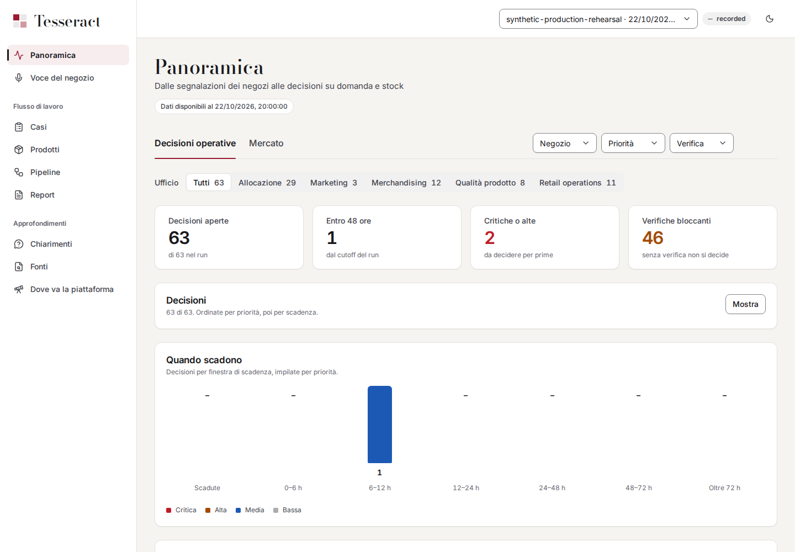
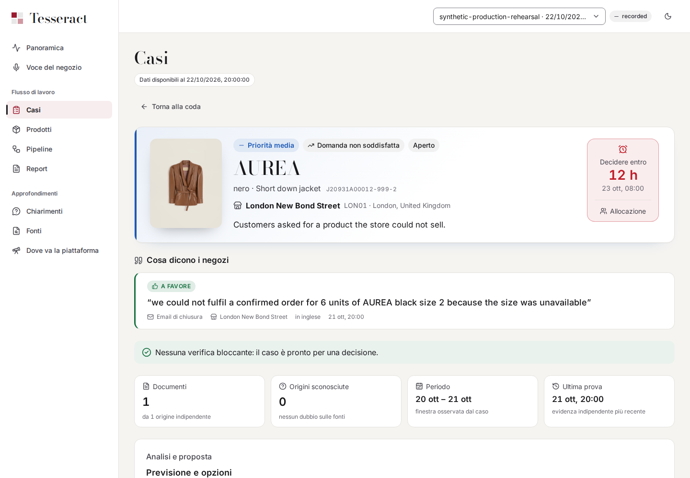
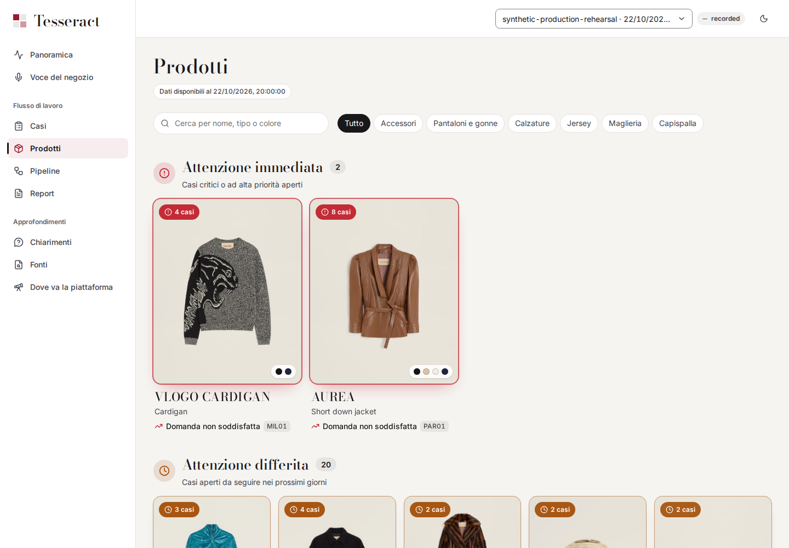
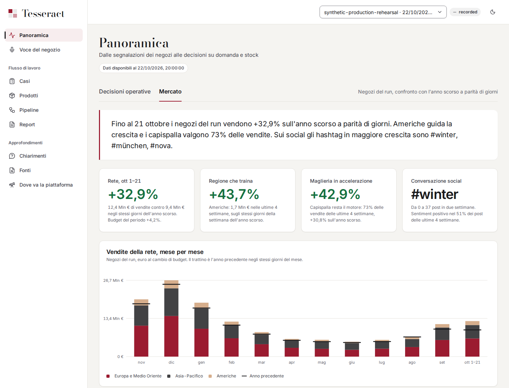
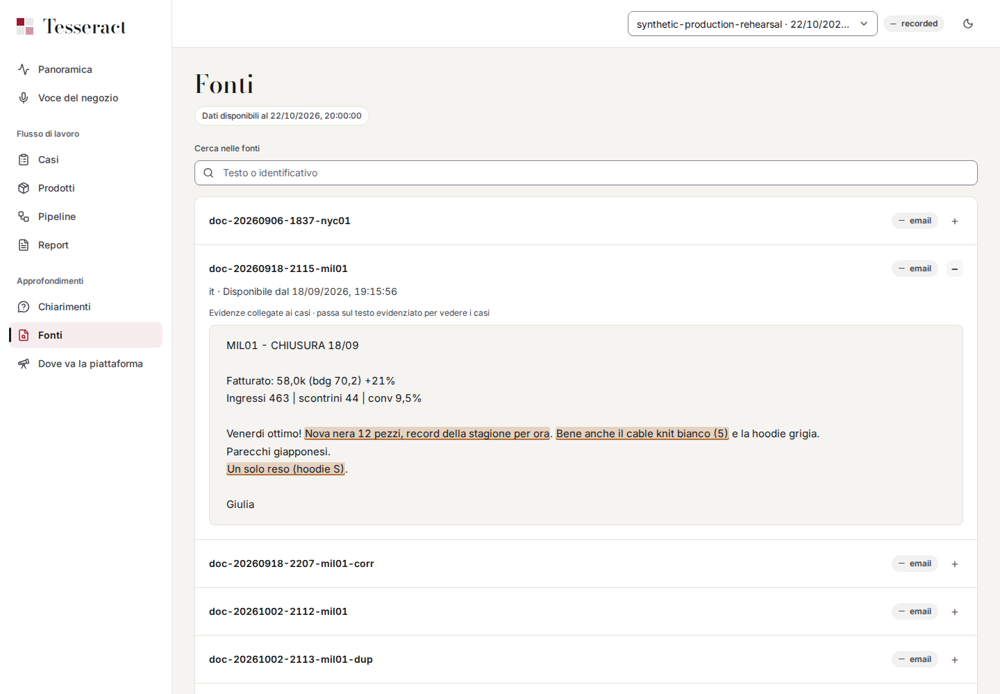
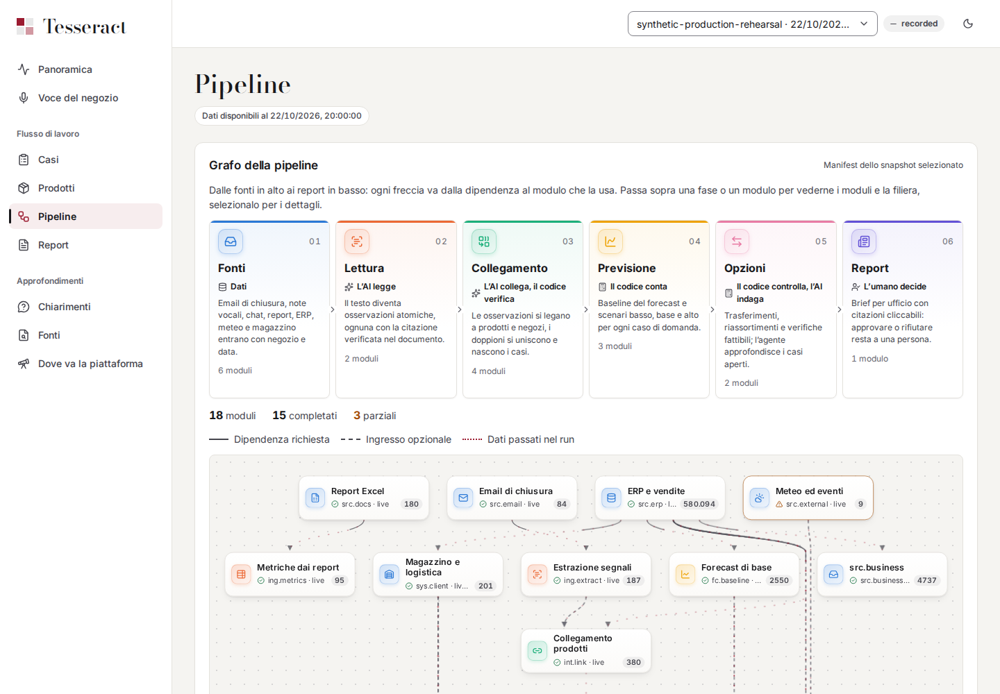
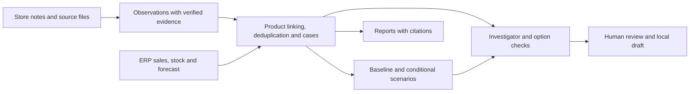

<div align="center">

# Tesseract

### From store feedback to retail decisions backed by evidence.

Turn multilingual store notes, sales and stock data into traceable cases, conditional forecast scenarios and proposals for a human to review.

**AI reads. Code counts. Humans decide.**

[](https://github.com/viganogabriele/fastweb-ai-hack/actions/workflows/check.yml)

FastwebAI Hackathon 2026 · Valentino demo branding · Python + FastAPI · React + TypeScript

Synthetic retail data · Recorded offline demo · Human approval

[Screenshots](#see-it-in-action) · [Run the demo](#run-the-demo) · [How it works](#how-it-works) · [Documentation](#documentation)

</div>



## Why Tesseract?

A missed sale often leaves no transaction. The useful detail is in a store's closing email or voice note: a requested size, a stock discrepancy, a recurring fit issue. HQ needs to connect that feedback to products, distinguish repeated messages from independent signals, and decide what deserves attention.

Tesseract brings those signals into one workspace for allocation, merchandising, retail operations and product quality. Every case keeps its supporting evidence. Uncertain product matches stay visible; missing information leads to verification rather than an invented answer.

| What you need to do | What the app provides |
| --- | --- |
| See what needs attention | An operational overview with priorities, deadlines, office and store filters. |
| Understand a case | Product and store context, quoted evidence, uncertainties, forecast scenarios or an explicit reason to abstain. |
| Compare signals with business data | Sales, stock and market views for the selected run, with global social listening shown separately. |
| Review a proposed action | Investigator traces, deterministic feasibility checks and a human decision saved as a local draft. |
| Explain the result | Source documents, cited reports and a pipeline view showing module outcomes. |

## See it in action

These are real application captures from the recorded **22 October 2026** development demo. The interface is in Italian. Click an image to inspect it at full size.

| Cases and decisions | Products and stock |
| --- | --- |
| [](docs/images/case-detail.png) | [](docs/images/products.png) |
| Follow a store signal into its case and inspect the evidence before acting. | Browse products by open cases, then open one for the selected run's stock detail. |

| Market context | Sources and evidence |
| --- | --- |
| [](docs/images/market.png) | [](docs/images/sources.png) |
| Read sales comparisons alongside clearly labelled listening context. | Go back to the original words behind an observation. |

<details>
<summary><strong>Inspect the pipeline</strong> — modules, dependencies and execution state</summary>



The same run and cutoff apply across the workspace. Module status and recorded responses remain inspectable, including degraded outcomes and fallbacks.

</details>

## Run the demo

**Requirements:** Git, Python 3.12, [uv](https://docs.astral.sh/uv/), Node.js 22 or newer, and `make`. Install FFmpeg as well for audio conversion and the full test suite.

```sh
git clone https://github.com/viganogabriele/fastweb-ai-hack.git
cd fastweb-ai-hack
make setup
make demo
```

Open **[localhost:5173](http://localhost:5173)**. The API runs at [localhost:8000](http://localhost:8000/docs), with interactive endpoint documentation at `/docs`. Stop both servers with `Ctrl+C`.

`make demo` rebuilds the committed nine-store recording and serves it through the real backend. The first build takes longer; later starts reuse its database. **No API keys or external systems server are needed.** Installing dependencies requires network access; replay runs offline once dependencies are installed.

Try this path:

1. **Panoramica** → scan active cases and deadlines; switch to **Mercato** for the business view.
2. **Casi** → open a case and read its evidence, uncertainties and available analysis.
3. **Prodotti** → browse reference images and stock tied to the selected run.
4. **Fonti**, **Report**, **Pipeline** → trace the result back to documents, citations and module execution.

See the [production demo runbook](docs/production-demo.md) for the recorded inputs, case walkthrough and replay checks.

## How it works



- **Models read; deterministic code calculates.** Extraction and investigation use Fastweb model responses. Quantities, dates, forecast scenarios and action checks pass through explicit contracts and validators.
- **Evidence travels with the result.** Observations retain source quotations and verified offsets. Duplicate messages and later corrections preserve their provenance.
- **Time is part of the data.** A run has an `as_of` cutoff. Source availability is enforced in the repository so later information cannot silently enter an earlier decision.
- **Uncertainty is an outcome.** Ambiguous products, missing quantities and failed prerequisites can produce a verification request or an unchanged baseline.
- **Approval stays with a person.** Reviewing an option creates a versioned local decision draft; the standard demo does not execute a real stock movement.

The backend uses **Python 3.12, FastAPI, Pydantic and SQLAlchemy on SQLite**. The frontend uses **React, TypeScript and Vite**. Modules exchange typed artifacts through a shared repository; the web API exposes published runs and generates the TypeScript contracts.

## What is real in this demo?

| Area | Scope |
| --- | --- |
| Pipeline | Real ingestion, linking, deduplication, case construction, scenario calculations, option checks and reports. |
| Data | A synthetic retail world. The recorded walkthrough covers nine development stores and multilingual sources; it is not a hold-out evaluation. |
| AI responses | Previously recorded provider responses replayed through the real pipeline. A new input can miss the cache; replay is not unrestricted offline inference. |
| Business systems | Simulated stock and logistics responses, with their ordinary adapter checks. Email and enterprise inputs are file snapshots, rather than live integrations. |
| Voice | Recorded voice examples and an optional live phone capture path. New live recordings require separate ASR, access and model configuration; they are not part of the keyless demo. |
| Images | Valentino photographs used as illustrative category references for synthetic products. They do not establish exact colour, fit or identity and are not demand evidence. |
| Results | Scenario changes illustrate a policy; they do not establish forecast accuracy gains, recovered revenue or ROI. |

The **Dove va la piattaforma** screen includes planned connectors and future capabilities. It describes the roadmap, not installed integrations. Photograph attribution and the synthetic product mapping are documented in [the catalog guide](data/catalog/README.md).

## Develop locally

```sh
make setup       # Install locked backend, frontend and API type-generator dependencies
make dev         # Backend :8000, frontend :5173, simulated systems :8088
make check       # Python checks and tests, web checks and tests, API contract consistency
```

`make dev` uses the ordinary local workspace; it does not populate the recorded demo database. Use `make demo` for the ready-to-explore walkthrough. Use `make types` after API changes and `make fmt` for Python formatting.

The default model mode is `LLM_MODE=replay`. Live or recording workflows need a **separate key per Fastweb model**; speech recognition uses the team's separate ASR service. See [AGENTS.md](AGENTS.md#backend-setup-and-secrets) for configuration. Keep credentials out of commits and screenshots.

<details>
<summary><strong>Repository map</strong></summary>

| Path | Purpose |
| --- | --- |
| [`web/`](web/) | Dashboard, store recording page and API client. |
| [`backend/tesseract/`](backend/tesseract/) | Contracts, artifact repository, orchestrator, API and pipeline modules. |
| [`config/`](config/) | Domain rules, module configuration and demo profiles. |
| [`data/fixtures/`](data/fixtures/) | Explicit test fixtures and committed replay packages. |
| [`data/catalog/`](data/catalog/) | Display metadata and local reference photographs. |
| [`generated/sources/`](generated/sources/) | Read-only synthetic source inputs; see the [dataset guide](generated/README.md). |
| [`eval/`](eval/) | Evaluation tooling, kept separate from product code. |
| [`docs/`](docs/) | Architecture, runbooks, research and demo material. |

</details>

## Documentation

| Start here | What you will find |
| --- | --- |
| [Demo runbook](docs/production-demo.md) | Reproduce the recorded run, understand its inputs and follow the dashboard. |
| [Architecture and data contracts](docs/RFC-001-piattaforma.md) | Product rules, temporal guarantees, modules and scenario design. |
| [Execution plan](docs/PLAN.md) · [GitHub issues](https://github.com/viganogabriele/fastweb-ai-hack/issues) | Ownership, dependencies and the current task board. |
| [API guide](backend/tesseract/api/README.md) | Run isolation, endpoints, reports, investigator jobs and decisions. |
| [Contributor instructions](AGENTS.md) | Setup, workflow, secrets and dataset boundaries. |
| [Documentation index](docs/README.md) | Research, design history and supporting material. |

Tesseract is a hackathon prototype with Valentino demo branding. Store feedback, cases and demand signals shown here are synthetic, not reports about actual Valentino stores or customers.
