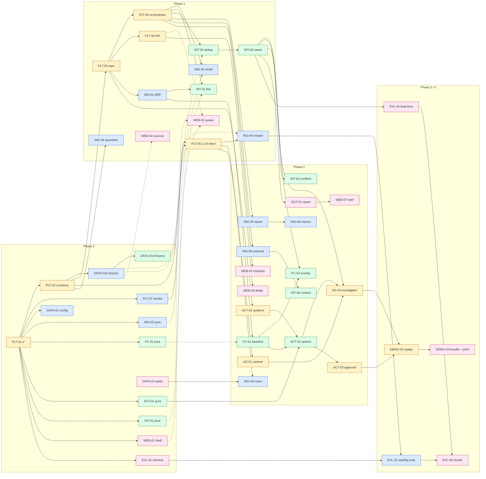

# PLAN: Tessera execution plan

| | |
|---|---|
| **What** | Who builds what, in which order, and how four people work in parallel without collisions |
| **Design** | `RFC-001-piattaforma.md` (what and why). This plan replaces RFC §6.3–§6.5 for order and ownership. RFC §6.1 budgets, §6.2 gates, §6.6 cut order and §6.7 conventions still apply |
| **Stack (OQ-1, decided)** | Python 3.12 + uv + FastAPI + Pydantic v2 + SQLAlchemy 2 on SQLite; React 19 + Vite + TypeScript. Fastweb API via the `openai` SDK |
| **Status** | Live in `../STATUS.md` (done, in progress, ready, blocked). Not tracked here |

Hours are offsets from kickoff (T0). Task IDs are the RFC backlog IDs (RFC §6.5). The class of each task (M = MVP, S = after G2 if reserve, C = roadmap) is unchanged.

---

## 1. Lanes and ownership

Each lane is one person, possibly with AI coding agents. A lane **owns** its paths: others only open PRs there after asking the owner. Fill in names at kickoff.

| Lane | Person | Focus (RFC §6.1) | Owns |
|---|---|---|---|
| **A: Reading** | _tbd_ | Connectors, extraction, quantities, reports, external data, voice | `backend/tessera/modules/sources/` (except `systems_client.py`), `modules/ingestion/`, `backend/prompts/extract_*`, `config/domain.yaml`, `config/aliases.yaml`, `config/eval_split.yaml`, `data/fixtures/{documents,observations,metrics,context}/` |
| **B: Evidence and decisions** | _tbd_ | Linking, dedup, cases, baseline and scenarios, options engine | `modules/integration/`, `modules/intelligence/`, `modules/actions/options.py`, `backend/prompts/link_*`, `data/fixtures/{links,cases,forecast,options}/` |
| **C: Platform and agent** | _tbd_ | Contracts, repo, runs, LLM client, API, systems adapter, investigator, approval, replay | `backend/tessera/core/`, `api/`, `cli.py`, `modules/agents/`, `modules/actions/dispatch.py`, `modules/sources/systems_client.py`, `backend/prompts/investigator*`, `scripts/`, `Makefile`, `backend/pyproject.toml`, `.github/`, `config/pipeline.yaml`, `AGENTS.md`, `data/fixtures/{runs,traces,stock}/` |
| **D: UI, eval, demo** | _tbd_ | Dashboard, reports, evaluation harness, demo bundle | `web/`, `eval/`, `modules/outputs/`, `config/demo.yaml`, `data/fixtures/{reports,voice}/`, demo material in `docs/` |

Tests mirror the code path (`backend/tests/modules/integration/test_link.py` for `modules/integration/link.py`) and belong to the owner of that code.

**Exception: contracts.** `core/contracts/` is one file per area (`common.py`, `documents.py`, `observations.py`, `links.py`, `cases.py`, `forecast.py`, `options.py`, `agents.py`, `reports.py`, `runs.py`). C writes all of them in PLT-02. After G0, the **producer lane** owns each file (A: documents, observations; B: links, cases, forecast, options; C: common, runs, agents; D: reports), and C reviews every change.

## 2. Rules that keep us out of each other's way

1. **Contracts are the only interface.** Modules talk through the DTOs in `core/contracts/` stored via `core/repo.py`. No module imports another module. A consumer never waits for a producer's code, only for its **fixture** (§3).
2. **Pure core first.** Every task starts as pure functions with unit tests (no DB, no API, no LLM). Wiring into the module interface comes after PLT-03/PLT-04. Most of Phase 0 and 1 work is therefore unblocked from minute one.
3. **Module interface (fixed now, implemented in PLT-04).** A module is one file that exports `MANIFEST: ModuleManifest` and `def run(ctx: RunContext) -> ModuleResult`. The registry discovers modules automatically, so adding a module never edits a shared file.
4. **One generic artifact store** (PLT-03 default). Derived DTOs go in one table `artifacts(run_id, kind, id, version, store_id, sku, case_id, available_at, payload JSON, input_refs, producer, computed_at)` through `repo.put(dto)` / `repo.list(Kind, ...)`, which also applies the `as_of` filter. Adding a field or a DTO never needs a migration or an edit to `core/db.py`. ERP data loaded by ING-01 lives in its own `erp_*` tables with an `available_at` column, read through `repo` helpers.
5. **Contract changes after G0.** Additive, optional fields only. Open a PR titled `[contract] ...`, have C review it, post it in the team chat, then the producer regenerates its fixtures and D regenerates web types (`make types`, PLT-06). Renames and removals wait until after G4.
6. **Hot files have one owner.** `Makefile`, `pyproject.toml`, `uv.lock`, `core/db.py`, `core/repo.py`, `api/main.py`: C. `web/package.json`, `package-lock.json`, `web/src/api/schema.d.ts` (generated, never hand-edited): D. If you need a dependency, add it in your own PR with `uv add` / `npm install`. On a lockfile conflict, never hand-merge: take `main`'s lockfile and re-run the command.
7. **Branches and PRs.** One branch per task, `<ID>-<slug>` (for example `ING-02-email-parser`). Keep PRs small, put the task ID in the title, squash-merge, and make sure `make check` passes (CI runs it on every PR). No branch lives longer than about 3 hours: rebase on `main` at least at every gate.
8. **The dataset rules in `AGENTS.md` apply to every person and agent.** Product code reads only `generated/sources/`, only `eval/` reads `ground_truth/`, and hold-out stores are never used for tuning.

## 3. Seams: artifacts between lanes

Every handoff is a DTO kind with a fixture. The producer writes the fixture in Phase 0 (DATA-01), and consumers build against it until the real producer lands. `tessera fixtures load` (PLT-03) loads fixtures into a separate `FIXTURE_MODE` namespace (RFC §4.6).

| Artifact (contract) | Producer | Consumers | Fixture |
|---|---|---|---|
| `SourceDocument`, `Segment` | A | B, D | `data/fixtures/documents/` |
| `Observation`, `Evidence`, `Quantity` | A | B, C, D | `data/fixtures/observations/` |
| `MetricFact`, `ContextEvent` | A | B, D | `data/fixtures/metrics/`, `data/fixtures/context/` |
| ERP tables (catalog, sales, stock, forecast) | A | B, C | Real dataset files; small inline frames in B's unit tests |
| `EntityLink`, `EvidenceRelation`, `Case` | B | C, D | `data/fixtures/links/`, `data/fixtures/cases/` |
| `ForecastAdjustment` | B | C, D | `data/fixtures/forecast/` |
| `ActionOption`, `Check`, `Leg`, `ScenarioOutcome` + the `evaluate_options()` service | B | C (investigator tool), D | `data/fixtures/options/` |
| `StockFact`, lanes/ETA (systems adapter) | C | B, C | `data/fixtures/stock/` |
| `RunSpec`, module status | C | everyone | `data/fixtures/runs/` |
| `AgentTrace`, `Decision`, `Clarification` | C | D | `data/fixtures/traces/` |
| `Report` | D | D | `data/fixtures/reports/` |
| HTTP API + generated TS types | C | D | OpenAPI from FastAPI (PLT-06) |

## 4. Phases

Columns: **Needs merged** lists hard dependencies, meaning code that must be on `main` first. **Builds against** lists what you can use before then (fixtures or pure functions). `T0+0` means "can start now".

### Phase 0: Foundation (T0 → G0, +2 h)

Goal: contracts frozen, fixtures for every seam, Fastweb access verified, every lane has pure code moving.

| ID | Lane | Needs merged | Builds against | Delivers / done when |
|---|---|---|---|---|
| PLT-01 | C | – | – | ✅ Scaffold, `make setup/dev/check`, CI, `.env.example`, dataset rules in `AGENTS.md` |
| PLT-02 | C | PLT-01 | RFC §4.5 | `core/contracts/` MVP subset as Pydantic v2; JSON Schema export; tests for null/unknown, units, quote offsets (`doc.text[start:end] == quote`). **Review by A, B, D within 30 min, then freeze = G0** |
| PLT-07 | A | PLT-01, API key | – | `scripts/smoke_fastweb.py`: chat, a tool-call round trip (does the model actually return `tool_calls`?), embeddings, ASR on a test WAV. Writes `docs/smoke-fastweb.md` with no secrets: what works, latency, chosen chat model (closes OQ-2/OQ-3) |
| DATA-02 | A | PLT-01 | Dataset README | `config/eval_split.yaml` (dev/hold-out from RFC §5.1), `config/domain.yaml` (RFC §3.3), `config/aliases.yaml` written from dev sources and the catalog only, with provenance |
| ING-02 (pure) | A | PLT-01 | Dev `.eml` files | `.eml` → canonical text + segments with code-point offsets, quotes and attachments flagged; 2 dev languages; tests on 3 real dev emails |
| FC-01 (pure) | B | PLT-01 | Inline frames | Weekly → daily disaggregation over open days, partial week, closed days, missing forecast → `not_estimable` (RFC §4.9 steps 1, 7) |
| ACT-01 (pure) | B | PLT-01 | Inline frames | Recursive daily stock simulation `served/lost/ending` per RFC §4.10; RFC §7.3 test 5 passes |
| INT-01 (pure) | B | PLT-01 | Catalog CSV, `config/aliases.yaml` once merged | Mention → ranked candidates (alias + `rapidfuzz`), abstention threshold, size consistent with family |
| WEB-01 | D | PLT-01 | Hand-written JSON in `web/src/mocks/` | App shell: layout, nav (Cases, Sources, Report, Modules), run / `as_of` selector placeholder, mode badges (`live/recorded/fixture/unavailable/synthetic`) |
| EVL-01 | D | PLT-01 | – | `eval/` package: reads a frozen export plus the answer key; a test that the product process cannot open `generated/ground_truth/` or `generator/` |
| DATA-03 | D | – | – | 2–3 recordings of 20–60 s in IT/EN plus sidecar JSON in `data/fixtures/voice/` (RFC §5.2). Paraphrase and independent note are labeled separately |
| DATA-01a | A | PLT-02 | Dev sources | Fixtures: D1 positive document + observation, an ambiguous mention, a forward/duplicate, a correction. Each validates against its contract in `make check` |
| DATA-01b | B | PLT-02 | DATA-01a | Fixtures: links (linked and ambiguous), cases, a baseline with unchanged scenarios, options (blocked move, hold, verify, one feasible isolated move) |

**G0 (+2 h):** PLT-02 merged and frozen; DATA-01a/b merged; PLT-07 report written (if the tool-call check fails, escalate at once: RFC §8 fallback).

### Phase 1: Skeleton (G0 → G1, +6 h)

Goal: **one real dev email → observation with verified evidence → link or abstention → case → visible in the UI.** Fixtures are allowed only at boundaries that aren't ready yet, with a banner.

| ID | Lane | Needs merged | Builds against | Delivers / done when |
|---|---|---|---|---|
| PLT-03 | C | PLT-02 | – | `core/db.py`, `core/repo.py`: SQLite, artifact store (§2 rule 4), `RunSpec`, `as_of` filter inside the repo, `tessera fixtures load`, `tessera reset --run`; RFC §7.3 test 1 (T1 → T2 → T1) for the repo |
| PLT-05 | C | PLT-02, PLT-07 | PLT-07 findings | `core/llm.py` + `core/cache.py`: `chat/extract/embed/transcribe`, single-tool structured output with one retry, `LLM_MODE=live/record/replay`, replay miss = explicit error, budget and backoff (RFC §4.7.2) |
| PLT-04 | C | PLT-03 | – | `core/registry.py` (auto-discovery), `core/orchestrator.py`: declared dependencies, one worker, statuses `succeeded/degraded/blocked/failed`, atomic publication; `tessera run --as-of ...` |
| PLT-06 | C | PLT-03 | Fixtures | API thin: `/api/runs`, `/api/runs/{id}/documents`, `/api/runs/{id}/cases` (RFC §4.6); `make types` generates `web/src/api/schema.d.ts` |
| ING-01 | A | PLT-03 | – | ERP loader: catalog, assortment, daily sales, stock, forecast vintages, with `available_at` per RFC §4.3; only the dev window needed for the slice |
| ING-02 | A | PLT-04 | ING-02 pure | `src.email` module writes `SourceDocument`/`Segment` for the selected dev mailboxes |
| ING-09 | A | PLT-02 | – | Physical quantities (exact/range/vague/unknown) with units, from span text; vague quantifiers from `config/domain.yaml` |
| ING-04 | A | PLT-05 | DATA-01a, dev emails | `ing.extract`: LLM candidates → code locates the quote and assigns offsets → `Observation` or logged abstention. Prompt `extract_observations.v1.md` |
| INT-01 | B | PLT-04, ING-01 | INT-01 pure, DATA-01a | `int.link` module: alias/fuzzy candidates → constrained LLM choice (once PLT-05 lands) → `EntityLink` linked/ambiguous/unlinked |
| INT-02 | B | PLT-04 | DATA-01a/b | `int.dedup`: certain copies vs possible overlap; `supersedes`/`retracts` per fact with their own timestamp |
| INT-03 | B | INT-02 | DATA-01b | `int.cases`: cases including unlinked ones (`scope=unknown`, status `verify`), owner from `domain.yaml`, document vs origin counts |
| WEB-02 | D | – | DATA-01b, then PLT-06 | Case queue (priority, deadline, uncertainty) and case detail skeleton |
| WEB-04 | D | – | DATA-01a, then PLT-06 | Sources view: canonical text with highlighted evidence, correct with emoji/CJK (code point → UTF-16) |

**G1 (+6 h):** `tessera run` on one dev store-day produces a real case from a real email; the UI shows it from the API. Write down what is still a fixture.

### Phase 2: Vertical slice (G1 → G2, +12 h)

Goal: the full Core path on dev stores (RFC §6.2 G2): dedup/correction, a real report and external source, baseline, an agent that chooses tools, validated options, local draft; an ambiguous case and a negative case.

| ID | Lane | Needs merged | Builds against | Delivers / done when |
|---|---|---|---|---|
| ING-05 | A | PLT-04 | – | `src.docs`: one CSV/XLSX report from `sources/reports/` with locators and availability |
| ING-06 | A | ING-05 | – | `ing.metrics`: one approved, versioned mapping → `MetricFact` with definition, period, currency/VAT, comparability |
| ING-08 | A | PLT-04 | – | `src.external`: one external feed relevant to the slice → `ContextEvent`, with no future weather backdated |
| ING-03 | A | PLT-05, DATA-03 | DATA-03 | `src.voice`: ASR (recorded) or declared fixture transcript; intervals only if real |
| INT-04 | B | INT-03 | – | Conflicts with structured facts and dates; no closing a case because of silence or old stock; `decision_due_at` when estimable |
| INT-06 | B | ING-08 | ContextEvent fixture | `int.context`: geo/time association, corroborating vs context-only |
| FC-01 | B | ING-01 | FC-01 pure | `fc.baseline` module: valid vintage at `as_of`, 7-day horizon |
| FC-03 | B | FC-01, INT-03 | DATA-01b | `fc.overlay`: quantitative gates, abstention reason, one overlay per piece of information, decay from the episode, cap reconciled (RFC §4.9) |
| ACT-04 | C | PLT-03 | Mock server `:8088`, `systems/agents/` contracts | `sys.client`: stock/ATP and lane/ETA adapter with crosswalk; missing time filter or route = `unknown` |
| ACT-02 | B | ACT-01 pure, FC-01, ACT-04 | ACT-04 fixture | `act.options` + shared `evaluate_options()` service: hold/verify/ask/notify plus one domestic transfer; all checks in RFC §4.10; size curve missing → blocked |
| AG-01 | C | PLT-05 | Fake tools | `agents/runtime.py`: bounded loop, tool allowlist, budget including retries, trace, deterministic fallback (RFC §4.8.1) |
| AG-03 | C | AG-01, ACT-02, INT-03 | DATA-01b | `ag.investigator` with the RFC §4.8.2 tools; two recorded dev traces where different evidence leads to different checks |
| ACT-03 | C | ACT-02, PLT-03 | Options fixture | Approval: input hash, idempotency key, ledger transaction, local draft; stale option → 409 |
| OUT-01 | D | INT-03 | DATA-01b | `out.reports`: per-owner brief from the same facts; numbers rendered from structured refs via templates; LLM prose optional |
| WEB-05 | D | PLT-06 | Forecast/options/trace fixtures | Case detail: baseline/scenarios or abstention reason, trace, options with checks, Approve/Reject |
| WEB-03 | D | PLT-04, PLT-06 | – | Modules list: status, counts, mode, on/off for the next run |
| WEB-07 | D | OUT-01 | Report fixture | Brief view with clickable citations of the same run |
| DEMO-01 | D | – | Dev cases (RFC §5.3) | 4-minute script draft on dev only; doesn't require a transfer or an uplift |

**G2 (+12 h):** the RFC §6.2 G2 criteria are met. If not, apply the RFC §6.6 cuts now, not later.

### Phase 3: Hardening and freeze (G2 → G3, +16 h)

No new features. Fix bugs, write the RFC §7.3 tests, then freeze prompts, config, aliases, manifests and sample.

| ID | Lane | Needs merged | Delivers / done when |
|---|---|---|---|
| PLT-08 | C | PLT-06 | The API serves only complete runs; no mixing of snapshots or sessions |
| DEMO-02 | C | All Phase 2 | Replay from empty projections with the network off, cache miss shown explicitly (RFC §7.3 test 10) |
| §7.3 tests 1–9 | Owner of the code under test | Phase 2 | Temporal (A, C), dedup (B), stock/size/concurrency (B, C), agent budget and injection (C) |
| EVL-02 | A | ING-04, INT-01, EVL-01 | Precision/recall of observations on labeled dev files, link errors among accepted links plus abstention rate, counts per language |
| EVL-04 | D | INT-03, EVL-01 | Lead time on the same event vs the sales and stock baselines; false alerts; "not detected by T_end" |

**G3 (+16 h):** freeze tag `freeze-g3` on `main`. From here on, only bugfixes, each with a regression test.

### Phase 4: Evaluation and demo (G3 → G4, +22 h)

| ID | Lane | Delivers |
|---|---|---|
| EVL-02/04 on hold-out | A, D | Metrics on the frozen hold-out run export, run once |
| EVL-05 | D | Results table with N, errors, exclusions and limits; no expected numbers presented as results |
| DEMO-03 | D (+ all) | Sanitized public bundle (RFC §4.12), pitch, timed rehearsal, video |

**G4 (+22 h)**, then 2 hours of margin.

### Reserve pool (after G2, only if the reserve allows; RFC §6.6 order)

S: INT-05 embeddings (B), FC-02 residuals (B), INS-01 product insights (B), AG-02 analyst (C), OUT-02 + WEB-09 clarification loop (C + D), WEB-06 pipeline graph (D), WEB-08 product view (D), EVL-03 forecast error (D).
C: ING-07 chat exports, AG-04 MCP, DEMO-04 live voice.

## 5. Dependency graph

Solid arrow: needs merged. Dashed arrow: develop against fixture or pure code, integrate later.

**Critical path:** PLT-02 → PLT-03 → PLT-04 → INT-02 → INT-03 → (ACT-02 ← ACT-04) → AG-03 → DEMO-02. Lane C carries most of it, so others should take work off C rather than add to it. PLT-07 already moved to A. If C slips at G0, B can take ACT-04.

## 6. Start now (after PLT-01)

Each of these needs nothing but `main` as it is today. Pick one per person and open a branch.

| Lane | First PR | Second PR (still unblocked) |
|---|---|---|
| A | **PLT-07** Fastweb smoke test: needs the API key in `.env`, and its result decides the extraction design | **DATA-02** split, domain, aliases → then **ING-02 (pure)** email parser |
| B | **ACT-01 (pure)** stock simulation + RFC §7.3 test 5 | **FC-01 (pure)** disaggregation → **INT-01 (pure)** candidate generation |
| C | **PLT-02** contracts. Everyone reviews it within 30 min: it gates G0 | **PLT-03** repo and artifact store |
| D | **WEB-01** app shell on hand-written JSON | **EVL-01** harness skeleton; record **DATA-03** audio in between |
