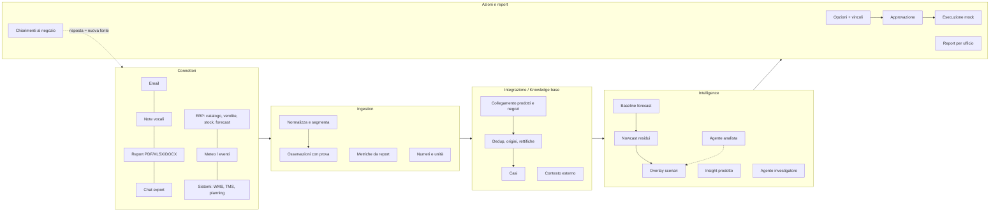
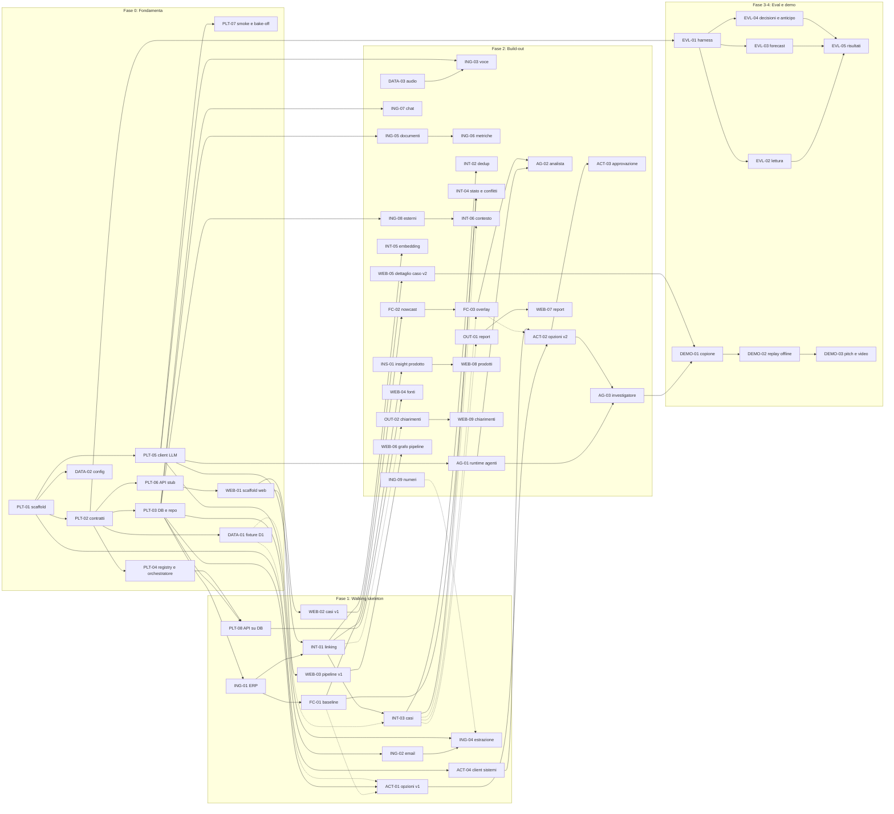

# RFC-001: Tessera, piattaforma modulare dai segnali dei negozi alle decisioni

| | |
|---|---|
| **Stato** | Draft, da approvare in team prima di aprire le prime PR |
| **Data** | 22 ottobre 2026 |
| **Nome** | "Tessera" è un nome provvisorio (moduli come tessere di un mosaico). Pacchetto Python `tessera` |
| **Sostituisce** | `project-design.md` §3–§8 per architettura, moduli e piano. La matematica di `project-design.md` §5 resta un riferimento, con le correzioni di `research-methods.md` §6 |
| **Integra** | `proposta-rivista.md` (feedback qualitativi, raccolta guidata), `research-recommendation.md` (evidenze, astensione, agente investigatore), `research-fastweb-assets.md` (modelli) |
| **Fonti** | `findings.md`, trascrizioni in `sources/transcripts/` (Q&A con il referente, `needfinding.md`, `Idea_Gabri.md`), `api-guide.pdf`, `../generated/README.md` |

---

## 0. TL;DR

- **Il prodotto.** Una piattaforma web modulare. Fonti eterogenee entrano dai connettori: note vocali WhatsApp, email di chiusura, report PDF/Excel, ERP, magazzino, logistica, meteo ed eventi. Diventano **osservazioni atomiche con prova** (citazione o timestamp audio), poi vengono **collegate** a prodotti e negozi, **deduplicate** e aggregate in **casi**. I casi alimentano una **correzione del forecast per scenari**, che si sovrappone al forecast esistente senza riaddestrarlo. Dai casi nascono **opzioni operative verificate** (trasferimento, riassortimento, hold, verifica) e **report per ufficio**. L'umano approva; l'esecuzione va a un sistema logistico simulato.
- **La modularità è insieme prodotto e metodo.** Ogni modulo ha un manifest (cosa consuma, cosa produce, reale o simulato) e un contratto dati comune. In dashboard la pipeline appare come un grafo di tessere attivabili. Nello sviluppo ogni modulo è un'unità di lavoro indipendente, sviluppata contro **fixture congelate** dei moduli a monte.
- **Principio.** *L'AI legge, il codice conta, l'umano decide.* I modelli Fastweb estraggono, collegano, trascrivono, indagano e scrivono. Ogni numero (forecast, quantità, ETA, unità perse) è calcolato da codice deterministico e tracciabile.
- **Niente demo finta.** La pipeline gira davvero sui file sintetici di `generated/sources/`, con un orologio di replay (`as_of`). Sono simulati solo i confini: canali di raccolta, sistemi aziendali (mock REST già nel dataset), esecuzione delle azioni e risposte dei negozi. Sono dichiarati in UI con un badge.
- **Piano.** Fase 0: fondamenta e contratti, circa 3 ore. Fase 1: walking skeleton end-to-end, entro 7 ore. Fase 2: sviluppo dei moduli in 5 lane parallele, entro 15 ore. Fase 3: valutazione e freeze, entro 19 ore. Fase 4: demo. In tutto 58 task della dimensione di una PR, con dipendenze esplicite (§6).
- **Stack consigliato.** Backend Python (FastAPI, Pydantic, SQLite, pandas). Frontend React con Vite, Tailwind e shadcn/ui. SDK `openai` puntato all'endpoint Fastweb. Motivazioni e alternative in §4.1; decisione da confermare (OQ-1).

---

## 1. Contesto

### 1.1 Il problema in una frase

Il forecast del brand è **lento per costruzione**: impara dalla stagione precedente e i consuntivi certificati arrivano il giorno dopo. I negozi invece vedono la realtà **in giornata**: richieste non soddisfatte, motivi per cui un capo non si vende, clienti, eventi locali. Questa informazione arriva in forma non strutturata (testo libero, voce, molte lingue, report con definizioni diverse) e oggi non entra né nelle previsioni né nelle decisioni.

### 1.2 Cosa abbiamo imparato (sintesi; dettagli in `findings.md`)

| Fonte | Cosa conta per il design |
|---|---|
| Brief della track e Q&A con il referente | Forecast e transazionale non si toccano. "Correggere il forecast" è ammesso, riaddestrando oppure supportando le decisioni con spiegazioni. Obiettivo: sapere prima dei consuntivi che serve agire. Lo stockout danneggia anche l'immagine. Spostare stock nel breve, produzione nel lungo. Decide l'umano. I vendor espongono i gestionali via MCP. "Non citateci". |
| `needfinding.md` (ex manager di più brand del lusso) | Nei negozi diretti i dati quantitativi sono già centralizzati. **Manca il qualitativo**: guardato, toccato, provato e non comprato, fit, tessuto. Già tentati piloti con vocali WhatsApp e 3–4 domande guida: **l'adozione è il vero tema**. La logistica è lenta anche con dati in tempo reale. Il franchising ha sistemi e report propri e diversi. |
| `Idea_Gabri.md` | Report vocale di fine giornata per dipendente, incrociato nello stesso negozio e giorno. Un **layer di ingestion comune** verso una knowledge base strutturata. **Output personalizzabili** per ufficio, priorità, prodotto o stagionalità. Il report spiega il perché; la soluzione la sceglie l'umano. |
| `research-*.md` | Prove indipendenti e non conteggio di menzioni. Astensione. `available_at` contro il leakage. Scenari dichiarati al posto di falsi intervalli. Simulazione giornaliera delle opzioni. Agente con budget di chiamate. Modelli e limiti dell'API Fastweb. |
| `api-guide.pdf` | API OpenAI-compatible: chat con vision e tool calling, embedding testo e immagine, trascrizione Whisper. Nessun TTS. Limiti di rate e budget non documentati. |
| `../generated/` | Mondo sintetico controllato: 39 negozi, 2.056 email in 10+ lingue, chat, report, ERP, sistemi con mock REST, meteo, eventi. Risposte nascoste in `ground_truth/`. Split dev e hold-out. **Non contiene audio.** |

### 1.3 Assunzioni di questo RFC

- **A1.** Team di 4 persone, ognuna guida 1–3 agenti di coding (Claude Code, Codex o simili). Sono finestre orarie relative all'avvio dello sviluppo, su una hackathon di 24 ore.
- **A2.** Il prodotto legge solo `generated/sources/` più le fixture che produciamo noi (audio). "Oggi" è il 22 ottobre 2026; la demo è un replay di giornate passate.
- **A3.** Primo utente: **merchandising e allocation HQ**. Gli altri uffici (retail ops, marketing, product/quality) ricevono viste e report dallo stesso stato.
- **A4.** Rete di negozi diretti. Franchising e multimarca sono un'estensione di posizionamento ("i loro report arrivano in formati diversi") e non un caso da costruire.
- **A5.** Rispetto a `proposta-rivista.md`, che escludeva la modifica numerica del forecast, questo RFC **reintroduce la correzione del forecast** come richiesto. Lo fa come *overlay di scenari* (baseline, base, low/high), mai sovrascrivendo il forecast di partenza.

---

## 2. Obiettivi, non-obiettivi, principi

### 2.1 Obiettivi della demo (verificabili)

| ID | Obiettivo | Come si vede |
|---|---|---|
| G1 | **Lettura** affidabile di fonti eterogenee | Email multilingue, nota vocale e report diventano osservazioni con citazione verificata; il prodotto ambiguo produce astensione o una domanda di chiarimento |
| G2 | **Integrazione** senza amplificare il rumore | Forward e duplicati diventano "N documenti, M origini"; le rettifiche sostituiscono il dato; i conflitti restano visibili |
| G3 | **Anticipo** rispetto ai dati certificati | Il caso compare la sera stessa; il comparatore che usa solo vendite e stock lo vede giorni dopo, o mai entro il replay |
| G4 | **Forecast corretto** in modo spiegabile | Grafico con baseline e scenari; ogni scostamento rimanda a componenti ed evidenze |
| G5 | **Decisione** fattibile | Opzioni con controlli di vincolo (stock, lead time, dogana, donatore), approvazione umana, invio al mock logistico |
| G6 | **Report** per ufficio | Brief giornaliero con viste configurabili, ogni affermazione con citazione cliccabile |
| G7 | **Piattaforma modulare** | Grafo dei moduli in dashboard; disattivare un modulo (per esempio le note vocali) cambia visibilmente l'output |

### 2.2 Non-obiettivi

- Nessun riaddestramento o nuovo modello di forecast di lungo periodo; nessun foundation model per serie temporali.
- Nessuna integrazione reale con WhatsApp Business, caselle email, Drive o ERP: i canali sono cartelle e upload.
- Nessun parsing universale di qualsiasi PDF o PPTX: solo i formati presenti nei casi demo.
- Nessuna stima di ROI reale; nessuna probabilità calibrata se non ne abbiamo i dati.
- Multi-tenant e autenticazione: fuori scope. La "configurabilità per business" si mostra con un file di dominio (§3.3).

### 2.3 Principi di design (vincolanti per ogni PR)

1. **L'AI legge, il codice conta, l'umano decide.** Un LLM non produce mai un numero che finisce in un calcolo o in una card senza passare da un validatore deterministico.
2. **Ogni fatto ha una prova.** Ogni osservazione ha `evidence` (citazione con offset verificati, o timestamp audio). Senza prova verificata l'osservazione viene scartata.
3. **Tempo esplicito.** Ogni record ha `available_at` (quando potevamo saperlo) e, se applicabile, il periodo del fatto. Il filtro per `as_of` vive nel livello di accesso al DB, non nella UI (README R5, `research-methods.md` §8).
4. **Simulare solo ai confini, e dichiararlo.** I moduli di logica (estrazione, linking, casi, forecast, opzioni, report) sono reali. Canali, sistemi aziendali ed esecuzione possono essere mock, con badge in UI.
5. **Un modulo, un contratto.** I moduli comunicano solo tramite le tabelle e i tipi di §4.5. Nessun modulo importa il codice interno di un altro.
6. **Determinismo in demo.** Ogni chiamata LLM passa da una cache; la demo gira in modalità replay offline.
7. **Nessun leakage.** Il prodotto non legge `generated/ground_truth/` né `generator/`. Solo `eval/` legge le risposte.

### 2.4 Cosa è reale e cosa è simulato

| Elemento | In demo | Implementazione |
|---|---|---|
| Email, chat, report, ERP, meteo, eventi | **Reale** (dati sintetici in formato realistico) | Connettori veri sui file di `generated/sources/` |
| Note vocali "WhatsApp" | Audio prodotto da noi, **trascrizione reale** | Registrazioni del team e/o TTS → Whisper Fastweb |
| Canali (mailbox, WhatsApp, Drive) | Simulati | Cartelle "inbox" più upload da UI |
| Estrazione, linking, dedup, casi, forecast, opzioni, report, agenti | **Reali** | Eseguiti a ogni run sul replay |
| WMS, TMS, planning, marketing | Mock | Mock server REST già fornito (`generator/systems/mock_agents/server.py`), chiamato via HTTP |
| Esecuzione dell'azione approvata | Simulata | POST al mock logistico, oppure bozza locale (OQ-7) |
| Risposte dei negozi ai chiarimenti | Simulate | L'operatore della demo risponde dalla UI |
| Orologio | Replay | `as_of` selezionabile in UI |

---

## 3. Il prodotto: piattaforma a tessere

### 3.1 I cinque layer



Il ciclo dei chiarimenti si chiude: una risposta del negozio rientra come nuova fonte e riattraversa la pipeline.

### 3.2 Catalogo dei moduli

Priorità: **Core**, senza il quale la demo non regge; **Should**, se siamo in linea a G1/G2; **Could**, solo se avanza tempo. "Mock ok" significa che il modulo può essere sostituito da un'implementazione da fixture, dichiarata in UI, senza rendere la demo finta.

| Modulo (id) | Layer | Cosa fa | AI | Priorità | Mock ok |
|---|---|---|---|---|---|
| `src.erp` | Connettori | Carica catalogo, assortimento, vendite giornaliere, stock, forecast, spedizioni, KPI con `available_at` | – | Core | No |
| `src.email` | Connettori | Parsing `.eml` (charset, HTML, allegati, thread, quote), segmenti con offset | – | Core | No |
| `src.voice` | Connettori | Audio più metadati → trascrizione con timestamp | Whisper | Core | Sì (trascritti salvati) |
| `src.docs` | Connettori | PDF, XLSX, DOCX, PPTX → testo e tabelle con locator | – | Should | – |
| `src.chat` | Connettori | Export WhatsApp, Teams, Kakao e simili → messaggi | – | Could | – |
| `src.external` | Connettori | Meteo (1–2 provider) ed eventi o disruption → `ContextEvent` | – | Should | Sì |
| `sys.client` | Connettori | Client tipizzato per il mock server (ATP, lanes, transfer, params) | – | Core | È già un mock |
| `ing.extract` | Ingestion | Segmenti → `Observation` con evidenza verificata | Chat LLM | Core | No |
| `ing.numbers` | Ingestion | Parser di numeri e valute multilingue ("16,1k", "1억 6,912만", "CHF 24'620.–") | – | Should | – |
| `ing.metrics` | Ingestion | Tabelle dei report → `MetricFact` con definizione (IVA, valuta, calendario, perimetro) | Chat LLM | Could | – |
| `int.link` | Integrazione | Menzione → SKU, stile o taglia, oppure ambiguo o non collegato; alias, fuzzy, eventuali embedding, scelta LLM vincolata | LLM ed embedding | Core | No |
| `int.dedup` | Integrazione | Gruppi di origine, duplicati, rettifiche (`supersedes`) | – | Core | No |
| `int.cases` | Integrazione | Osservazioni → casi per negozio, prodotto, tipo e finestra; stato, owner, priorità, scadenza, conflitti | – | Core | No |
| `int.context` | Integrazione | Associa eventi esterni ai casi (geo e tempo) | – | Should | – |
| `fc.baseline` | Intelligence | Vintage del forecast valido ad `as_of`, disaggregazione giornaliera | – | Core | No |
| `fc.nowcast` | Intelligence | Rapporto residui su giorni non censurati, con shrinkage | – | Core | No |
| `fc.overlay` | Intelligence | Casi e contesto → scenari low, base, high con decadimento | – | Core | No |
| `ag.analyst` | Intelligence | Agente che sceglie template e intensità di correzione per un caso, con motivazione citata; il codice valida | Chat e tools | Should | – |
| `ins.product` | Intelligence | "Stesse vendite, motivi diversi": motivi e funnel per prodotto, più codici di reso POS | – | Should | – |
| `ag.investigator` | Azioni | Agente che sceglie la verifica successiva (stock, ETA, chiarimento) e propone l'opzione | Chat e tools | Core | No (fallback a DAG fisso) |
| `act.options` | Azioni | Opzioni hold, verifica, DC, trasferimento o combinate; simulazione giornaliera e controlli | – | Core | No |
| `act.dispatch` | Azioni | Approvazione → POST al mock logistico, audit | – | Should | È già un mock |
| `out.reports` | Azioni | Brief giornaliero e viste per ufficio, priorità o prodotto, con citazioni | Chat LLM | Core (thin) | – |
| `out.clarify` | Azioni | Domande al negozio nella sua lingua; risposta → nuova fonte | Chat LLM | Should | Sì (risposta da UI) |
| `mcp.server` | Piattaforma | Espone tool e knowledge base via MCP | – | Could | – |

**Minimo agentico:** `ag.investigator` è Core. Il criterio "innovazione agenti AI" pesa il 20%, quindi non va mai tagliato del tutto: in caso di difficoltà resta come DAG fisso con lo stesso trace.

### 3.3 Personalizzazione per business ("la tessera giusta per ogni azienda")

Due file di configurazione rendono visibile la modularità senza costruire il multi-tenant:

```yaml
# config/pipeline.yaml: quali tessere sono attive e con quale implementazione
modules:
  src.email:      { enabled: true }
  src.voice:      { enabled: true, impl: real }      # real | mock (trascrizioni da fixture)
  src.docs:       { enabled: true }
  src.external:   { enabled: true, impl: real }
  int.link:       { enabled: true, params: { use_embeddings: true, top_k: 8 } }
  ag.investigator:{ enabled: true, params: { max_tool_calls: 6 } }
  act.dispatch:   { enabled: true, target: mock_logistics }   # mock_logistics | local_draft
```

```yaml
# config/domain.yaml: il significato è configurabile, la pipeline è la stessa
domain: fashion_retail_direct
owners:                       # chi riceve cosa
  unmet_demand: allocation
  stock_discrepancy: retail_ops
  product_feedback: product_quality
  traffic_change: retail_ops
  demand_shift: merchandising
views:                        # le "viste" richieste in Idea_Gabri
  - { id: by_office,   group_by: owner }
  - { id: by_priority, group_by: priority }
  - { id: by_product,  group_by: [category, season_group] }
vague_quantifiers: { it: [tanti, molti, parecchi], fr: [plusieurs, beaucoup], en: [several, lots, many] }
reason_taxonomy: [fit, size_availability, colour, fabric_material, quality_defect, price, style, other]
```

### 3.4 Pagine della dashboard

| Pagina | Contenuto | Priorità |
|---|---|---|
| **Pipeline** | Grafo delle tessere per layer: stato, conteggi, badge reale/mock, interruttori; selettore `as_of` e pulsante "Esegui" | Core (lista), Should (grafo) |
| **Casi** | Coda ordinata per priorità e scadenza, filtri per vista (ufficio, prodotto, negozio) | Core |
| **Dettaglio caso** | Cosa è cambiato, prove a favore e contro con citazioni, "N documenti, M origini", contesto, grafico forecast con baseline e scenari, trace dell'agente, opzioni con controlli, Approva/Rifiuta | Core |
| **Fonti** | Inbox dei documenti; dettaglio con originale (testo o player audio), evidenze evidenziate, osservazioni e stato del link | Core |
| **Report** | Brief per vista, markdown con citazioni cliccabili | Core (thin) |
| **Prodotti** | Vendite affiancate ai motivi riportati per prodotto | Should |
| **Chiarimenti** | Chat simulata con i negozi | Should |

---

## 4. Architettura tecnica

### 4.1 Stack

| Livello | Scelta | Perché |
|---|---|---|
| Backend | **Python 3.12**, `uv`, **FastAPI**, **Pydantic v2**, **SQLAlchemy 2.0** su **SQLite**, `pandas` | Parsing robusto in stdlib e librerie mature (`email`, `openpyxl`, `pdfplumber`, `python-docx`, `python-pptx`). Il generatore e il mock server del dataset sono Python. Combinazione molto nota agli agenti di coding |
| LLM | SDK **`openai`** con `base_url=https://spod.ai-factory.fastweb.it/v1` | L'API Fastweb è OpenAI-compatible: un solo client per chat, tools, embedding e trascrizione |
| Matching | `rapidfuzz` più numpy in memoria (embedding) | Il catalogo ha 114 SKU-colore e 643 SKU-taglia: nessun vector DB necessario |
| Frontend | **React 18 + Vite + TypeScript**, Tailwind, **shadcn/ui**, TanStack Query, React Router, **Recharts**, **@xyflow/react** (grafo pipeline) | Scelte popolari e ben documentate. Tipi generati dall'OpenAPI del backend con `openapi-typescript` e `openapi-fetch` |
| Qualità | `ruff`, `pytest`, `tsc --noEmit`, `eslint` | Un comando `make check` prima di ogni PR |
| Esecuzione | `make dev`: backend `uvicorn` su :8000, web su :5173, mock server su :8088 | Nessun Docker obbligatorio |

**Alternative considerate.** (a) Full-stack TypeScript (Nuxt o Hono, come nella bozza v0): parsing di EML, XLSX, PDF e DOCX meno maturo, più codice di collegamento con i tool Python del dataset. (b) Streamlit: più veloce da scrivere, ma l'aspetto da prodotto e il grafo interattivo sono limitati. Resta il piano di emergenza per la UI (OQ-1).

### 4.2 Struttura del repository

```
backend/
  pyproject.toml
  tessera/
    core/           config.py clock.py contracts.py tables.py db.py repo.py
                    registry.py orchestrator.py llm.py cache.py prompts.py
    modules/
      sources/      erp.py email.py voice.py docs.py chat.py external.py systems_client.py
      ingestion/    extract.py numbers.py metrics.py
      integration/  link.py dedup.py cases.py context.py
      intelligence/ baseline.py nowcast.py overlay.py insights.py
      agents/       runtime.py tools.py investigator.py analyst.py
      actions/      options.py dispatch.py clarify.py
      outputs/      reports.py
    api/            main.py  routers/{modules,runs,documents,cases,forecast,options,reports,clarifications,clock}.py
    cli.py          # `tessera run|reset|export|smoke`
  prompts/          extract_observations.v1.md  link_product.v1.md  investigator.v1.md ...
  tests/            unit/  contract/  golden/
web/                # Vite app; src/api/schema.d.ts generato
eval/               # pacchetto separato: UNICO codice che legge generated/ground_truth
config/             pipeline.yaml domain.yaml eval_split.yaml demo.yaml
data/               # gitignored: tessera.db, cache/, audio/  (eccezione: data/fixtures/ versionato)
scripts/            smoke_fastweb.py  make_voice_notes.sh  start_mocks.sh
AGENTS.md           # regole per agenti di coding (anche come CLAUDE.md)
Makefile
```

### 4.3 Runtime: orchestratore, orologio, run incrementali

- **Orologio di replay.** `as_of` è un `datetime` con fuso orario (per esempio `2026-10-08T23:00+02:00`). È salvato come stato globale dell'app (`PUT /api/clock`) e passato a ogni modulo nel `RunContext`.
- **Run.** `tessera run --as-of <ts> [--modules a,b] [--stores MIL01,MIL02]`, oppure `POST /api/runs`. L'orchestratore ordina i moduli attivi per dipendenze (`consumes`/`produces`), li esegue in sequenza e registra `module_runs` (inizio, fine, righe in ingresso e in uscita, errori). I run da API girano in un thread di background; la UI interroga lo stato.
- **Incrementale.** I connettori calcolano `content_hash`; un documento già processato con la stessa versione di estrattore non viene riletto. Ogni chiamata LLM è in cache (§4.8). Rieseguire con un `as_of` successivo elabora solo i nuovi input.
- **Il DB è derivato.** `tessera reset` ricostruisce tutto dalle fonti: niente migrazioni, si usa `create_all`.
- **Visibilità temporale.** `repo.visible(table, as_of)` applica `available_at <= as_of` a ogni lettura. Nessun modulo esegue query grezze sulle tabelle di fatto. Le regole per fonte seguono `generated/README.md` §4 (vendite, KPI e stock: `business_date <= D-1`; forecast: `run_date <= D`; email: header `Date:`).

### 4.4 Contratto di modulo

```python
# tessera/core/registry.py
class Layer(StrEnum): SOURCE="source"; INGESTION="ingestion"; INTEGRATION="integration"; INTELLIGENCE="intelligence"; ACTION="action"

class ModuleManifest(BaseModel):
    id: str                       # "int.link"
    name: str                     # "Collegamento prodotti"
    layer: Layer
    description: str              # una riga, mostrata in dashboard
    consumes: list[str]           # nomi di tabelle/artefatti, es. ["observations", "catalog"]
    produces: list[str]           # es. ["entity_links"]
    impl: Literal["real", "mock"] = "real"
    uses_ai: list[Literal["chat", "tools", "embeddings", "asr", "vision"]] = []
    params_model: type[BaseModel] | None = None

class RunContext(BaseModel):
    run_id: str
    as_of: datetime
    stores: list[str] | None      # filtro opzionale
    repo: Repo                    # accesso al DB già filtrato su as_of
    llm: LLMClient
    params: BaseModel | None
    log: RunLogger                # contatori e messaggi visibili in UI

class ModuleResult(BaseModel):
    rows_in: int; rows_out: int; warnings: list[str] = []

class Module(Protocol):
    manifest: ModuleManifest
    def run(self, ctx: RunContext) -> ModuleResult: ...
```

Ogni modulo:

- vive in un solo file o cartella;
- si registra con `@register`;
- è eseguibile da solo (`tessera run --modules int.link`);
- ha test di contratto, cioè input da `data/fixtures/<tabella>.json` e output validato contro gli schemi Pydantic.

Una variante mock dello stesso modulo usa lo stesso `id` con `impl: "mock"` e legge da `data/fixtures/`.

### 4.5 Modello dati (contratti condivisi)

I contratti sono **congelati a G0**. Dopo G0 sono ammesse solo modifiche additive (campi nuovi opzionali), con PR etichettata `contract` e approvata dall'owner dei contratti. I campi annidati sono colonne JSON in SQLite.

```python
# tessera/core/contracts.py (estratto normativo)

class SourceType(StrEnum):
    EMAIL="email"; VOICE_NOTE="voice_note"; CHAT_MESSAGE="chat_message"; REPORT="report"
    EXTERNAL_FEED="external_feed"; SYSTEM_API="system_api"; CLARIFICATION_REPLY="clarification_reply"

class Origin(BaseModel):
    kind: Literal["store","warehouse","logistics","hq","external","vendor"]
    id: str | None                       # "MIL01", "DC-IT-CSG", ...

class SourceDocument(BaseModel):
    id: str                              # "doc_" + sha1(uri|message_id)[:12]
    source_type: SourceType
    connector: str                       # id del modulo, es. "src.email"
    uri: str                             # path relativo a generated/sources o data/
    content_hash: str
    origin: Origin
    author: str | None = None
    language: str | None = None          # ISO 639-1
    event_start: date | None = None      # business date a cui si riferisce
    event_end: date | None = None
    available_at: datetime               # UTC: quando potevamo saperlo
    thread_key: str | None = None        # Message-ID radice, id chat
    supersedes_id: str | None = None
    text: str                            # testo normalizzato (trascrizione per audio)
    meta: dict = {}                      # subject, allegati, durata audio, ...

class Segment(BaseModel):
    id: str; document_id: str; idx: int
    text: str
    char_start: int; char_end: int       # offset in SourceDocument.text
    t_start_s: float | None = None       # solo audio
    t_end_s: float | None = None
    locator: str | None = None           # "p3", "Sheet1!B4:F20", "slide 7"
    is_quoted: bool = False              # testo citato da mail precedente

class Evidence(BaseModel):
    document_id: str; segment_id: str
    quote: str                           # sottostringa esatta di SourceDocument.text
    char_start: int; char_end: int       # verificati dal codice, non dal modello
    t_start_s: float | None = None

class Quantity(BaseModel):
    kind: Literal["exact","range","vague","unknown"]
    value: float | None = None; low: float | None = None; high: float | None = None
    unit: Literal["units","customers","requests","eur","local_currency","percent","visitors"] | None = None
    raw: str | None = None               # "plusieurs", "5", "una decina"

class ProductMention(BaseModel):
    text: str                            # come scritto: "la Maire nera", "粉色", "the long black one"
    style_hint: str | None = None; colour_hint: str | None = None
    size_hint: str | None = None; category_hint: str | None = None

class ObservationKind(StrEnum):
    UNMET_DEMAND="unmet_demand"          # richiesto ma non disponibile
    DEMAND_UP="demand_up"; DEMAND_DOWN="demand_down"
    STOCKOUT="stockout"; LOW_STOCK="low_stock"
    STOCK_DISCREPANCY="stock_discrepancy"  # "ne abbiamo solo uno" vs sistema
    PRODUCT_FEEDBACK="product_feedback"  # fit, tessuto, colore, difetto...
    TRAFFIC_CHANGE="traffic_change"      # cantiere, sciopero, evento
    CUSTOMER_PROFILE="customer_profile"  # turisti coreani, VIC...
    OPERATIONAL_ISSUE="operational_issue"  # consegna errata, POS down
    SALES_FIGURE="sales_figure"          # fatturato o ingressi dichiarati
    LOCAL_EVENT="local_event"; OTHER="other"

class Observation(BaseModel):
    id: str; document_id: str
    kind: ObservationKind
    store_id: str | None
    period_start: date | None; period_end: date | None
    product: ProductMention | None = None
    quantity: Quantity
    direction: Literal["up","down","none"] = "none"
    reason: str | None = None            # da domain.reason_taxonomy
    reason_text: str | None = None
    funnel_stage: Literal["noticed","touched","tried_on","requested","purchased","returned"] | None = None
    attribution: Literal["customer_said","staff_observed","staff_opinion","system_reported"]
    negated: bool = False
    evidence: Evidence
    extractor: str                       # "gemma-4-26b|extract_observations.v3"
    status: Literal["active","superseded","duplicate","retracted"] = "active"
    origin_group: str | None = None      # assegnato da int.dedup
    available_at: datetime               # = documento (o successivo)

class Candidate(BaseModel):
    target_id: str; score: float; method: Literal["exact","alias","fuzzy","embedding","llm"]

class EntityLink(BaseModel):
    observation_id: str
    status: Literal["linked","ambiguous","unlinked","not_product"]
    level: Literal["sku_size","sku","style","category"] | None
    target_id: str | None                # "J20931A00012-999" o "...-999-2"
    candidates: list[Candidate]
    decided_by: Literal["rule","llm","human"]
    rationale: str | None = None

class Case(BaseModel):
    id: str
    case_type: Literal["unmet_demand","demand_shift","stock_discrepancy","product_feedback","traffic_change","operational_issue"]
    store_id: str | None; scope_level: Literal["sku_size","sku","style","store"]; scope_id: str | None
    window_start: date; window_end: date
    status: Literal["open","verify","monitor","action_proposed","decided","closed"]
    owner: str                           # da domain.owners
    priority: Literal["P1","P2","P3"]; priority_reason: str
    decision_due_at: datetime | None
    first_available_at: datetime; last_evidence_at: datetime
    supporting: list[str]; contradicting: list[str]   # observation ids
    n_documents: int; n_origins: int
    context_event_ids: list[str] = []
    blocking_uncertainties: list[str] = []            # "taglia non specificata", "stock MIL02 non verificato"
    summary_md: str | None = None                     # scritto da LLM, solo con citazioni [obs:...]

class MetricFact(BaseModel):              # Could: da report
    id: str; document_id: str; metric: str; definition: str | None
    value: float; unit: str; currency: str | None; vat_included: bool | None
    scope: str; period_start: date; period_end: date; calendar: str | None
    locator: str; available_at: datetime

class ContextEvent(BaseModel):
    id: str; kind: Literal["weather_anomaly","holiday","city_event","disruption","social_spike","news"]
    store_ids: list[str]; start: date; end: date
    magnitude: dict                       # {"temp_anomaly_c": -6.2} | {"footfall_factor": 0.5}
    description: str; document_id: str | None; available_at: datetime

class DailyPoint(BaseModel):
    date: date; baseline: float; low: float; base: float; high: float; actual: float | None = None

class AdjustmentComponent(BaseModel):
    name: Literal["residual_ratio","unmet_overlay","vague_overlay","traffic_exposure","weather_context","agent_template"]
    params: dict; evidence_ids: list[str]; explanation: str

class ForecastAdjustment(BaseModel):
    id: str; case_ids: list[str]; store_id: str; sku: str
    baseline_run_date: date; horizon_start: date; horizon_end: date
    series: list[DailyPoint]
    components: list[AdjustmentComponent]
    proposed_by: Literal["code","agent"]; rationale_md: str | None = None
    status: Literal["proposed","accepted","rejected"] = "proposed"

class Leg(BaseModel):
    origin: str; dest: str; sku_size: str; qty: int
    ship_date: date; eta: date; lane_id: str | None; cost_eur: float | None

class Check(BaseModel):
    name: str; passed: bool; detail: str  # "donor_protected", "eta_before_deadline", "no_cross_border", "atp_available", "not_double_booked", "quality_hold"

class ScenarioOutcome(BaseModel):
    lost_units_dest: float; lost_units_donor: float; leftover_units: float; cost_eur: float | None

class ActionOption(BaseModel):
    id: str; case_id: str
    kind: Literal["hold","verify_stock","ask_store","replenish_dc","transfer","combo","notify_owner"]
    legs: list[Leg] = []
    outcomes: dict[Literal["low","base","high"], ScenarioOutcome]
    checks: list[Check]
    recommended: bool = False; rationale_md: str

class Decision(BaseModel):
    option_id: str; decision: Literal["approved","rejected"]; by: str; at: datetime; note: str | None
    dispatch: dict | None = None          # {system, request, response, http_status}

class Report(BaseModel):
    id: str; kind: Literal["daily_brief","office_view","product_view"]; view: str
    as_of: datetime; markdown: str; citations: list[str]; generated_by: str

class AgentStep(BaseModel):
    tool: str; args: dict; result_summary: str; ms: int
class AgentTrace(BaseModel):
    id: str; agent: Literal["investigator","analyst"]; case_id: str
    steps: list[AgentStep]; outcome: str; fallback_used: bool; tokens_in: int; tokens_out: int
```

Tabelle di supporto: `catalog_*`, `sales_daily`, `stock_eod`, `forecast_runs`, `shipments` e `kpi_daily` (copie tipizzate dell'ERP), più `module_runs`, `llm_calls`, `clarifications`, `reservations` (ledger simulato per non promettere due volte la stessa unità).

### 4.6 API HTTP (FastAPI; i tipi web sono generati dall'OpenAPI)

| Metodo e path | Uso |
|---|---|
| `GET /api/clock` · `PUT /api/clock` | Leggere e impostare `as_of` |
| `GET /api/modules` · `PATCH /api/modules/{id}` | Manifest, stato, ultimo run; on/off, `impl`, parametri |
| `POST /api/runs` · `GET /api/runs/{id}` | Avvia una pipeline (`as_of`, moduli, negozi); stato per modulo |
| `GET /api/documents` · `GET /api/documents/{id}` · `GET /api/documents/{id}/media` | Inbox; dettaglio con segmenti, osservazioni e link; audio |
| `GET /api/cases` · `GET /api/cases/{id}` | Coda filtrabile (`view`, `owner`, `store`, `status`); dettaglio completo |
| `POST /api/cases/{id}/investigate` · `GET /api/cases/{id}/trace` | Avvia l'agente investigatore; trace |
| `GET /api/forecast?store=&sku=` | Baseline, scenari e actual visibili ad `as_of` |
| `POST /api/options/{id}/decision` | Approva o rifiuta; dispatch al mock |
| `GET /api/reports?view=` · `POST /api/reports` | Lista; genera il brief per una vista |
| `GET /api/clarifications` · `POST /api/clarifications/{id}/answer` | Chat simulata col negozio |
| `GET /api/insights/products` | Dati della pagina Prodotti |

Prima che il DB sia pronto, con `FIXTURE_MODE=1`, tutte le GET rispondono con `data/fixtures/`: la UI si sviluppa dal minuto zero.

### 4.7 Integrazione AI: API Fastweb

#### 4.7.1 Modelli e uso

| Uso | Endpoint | Modello iniziale | Note |
|---|---|---|---|
| Estrazione osservazioni, linking vincolato, testi di report e chiarimenti | `/v1/chat/completions` | `google/gemma-4-26B-A4B-it` (hosting EU) | Alternativa `Qwen/Qwen3.6-35B-A3B-FP8`; scelta dopo il bake-off PLT-07 (OQ-2) |
| Agenti (tool calling) | `/v1/chat/completions` con `tools` | Come sopra | Si usa Chat Completions, non Responses: più compatibile e lo stato si gestisce da noi |
| Retrieval candidati prodotto | `/v1/embeddings` | `Qwen/Qwen3-VL-Embedding-2B`, `dimensions=512` | Catalogo pre-calcolato una volta; confronto con 2048 solo se il recall è basso |
| Note vocali | `/v1/audio/transcriptions` | `openai/whisper-large-v3-turbo` | `response_format=verbose_json` per i timestamp dei segmenti; `language` dal negozio. Accesso da verificare (OQ-3) |
| Foto allegate (opzionale) | chat con `image_url` base64 | Come sopra | Per esempio la foto del ponteggio nella chat di ROM01 → `traffic_change` (Could) |

#### 4.7.2 Client `tessera.core.llm`

- `chat(messages, tools=None, model=None)`, `extract(schema: type[BaseModel], messages)`, `embed(texts, dimensions=512)`, `transcribe(path, language)`.
- **Output strutturato.** `extract()` espone lo schema Pydantic come unico tool (`submit_<schema>`) e valida gli argomenti con Pydantic. Se mancano o non sono validi, riprova una volta passando l'errore. Se fallisce ancora, solleva `ExtractionFailed`: il modulo registra l'astensione e non inventa. Se il bake-off mostra che `response_format` JSON funziona meglio, si cambia nel client senza toccare i moduli.
- **Cache.** Tabella `llm_calls` con chiave `sha256(model, prompt_id@version, payload_normalizzato)`. `LLM_MODE=live|record|replay`: `replay` non chiama mai la rete; un miss è un errore esplicito, e la demo gira così.
- **Robustezza.** Semaforo di concorrenza (default 4), backoff esponenziale su 429 e 503, timeout di 60 secondi, log di token e latenza per chiamata. Il budget è condiviso fra le chiavi del team: si processano solo i negozi dev, la finestra demo e l'hold-out per l'eval (OQ-9).
- **Prompt versionati** in `backend/prompts/<id>.v<N>.md` (Jinja). La versione entra nella chiave di cache e nel campo `extractor`.
- **Configurazione** da `.env`: `FASTWEB_API_KEY`, `FASTWEB_BASE_URL`, `CHAT_MODEL`, `EMBED_MODEL`, `ASR_MODEL`. La chiave non va mai committata; `.env.example` è versionato.

#### 4.7.3 Dove conviene altro (vantaggi concreti)

| Bisogno | Con Fastweb | Alternativa | Raccomandazione |
|---|---|---|---|
| Creare l'audio di test | Nessun TTS nell'API | Registrazioni del team; `say` di macOS (voci it, fr, en, ja, ko, zh, offline); `edge-tts` | **Usare l'alternativa**: serve solo a creare i dati, non al prodotto. Registrazioni reali per it ed en (più credibili), TTS per le altre lingue |
| Testo e tabelle da PDF, XLSX, DOCX, PPTX | Vision sulle immagini delle pagine | `pdfplumber`, `openpyxl` o `pandas`, `python-docx`, `python-pptx` | **Librerie**: esatte, gratuite, con locator di cella e pagina. Vision solo per JPG e scansioni |
| Prima generazione dei candidati prodotto | Embedding | `rapidfuzz` su alias e nomi stile o colore | **Prima `rapidfuzz`, poi gli embedding** come secondo segnale (recall su descrizioni come "the long black one") |
| Framework agentico | – | LangGraph, OpenAI Agents SDK, PydanticAI | **Loop scritto a mano** (circa 150 righe): controllo diretto di budget, trace e guardrail, nessuna sorpresa di compatibilità con un endpoint non-OpenAI |
| Vector store | – | Chroma, pgvector | **Nessuno**: matrice numpy in memoria |
| LLM più forte | Modelli piccoli MoE (3–4B attivi) | Claude o GPT via API | Solo se il bake-off fallisce su CJK o tool calling: stesso client, cambia `base_url`. Costo: meno allineamento con l'infrastruttura Fastweb e niente hosting EU (OQ-4) |
| Voce live da telefono | – | Telegram Bot API (gratuita, gestisce i vocali) | Could: un vocale registrato sul palco attraversa la pipeline. WhatsApp Business richiede approvazioni: escluso |

### 4.8 Agenti

#### 4.8.1 Runtime comune (`agents/runtime.py`)

- Loop ReAct su Chat Completions: messaggi, risposta del modello, `tool_calls`, esecuzione delle funzioni Python registrate (argomenti validati con Pydantic), messaggi `tool`, e così via fino alla risposta finale o all'esaurimento del budget.
- **Budget**: `max_tool_calls` (default 6), `max_turns` 8, timeout totale 90 secondi.
- **Guardrail sui numeri**: ogni numero nel testo finale deve comparire in un output di tool. Altrimenti c'è un retry; se fallisce ancora, si usa un testo template.
- **I tool leggono solo dati visibili ad `as_of`.** Nessun tool di scrittura, tranne `request_clarification`, che crea una bozza.
- **Fallback**: se il modello sbaglia formato due volte o il budget finisce, parte un DAG fisso equivalente (sempre stock, poi lane, poi opzioni) e il trace lo marca con `fallback_used=true`.
- Il trace completo viene salvato in `agent_traces` e mostrato nel dettaglio del caso.

#### 4.8.2 `ag.investigator` (Core)

Obiettivo: dato un caso, decidere quale verifica cambia la decisione, eseguirla e proporre l'opzione.

| Tool | Restituisce |
|---|---|
| `get_case_evidence(case_id)` | Osservazioni pro e contro con citazioni, origini, incertezze bloccanti |
| `get_available_stock(sku, size?, locations?)` | Stock a fine giornata da ERP (D−1) e ATP o quality hold dal mock warehouse, con timestamp |
| `get_lane_and_eta(origin, dest)` | Lead time, cutoff, dogana e costo dal mock logistico (lane matrix) |
| `evaluate_options(case_id, candidate_donors?)` | Esegue `act.options` (deterministico) e restituisce opzioni ed esiti per scenario |
| `request_clarification(store_id, question)` | Crea una domanda nella lingua del negozio (bozza) |
| `finish(recommended_option_id, status, rationale)` | Chiude con stato `action_proposed`, `verify` o `monitor` |

Comportamento atteso nel caso demo D1 (§5.3): legge la richiesta di cardigan M non soddisfatta a MIL01, controlla lo stock, sceglie MIL02 come donatore, trova la nota di MIL02 che contraddice lo stock di sistema ("ne abbiamo solo uno" contro 3). A quel punto verifica o chiede chiarimento, poi ricalcola: **l'indagine cambia percorso**.

#### 4.8.3 `ag.analyst` (Should): l'agente che "corregge il forecast"

Il modello non scrive numeri. Sceglie fra template enumerati e definisce i parametri qualitativi; il codice di `fc.overlay` calcola la serie.

| Tool | Uso |
|---|---|
| `get_case_evidence`, `get_baseline(store, sku)`, `get_context(store, window)` | Lettura |
| `list_adjustment_templates()` | Per esempio `unmet_explicit`, `vague_up`, `vague_down`, `traffic_exposure`, `weather_cold`, `no_change` |
| `propose_adjustment(template, intensity: low/med/high, evidence_ids, rationale)` | Il codice valida (template ammesso per quel tipo di caso, evidenze esistenti e visibili), calcola e salva una `ForecastAdjustment` con `proposed_by="agent"` |

Senza `ag.analyst`, `fc.overlay` applica la regola di default per tipo di caso. In UI si mostrano entrambe le proposte quando differiscono.

### 4.9 Correzione del forecast (deterministica, "good enough")

Granularità: **SKU-colore × negozio**. Baseline: run settimanale con `run_date <= as_of` più recente. Orizzonte: dal giorno D+1 a fine della settimana successiva (8–14 giorni). Tutti i parametri stanno in `config/domain.yaml` e sono tarati solo sui negozi dev.

1. **Disaggregazione.** `f_d = f_week / giorni_aperti(week)`. È un'assunzione dichiarata; i pesi per giorno della settimana stimati dallo storico sono Should.
2. **Nowcast dei residui** (`fc.nowcast`). Sugli ultimi 14 giorni `<= D-1`, solo giorni **non censurati** (stock a fine giorno precedente > 0 per quella SKU): `r = (Σ vendite + κ) / (Σ f_d + κ)` con κ = 5 unità di pseudo-conteggio, limitato a [0,5; 2,0]. Con meno di 5 giorni utili: `r = 1` e flag `insufficient_history`.
3. **Overlay da casi** (`fc.overlay`): **una sola componente per caso** dopo la dedup, mai una per menzione. Decadimento `w(h) = 0.5^(h/7)`.
   - `unmet_demand` con quantità esplicita `n` su una finestra di `w` giorni: `u = n/w` unità al giorno; scenari low, base e high = `0.5u`, `u`, `1.5u` (euristica dichiarata).
   - quantità vaga ("molti", "plusieurs"): **base invariata**; solo high = `+q_vague` (da config) e flag "ipotesi".
   - `traffic_change` con fattore φ (per esempio 0,5 dal cantiere): due serie distinte, **domanda servibile** = `φ · f` e domanda latente invariata. Il nowcast esclude i giorni del disturbo, per non contare due volte la riduzione.
   - contesto meteo (anomalia ≤ −X °C, categoria outerwear) **solo se esiste almeno un'osservazione che lo conferma** nel negozio: high += ε%. Contesto senza osservazioni: nessuna modifica, caso in `monitor`.
4. **Combinazione.** `f_adj(h) = clip(r · f_d(h) + Σ_c o_c(h) · w(h), 0, 3 · f_d(h))` per ciascuno scenario. Il limite 3× è una policy.
5. **Output.** `ForecastAdjustment` con serie e componenti, ognuna con le sue evidenze. In UI: "perché questo numero" scompone la differenza per componente.

Cosa **non** si dichiara: probabilità, intervalli all'80%, apprendimento. Gli scenari sono scenari (`research-methods.md` §1).

### 4.10 Motore delle opzioni (`act.options`)

Si implementa la simulazione giornaliera di `research-methods.md` §5. Per ogni scenario s e giorno h:

```
available = stock_iniziale + arrivi_vendibili(h) − uscite(h)
served    = min(domanda_s(h), max(0, available))
lost      = domanda_s(h) − served            # lost sales, nessun backlog
```

- **Domanda della destinazione** = serie `f_adj` dello scenario. **Donatore**: la sua serie adjusted più un safety stock di policy. Un'unità è disponibile al donatore solo se non serve a lui lungo tutto l'orizzonte.
- **Opzioni enumerate:**
  - `hold`;
  - `verify_stock`, se il caso ha `stock_discrepancy` o stock più vecchio di 1 giorno;
  - `replenish_dc`, se l'ATP del warehouse è positivo, con ETA;
  - `transfer` dai 3 donatori migliori (stessa nazione prima, poi stessa regione);
  - `combo` (DC più transfer).
- **Controlli** (`Check`):
  - `atp_available`;
  - `donor_protected`;
  - `eta_before_deadline`;
  - `no_cross_border` (oppure `customs_ok` con la lane);
  - `cutoff_respected`;
  - `quality_hold`;
  - `not_double_booked` (ledger `reservations`).
- **Raccomandazione.** L'opzione con meno unità perse (destinazione più donatore) nello scenario base fra quelle che passano tutti i controlli. Se l'opzione migliore cambia fra low e high, il caso passa a `verify` con l'incertezza bloccante che la fa cambiare: è la "sensibilità della decisione".
- `decision_due_at = data_necessaria − lead_time − buffer`, considerando cutoff e weekend.

### 4.11 Sistemi esterni simulati

- **Mock server** (`scripts/start_mocks.sh`): `.venv/bin/python generator/systems/mock_agents/server.py --port 8088`. Route `/<warehouse|logistics|marketing|planning>/v1/...`, tutte con `asOf`. Si avvia come processo; il codice non si importa (README R2).
- `sys.client` è un client tipizzato scritto a partire da `generated/sources/systems/agents/openapi/*.yaml`.
- **Esecuzione.** `POST /logistics/v1/transfer-requests` valida e prenota. Con `act.dispatch.target=mock_logistics` la UI mostra la risposta (200, oppure 409 per una regola di business violata, come il cutoff). Con `local_draft` si scrive solo una bozza locale (OQ-7).
- **MCP (Could).** `mcp.server` espone `get_cases`, `get_case_evidence` e `get_forecast_adjustment` con l'SDK ufficiale `mcp` (FastMCP). Narrativa: "i vendor espongono i gestionali via MCP; anche noi siamo una tessera dell'ecosistema".

### 4.12 Anonimato del brand

Il referente ha chiesto di non citare il brand, ma il dataset usa nomi reali di stile, domini email e nomi di file con il brand. Proposta: nel pitch si parla di "un brand del lusso"; in UI un'opzione `display.brand_alias` sostituisce le stringhe del brand nei testi mostrati, lasciando intatti i dati (OQ-12).

---

## 5. Dati, audio e casi demo

### 5.1 Perimetro dei dati

- **Dev** (taratura di prompt, soglie e parametri): MIL01, MIL02, PAR01, LON01, MUN01, MAD01, NYC01, TYO01, SEL01, SHA01, HKG01, SYD01.
- **Hold-out** (solo metriche finali): ROM01, PAR02, LON02, ZRH01, NYC02, TYO02, SEL02, BJS01, TPE01, DXB01. Vedi `generated/README.md` §5, in `config/eval_split.yaml`.
- **Finestra LLM**: tutti i documenti dei negozi dev da metà settembre al 21 ottobre, più quelli hold-out necessari all'eval. Non le 2.056 email intere, salvo budget confermato (OQ-9).
- **Report**: 2–3 file scelti per i casi demo (per esempio `internal_comms/hq_memos/2026-10-05_QUALITY_ALERT_QA-26-017_TIB.eml`, `2026-10-02_ARNEB_sizing_note.eml` e un XLSX di sell-through), non tutti i 25.

### 5.2 Note vocali (il dataset non contiene audio)

- 8–12 note da 20–60 secondi, dei negozi **dev**, in it, en e fr (registrate dal team) più 2–3 in ja, ko o zh (TTS).
- **Contenuto.** Riformulare in modo parlato fatti visibili nelle **fonti** della stessa giornata (email, chat), più 2 note "rumorose": chiacchiere, un'esagerazione, una rettifica ("no aspetta, era la beige"). Scrivere i copioni senza aprire `ground_truth/`.
- **Formato.** `.ogg` (Opus, come WhatsApp) prodotto con `ffmpeg`, più una copia `.mp3` se Whisper rifiuta l'Opus. Sidecar `<file>.json` con `{store_id, sender, sent_at (ora locale), channel: "whatsapp"}`.
- Si salvano in `data/fixtures/voice/`, **fuori** da `generated/sources/`, che è di sola lettura (README R4). Il connettore `src.voice` legge quella cartella come se fosse una inbox WhatsApp.
- Almeno una nota **si sovrappone** a un'email dello stesso negozio e giorno: la dedup deve mostrare "2 documenti, 1 episodio". Un'altra porta un'informazione **assente** dall'email, per mostrare il valore aggiunto della raccolta vocale (`proposta-rivista.md`).

### 5.3 Casi demo (dai negozi dev, salvo indicazione)

| ID | Caso | Fonti | Tessere che lo rendono possibile | Cosa dimostra |
|---|---|---|---|---|
| **D1** | MIL01 cardigan logo **taglia M** esaurito, richieste non soddisfatte; DC senza stock fino a fine ottobre; donatore MIL02 con stock di sistema in conflitto con la nota | Email MIL01 e MIL02, nota vocale, stock ERP, ATP warehouse, lane | `src.email` `src.voice` `ing.extract` `int.link` `int.dedup` `int.cases` `fc.*` `ag.investigator` `act.options` `act.dispatch` | Domanda invisibile alle vendite; l'indagine cambia percorso; decisione con vincoli |
| **D2** | **Maire nera** richiesta da turisti coreani a PAR01 e MIL01; DC vuoto fino al 16 ottobre | Email fr e it, `customer_profile`, forecast | `int.link` (multilingue) `int.cases` `fc.overlay` | Pattern su più negozi; scenari di forecast |
| **D3** | **Freddo** a MUN01 con note che lo confermano | Meteo con unità e provider diversi, email de | `src.external` `int.context` `fc.overlay` `ag.analyst` | Contesto più conferma osservata = correzione; contesto senza conferma = monitor |
| **D4** | **"Stesse vendite, motivi diversi"**: TIB con difetto della zip (allerta qualità più resi DEF) contro ARNEB con tema vestibilità | Memo HQ, email, codici di reso POS | `ing.extract` (reason, funnel) `ins.product` `out.reports` | Il bisogno raccolto nel needfinding |
| **D5** | **Prodotto ambiguo** ("Maya" scritto per Maire a MIL01, "粉紅 Bady" a HKG01) | Email it e zh | `int.link` (astensione) `out.clarify` | Il sistema sa fermarsi e chiedere |
| **D6** | **ROM01 cantiere** (hold-out, mai usato per tarare) | Chat WhatsApp ROM01 con foto, email, traffico | `traffic_change`, domanda servibile contro latente | Generalizza a un negozio mai visto; non scambia il cantiere per "domanda in calo" |

Le date esatte di `as_of` per ciascun caso si fissano in DEMO-01 leggendo solo le fonti, e si salvano in `config/demo.yaml`.

### 5.4 Fixture "golden" (abilitano il lavoro parallelo)

`data/fixtures/` contiene, per il caso D1, un esempio valido di **ogni** tabella del §4.5: 2 documenti, 6 segmenti, 5 osservazioni, 5 link, 1 caso, 1 adjustment, 3 opzioni, 1 report, 1 trace. Sono scritte a mano a G0 (DATA-01) e validate in CI contro i contratti. Ogni lane sviluppa contro le fixture del layer a monte, senza aspettare il codice reale.

---

## 6. Piano di lavoro

### 6.1 Strategia

1. **Contratti prima di tutto** (G0): tipi, tabelle, API e fixture congelati. Da qui le lane sono indipendenti.
2. **Walking skeleton** (G1): ogni modulo Core esiste in versione minima reale e la pipeline attraversa D1 dalla mail alla UI. Da G1 in avanti la demo "funziona sempre"; si migliora un modulo alla volta.
3. **Dipendenze morbide e dure.** *Morbida* (`-.->` nel grafo): si può sviluppare contro le fixture e serve il codice reale solo per l'integrazione. *Dura* (`-->`): serve il codice a monte già mergiato. Quasi tutte le dipendenze fra lane sono morbide.
4. **Ogni task è una PR**: un modulo o una feature, con test, senza modifiche ai contratti (salvo PR `contract`), mergiabile da sola.

### 6.2 Gate

| Gate | Ora indicativa | Criterio di superamento |
|---|---|---|
| **G0: Contratti** | +3 h | `contracts.py`, `tables.py` e API stub mergiati; fixture D1 valide; UI che mostra le fixture; smoke test Fastweb (chat, tools, embedding, ASR) eseguito e annotato |
| **G1: Skeleton** | +7 h | `make pipeline AS_OF=<D1>` con negozi MIL01 e MIL02: da email reale si arriva a caso reale, opzione reale e UI. Moduli non pronti in `impl: mock` |
| **G2: Core reale** | +15 h | Tutti i Core in `impl: real` su D1, D2 e D5; agente investigatore con trace; prima esecuzione dell'eval |
| **G3: Freeze** | +19 h | Niente nuove feature. Cache LLM registrata (`LLM_MODE=replay` gira offline); metriche su hold-out; bug fix |
| **G4: Demo** | +22 h | Prova generale cronometrata; video di backup registrato |

### 6.3 Lane e persone

| Lane | Responsabilità | Persona suggerita |
|---|---|---|
| **P: Piattaforma e azioni** | core, API, orchestratore, client LLM, sistemi, opzioni, investigatore | A (owner dei contratti) |
| **I: Ingestion** | ERP, email, voce, documenti, estrazione, numeri | B |
| **K: Integrazione e forecast** | linking, dedup, casi, contesto, nowcast, overlay, analista, insight | C |
| **U: Web e report** | scaffold, pagine, report, chiarimenti | D |
| **E: Dati, eval e demo** | fixture, audio, eval, demo | Condivisa: DATA-01 (A), DATA-03 (B), EVL (tutti, ciascuno sul proprio layer), DEMO (D più tutti) |

Ogni persona tiene in parallelo 2 agenti su task senza dipendenze reciproche (per esempio WEB-04 e OUT-01).

### 6.4 Grafo delle dipendenze



**Percorso critico.** La catena più lunga è PLT-01 → PLT-02 → PLT-03 → ING-01 → FC-01 → ACT-01 → ACT-02 → AG-03, circa 15 ore, seguita da DEMO-01..03. Coincide con G2 e non ha margine. Per questo:

- ACT-01 parte dalla baseline in fixture, senza aspettare FC-01;
- AG-03 si sviluppa con `evaluate_options` stub (fixture di opzioni) in parallelo ad ACT-02;
- FC-03 e INT-03 partono da fixture.

La seconda catena, quella della lettura (PLT-03 → ING-02 → ING-04 → INT-03 → INT-02/INT-04), dura circa 12 ore.

### 6.5 Task

Formato: **ID: titolo** · lane · priorità · stima (ore-persona con agenti) · dipendenze (*dure*, ~morbide~). Seguono requisiti tecnici e "Fatto quando" (criteri di accettazione verificabili in PR).

#### Fase 0: Fondamenta (fino a G0)

**PLT-01: Scaffold del monorepo** · P · Core · 1 h · –
- Struttura di §4.2. `backend/pyproject.toml` (uv; dipendenze fastapi, uvicorn, pydantic, sqlalchemy, pandas, openpyxl, pdfplumber, python-docx, python-pptx, rapidfuzz, openai, jinja2, numpy, httpx, pyyaml, typer; dev: ruff, pytest).
- `web/` con Vite React TS.
- `Makefile` con i target `dev`, `check`, `test`, `pipeline`, `reset`, `eval`, `mocks`.
- `.env.example`, `.gitignore` (`data/*` tranne `data/fixtures/`, `.env`).
- `AGENTS.md`, con symlink `CLAUDE.md`, contenente: la regola anti-leakage del README R8 copiata alla lettera; "non modificare `core/contracts.py` senza label contract"; "un task = una PR"; "esegui `make check`".
- Fatto quando: `make check` passa su repo vuoto; `make dev` avvia backend e web.

**PLT-02: Contratti** · P · Core · 1,5 h · *PLT-01*
- `core/contracts.py` con tutti i modelli e gli enum di §4.5; `core/registry.py` con `ModuleManifest`, `RunContext`, `ModuleResult` e `Module` (§4.4).
- Script `make schemas`, che esporta JSON Schema in `backend/schemas/`.
- Revisione obbligatoria di un membro per ciascuna lane.
- Fatto quando: i modelli importano, i JSON Schema sono generati e la PR è approvata da tutte le lane. **Da qui scatta G0.**

**PLT-03: DB e repository con filtro temporale** · P · Core · 1,5 h · *PLT-02*
- `core/tables.py`: tabelle SQLAlchemy 2.0 che rispecchiano i contratti (campi annidati come JSON) più le tabelle ERP di §4.5.
- `core/db.py`: `init()` e `reset()`. `core/repo.py`: `Repo(as_of)` con `visible()`, `upsert_*`, `get_*`.
- Test: un record con `available_at` successivo ad `as_of` non è mai restituito.
- Fatto quando: test di visibilità verdi; round-trip Pydantic → DB → Pydantic senza perdite su tutte le fixture.

**PLT-04: Registry, orchestratore e CLI** · P · Core · 2 h · *PLT-02* (~PLT-03~)
- `@register`; caricamento di `config/pipeline.yaml`; ordinamento topologico per `consumes`/`produces` (errore su cicli); esecuzione sequenziale con `module_runs`; supporto `impl: mock`.
- CLI `tessera run --as-of --modules --stores` e `tessera reset`.
- Fatto quando: due moduli di prova (A produce X, B consuma X) vengono eseguiti nell'ordine giusto e i conteggi sono registrati.

**PLT-05: Client LLM Fastweb** · P · Core · 2 h · *PLT-01*
- `core/llm.py` come in §4.7.2: `chat`, `extract`, `embed`, `transcribe`; cache `llm_calls`; `LLM_MODE`; backoff su 429 e 503; semaforo; log di token e latenza.
- `core/prompts.py`: caricamento Jinja con versione.
- Test con server finto (respx o httpx mock) per `extract()` con argomenti non validi seguiti da retry, poi `ExtractionFailed`.
- Fatto quando: test verdi; `LLM_MODE=replay` senza rete restituisce i risultati in cache e un miss dà un errore leggibile.

**PLT-06: API stub e generazione dei tipi** · P · Core · 1 h · *PLT-02*
- Router di §4.6 che, con `FIXTURE_MODE=1`, rispondono da `data/fixtures/`. `make types` esporta `openapi.json` e genera `web/src/api/schema.d.ts`.
- Fatto quando: `GET /api/cases/{id}` restituisce la fixture D1 tipizzata; i tipi TS compilano.

**PLT-07: Smoke test Fastweb e bake-off dei modelli** · P · Core · 1 h · *PLT-05*
- `scripts/smoke_fastweb.py`: lista modelli, una chat, un round-trip di tool calling (incluse chiamate parallele), un embedding a 512 dimensioni, una trascrizione di 10 secondi.
- Bake-off: Gemma 4 contro Qwen 3.6 sul prompt di estrazione v0, con 15 segmenti dev in it, fr, ja e ko. Si registrano JSON validi, osservazioni corrette (a occhio), latenza.
- Risultato scritto in `docs/notes/bakeoff.md` e scelta in `.env.example`.
- Fatto quando: la tabella dei risultati è nel repo e il modello è scelto (chiude OQ-2 e OQ-3).

**DATA-01: Fixture golden del caso D1** · E (A) · Core · 1,5 h · *PLT-02*
- Un JSON per tabella in `data/fixtures/`, coerente fra loro (gli id combaciano). Testi brevi realistici ispirati alle fonti di MIL01 e MIL02.
- Test `tests/contract/test_fixtures.py` che valida tutte le fixture.
- Fatto quando: il test è verde; la UI (WEB-01) mostra il caso.

**DATA-02: Configurazioni** · E · Core · 0,5 h · *PLT-01*
- `config/pipeline.yaml`, `domain.yaml` (§3.3), `eval_split.yaml` (§5.1).
- Lista di nomi colore multilingue copiata a mano (non importata) da `generator/config.py`, come prescrive il README.
- Fatto quando: i file sono caricati e validati da `core/config.py`.

**WEB-01: Scaffold web** · U · Core · 1,5 h · *PLT-06*
- Vite, Tailwind, shadcn/ui; layout con sidebar (Pipeline, Casi, Fonti, Report, Prodotti, Chiarimenti); `openapi-fetch` con TanStack Query; selettore `as_of` globale nell'header (`PUT /api/clock`); badge "simulato".
- Fatto quando: ogni pagina mostra almeno i dati fixture e il selettore `as_of` modifica lo stato del backend.

#### Fase 1: Walking skeleton (fino a G1)

**ING-01: Connettore ERP** · I · Core · 2 h · *PLT-03*
- Carica master data, vendite giornaliere (solo da agosto 2026, più lo storico necessario a FC-02), stock giornaliero, run di forecast, spedizioni, KPI e traffico.
- Calcola `available_at` secondo README §4: `business_date + 1 giorno` alle 06:00 locali; forecast al `run_date` alle 06:00 locali.
- Tipi coerenti (SKU, taglia come stringa).
- Fatto quando: per `as_of = 2026-10-08 23:00` la query "stock MIL01 cardigan M" restituisce lo snapshot del 7 ottobre e non quello dell'8.

**ING-02: Connettore email** · I · Core · 2,5 h · *PLT-03*
- `email.policy.default`; `get_body(('plain','html'))`, con HTML convertito in testo (`html2text` o `BeautifulSoup`); charset dichiarati (ISO-2022-JP, EUC-KR, GB18030).
- Allegati elencati in `meta`; XLSX e CSV passati a `src.docs` se attivo.
- Data da `Date:` → UTC per `available_at`; negozio dalla cartella o dal mittente; `thread_key` da `In-Reply-To`/`References`.
- Rilevamento del testo citato (righe `>`, blocchi "Le … a écrit :", "On … wrote:", "-----Original Message-----") con `is_quoted=True`.
- Segmentazione per paragrafo con offset.
- Fatto quando: 30 email dev in 6 lingue sono parse senza eccezioni; test golden su 3 casi difficili (reply con quote, ISO-2022-JP, mail con solo allegato).

**ING-04: Estrazione osservazioni** · I · Core · 3 h · *PLT-05, ING-02* (~ING-09~)
- Prompt `extract_observations.v1` con:
  - catalogo dei tipi e regole (negazioni, "tanti" = vago, cliente contro opinione del personale, niente SKU inventati, una osservazione per fatto);
  - 3 few-shot scritti dal team su negozi dev, **mai** dagli answer key.
- Input: segmenti non citati del documento, metadati (negozio, data, lingua). Output: `list[Observation]` senza id, evidenza e offset.
- **Verifica dell'evidenza nel codice**: la citazione deve essere sottostringa del testo; prima esatta, poi dopo normalizzazione di spazi e Unicode NFKC. Se manca, l'osservazione è scartata e il conteggio registrato.
- Fatto quando: su 10 email dev etichettate a mano dal team, il JSON è valido al 100% e la verifica dell'evidenza funziona. Precisione e recall annotati nella PR.

**INT-01: Collegamento prodotti v1** · K · Core · 3 h · *ING-01, PLT-05*
- Indice di alias: nomi stile, nomi colore multilingue (DATA-02), sinonimi di categoria (`domain.yaml`).
- Candidati con `rapidfuzz` (prima l'assortimento del negozio, poi il catalogo globale; top-k = 8). Regole esatte: stile più colore univoci → `linked` da regola.
- Altrimenti l'LLM (`link_product.v1`) sceglie **solo fra i candidati** oppure `ambiguous`/`unlinked`, con motivazione.
- Parsing della taglia per famiglia (`00 0 1 2 3 4`, `1–7`, `XS–XXL`, EU, `TU`).
- Fatto quando: su 25 menzioni dev (incluse "Maya", "粉色", "the long black one") nessun link sicuro errato su quelle etichettate ambigue; tabella dei risultati nella PR.

**INT-03: Costruzione dei casi v1** · K · Core · 2 h · *INT-01* (~DATA-01~)
- Raggruppa le osservazioni collegate e attive per `(store, scope_id, case_type)` in finestre di 7 giorni.
- Mappa `kind` → `case_type` e `owner` da `domain.yaml`.
- Priorità v1 a regole: P1 se `unmet_demand` o `stockout` su SKU con stock destinazione ≤ 1; P2 per pattern su più negozi; P3 per il resto.
- Calcola `n_documents`, `first_available_at`, `last_evidence_at`.
- Fatto quando: dalle fixture produce esattamente il caso D1 atteso; test di idempotenza (due run, stessi casi).

**FC-01: Accesso alla baseline** · K · Core · 1,5 h · *ING-01*
- `baseline(store, sku, as_of)`: run valido più recente, settimane correnti e successive, disaggregazione uniforme sui giorni aperti (`closed_dow`), actual visibili.
- Fatto quando: per D1 restituisce la serie giornaliera e il `run_date` usato, coerente con il filtro temporale.

**ACT-01: Opzioni v1** · P · Core · 2 h · *PLT-03* (~FC-01, DATA-01~)
- Enumera `hold`, `replenish_dc` (da stock DC nell'ERP o in fixture) e `transfer` da un donatore. Simulazione giornaliera sullo scenario base. Controlli `donor_protected` ed `eta_before_deadline` con lead time da tabella statica.
- Fatto quando: per D1 restituisce 3 opzioni con controlli e una raccomandata; test di unità sui conti della simulazione.

**ACT-04: Client dei sistemi** · P · Core · 1,5 h · *PLT-01*
- `scripts/start_mocks.sh`. Client `httpx` tipizzato per warehouse (`/stock`, `/atp`, `/quality-stock`, `/reservations`), logistics (`/lanes`, `/shipments/{ref}/tracking`, `/transfer-requests`, `/customs/holds`) e planning (`/replenishment-parameters/{store}`), con `asOf`.
- Scritto leggendo `openapi/*.yaml` ed `examples/`, senza importare codice da `generator/`.
- Fatto quando: test d'integrazione (skip se il mock non gira) che riproduce `examples/warehouse_get_atp_*.json`.

**PLT-08: API sul DB** · P · Core · 1,5 h · *PLT-03, PLT-04*
- Le route leggono dal DB tramite `Repo(as_of)`; `FIXTURE_MODE` resta disponibile. `POST /api/runs` esegue in background; `GET /api/runs/{id}` dà lo stato per modulo.
- Fatto quando: la UI, senza fixture, mostra i casi prodotti da `make pipeline`.

**WEB-02: Coda casi e dettaglio v1** · U · Core · 2,5 h · *WEB-01*
- Tabella con priorità, scadenza, owner, negozio, prodotto e stato; filtri per vista.
- Dettaglio v1: sintesi, osservazioni con citazioni, opzioni con controlli (spunte verdi o rosse).
- Fatto quando: sulle fixture D1 si naviga dalla coda al dettaglio; i filtri modificano la query.

**WEB-03: Pagina pipeline v1** · U · Core · 1,5 h · *WEB-01*
- Lista dei moduli per layer con stato, conteggi, badge reale/mock e interruttore (`PATCH /api/modules/{id}`); pulsante "Esegui ad `as_of`" con avanzamento.
- Fatto quando: disattivare `src.voice` e rieseguire cambia i conteggi a valle.

#### Fase 2: Sviluppo dei moduli (fino a G2)

*Lane I: Ingestion*

**DATA-03: Note vocali sintetiche** · E (B) · Core · 1,5 h · –
- Come in §5.2: copioni in `data/fixtures/voice/scripts.md`; `scripts/make_voice_notes.sh` (`say -v <voce> -o x.aiff`, poi `ffmpeg` verso `.ogg` Opus e `.mp3`); registrazioni del team; sidecar JSON.
- Fatto quando: 8–12 file con sidecar; almeno una nota sovrapposta e una con informazione nuova rispetto alle email (§5.2).

**ING-03: Connettore note vocali** · I · Core · 2 h · *PLT-05, DATA-03*
- Lettura di `data/fixtures/voice/`; trascrizione `verbose_json` con lingua dal negozio; `SourceDocument(source_type=voice_note)` con `text` uguale alla trascrizione; segmenti con `t_start_s`/`t_end_s` e offset.
- La variante `impl: mock` legge trascrizioni salvate.
- Fatto quando: le note sono trascritte, le osservazioni estratte da ING-04 hanno un timestamp audio e la UI riproduce l'audio dal punto della citazione.

**ING-05: Connettore documenti** · I · Should · 2,5 h · *PLT-03*
- PDF con `pdfplumber` (testo e tabelle per pagina), XLSX con `openpyxl` (fogli, intestazioni, note e commenti), DOCX con `python-docx` (paragrafi e tabelle), PPTX con `python-pptx` (testo per slide). Segmenti con `locator`.
- Gli allegati CSV, XLSX e JPG delle email arrivano qui. I JPG si registrano soltanto (vision è Could).
- `available_at` dalla data di emissione nel documento o nel nome file; in mancanza si adotta la convenzione conservativa "fine del periodo più 3 giorni", dichiarata.
- Fatto quando: i 3 report demo e i due memo HQ (§5.1) diventano segmenti leggibili in UI.

**ING-06: Metriche dai report** · I · Could · 2,5 h · *ING-05, PLT-05*
- L'LLM legge intestazioni e note a piè di pagina di una tabella e restituisce mapping di colonne e definizione (IVA, valuta, perimetro, calendario). I valori li parsa il codice (con ING-09).
- Si produce `MetricFact`. Un conflitto fra due definizioni di sell-through viene mostrato, non fuso.
- Fatto quando: 2 report con definizioni diverse producono `MetricFact` affiancabili e un avviso di non confrontabilità.

**ING-07: Connettore chat export** · I · Could · 1,5 h · *PLT-03*
- Parser WhatsApp `.txt` (data, ora, autore, messaggi multilinea, `<Media omessi>`, cartella con foto). Gli altri formati (Teams JSON, KakaoTalk, LINE, WeChat) solo se serve un caso demo.
- Un `SourceDocument` per giorno e chat; segmenti per messaggio. Le chiacchiere vengono ignorate dall'estrazione.
- Fatto quando: la chat MIL01 e quella ROM01 producono documenti giornalieri e le osservazioni sul cantiere ROM01 emergono.

**ING-08: Connettore esterni** · I · Should · 2,5 h · *PLT-03*
- Meteo: 1–2 provider che coprono le città demo (`external/weather/eu_meteoarchive`, `global_weatherhub_api`), con conversione °F/°C.
- Anomalia: temperatura del giorno meno la media dello stesso periodo nello storico disponibile. Un `ContextEvent` per anomalia di almeno X °C.
- Disruption ed eventi da `external/events/`. `available_at` corretto: osservazione dal giorno stesso, previsione solo se emessa entro D.
- Fatto quando: per MUN01 nella settimana del freddo esiste un `weather_anomaly`; per ROM01 una `disruption`.

**ING-09: Normalizzazione dei numeri** · I · Should · 1,5 h · –
- Funzione pura `parse_amount(text, locale_hint) -> (value, currency, scale, vat_hint)`: "16,1k", "125,1k", "1억 6,912만", "12.3万", "5,340万円 税込", "CHF 24'620.–", "EUR 8.465".
- Tabella di 40 test.
- Fatto quando: tutti i test sono verdi; usata da ING-04 per `Quantity` monetarie.

*Lane K: Integrazione e forecast*

**INT-02: Dedup e provenienza** · K · Core · 2,5 h · *INT-03, ING-02*
- `origin_group` per:
  - stesso `Message-ID` o thread con testo citato (le citazioni sono già escluse da ING-04, ma si gestiscono i forward senza `>`);
  - quasi-duplicati via similarità `rapidfuzz` sopra 0,9 nello stesso negozio e giorno;
  - vocale ed email dello stesso autore, negozio e giorno con stesso SKU e tipo, che diventano lo stesso episodio salvo quantità diverse.
- **Rettifiche**: il prompt di ING-04 marca `kind=other` con `reason_text="correction"`; qui si collega a ciò che sostituisce (`status=superseded`).
- I casi contano `n_origins`.
- Fatto quando: una mail inviata due volte più un forward producono "3 documenti, 1 origine"; la rettifica "38k non 83k" sostituisce il valore.

**INT-04: Stato del caso, conflitti e scadenze** · K · Core · 2,5 h · *INT-03, FC-01*
- `contradicting`: un'osservazione di stock (o `stock_discrepancy`) confrontata con lo stock ERP visibile, con timestamp. Un conflitto apre `stock_discrepancy` sul negozio coinvolto.
- Transizioni di stato: assenza di report non chiude il caso; stock ERP positivo più vecchio della nota non chiude lo stockout.
- `blocking_uncertainties` (taglia ignota, prodotto ambiguo, stock non verificato). `decision_due_at` dalla lane (da ACT-04 o da tabella).
- Fatto quando: nel caso D1 compaiono il conflitto su MIL02 e la scadenza; test sulle transizioni di stato.

**INT-05: Embedding per il linking** · K · Should · 2 h · *INT-01, PLT-05*
- Descrizioni del catalogo (stile, colore in 8 lingue, categoria, descrizione italiana) embeddate una volta a 512 dimensioni e salvate in `.npy`.
- Score ibrido `max(fuzzy, cos)` nella generazione dei candidati; misura recall@5 contro INT-01 sulle 25 menzioni dev.
- Fatto quando: tabella recall@5 con e senza embedding nella PR; flag `use_embeddings` in config.

**INT-06: Collegamento del contesto** · K · Should · 1,5 h · *ING-08* (~INT-03~)
- Associa i `ContextEvent` ai casi per negozio o città e sovrapposizione temporale. Etichetta `context_confirmed` se esiste almeno un'osservazione coerente, altrimenti `context_only`, nel qual caso il caso va in `monitor`.
- Fatto quando: in D3, MUN01 risulta confermato, mentre le città con freddo lieve e senza note restano solo contesto.

**INS-01: Insight prodotto** · K · Should · 2 h · *INT-01, ING-01*
- Per stile-colore e finestra: vendite (ERP), resi per codice motivo (`pos_lines`), osservazioni `product_feedback` per `reason` e `funnel_stage`, negozi e origini.
- Output per la pagina Prodotti e per `out.reports` (vista by_product).
- Fatto quando: D4 mostra due prodotti con vendite simili e motivi diversi, con citazioni.

**FC-02: Nowcast dei residui** · K · Core · 1,5 h · *FC-01*
- Come in §4.9 punto 2: rilevamento dei giorni censurati dallo stock; κ e clamp da config; flag di storico insufficiente; esclusione dei giorni di disruption noti.
- Fatto quando: test di unità su 4 serie sintetiche (in linea, sopra, censurata, corta).

**FC-03: Overlay di scenario** · K · Core · 2,5 h · *FC-02* (~INT-03~)
- Regole di §4.9 punto 3, combinazione e limite del punto 4, una componente per caso.
- `ForecastAdjustment` con componenti ed evidenze; endpoint `GET /api/forecast`.
- Fatto quando: per D1 e D2 la serie è prodotta e scomposta per componenti; nessuna componente duplicata per osservazioni con lo stesso `origin_group`.

**AG-02: Agente analista** · K · Should · 2 h · *AG-01, FC-03*
- Tool e validazione di §4.8.3; prompt `analyst.v1`; proposta salvata come `proposed_by=agent`.
- Fatto quando: per D3 l'agente sceglie `weather_cold` citando l'osservazione di MUN01; per una città senza note sceglie `no_change`.

*Lane P: Azioni e agenti*

**AG-01: Runtime agentico** · P · Core · 2,5 h · *PLT-05*
- Loop, budget, guardrail sui numeri, fallback e trace di §4.8.1. Registro tool con argomenti Pydantic che generano lo schema JSON per il campo `tools`; gestione di più `tool_calls` per turno.
- Fatto quando: test con LLM finto (sequenza di risposte registrate) che copre successo, argomenti non validi, budget esaurito e fallback.

**ACT-02: Opzioni v2** · P · Core · 3 h · *ACT-01, ACT-04* (~FC-03~)
- Tre scenari, più donatori, ATP dal mock warehouse, lane, cutoff e dogana dal mock logistico, quality hold, ledger `reservations`, `decision_due_at`, regola di raccomandazione e sensibilità di §4.10.
- Fatto quando: test su D1 (transfer domestico fattibile), cross-border (bloccato o con dogana), donatore che resterebbe scoperto (escluso) e doppia prenotazione (bloccata).

**AG-03: Agente investigatore** · P · Core · 2,5 h · *AG-01, ACT-02*
- Tool e comportamento di §4.8.2; prompt `investigator.v1`; `POST /api/cases/{id}/investigate`.
- Fatto quando: su D1 il trace mostra almeno 3 tool, rileva il conflitto MIL02 e cambia la proposta, oppure chiede verifica; su D5 chiede chiarimento invece di proporre un trasferimento.

**ACT-03: Approvazione e dispatch** · P · Should · 1,5 h · *ACT-02, ACT-04*
- `POST /api/options/{id}/decision`. Se approvata: `POST /logistics/v1/transfer-requests` (o bozza locale), risposta salvata in `Decision.dispatch`, gestione dei 409 mostrata in UI, prenotazione nel ledger.
- Fatto quando: l'approvazione su D1 restituisce un riferimento dal mock; un transfer dopo il cutoff (come nell'esempio BER01 → PAR01) restituisce 409 visibile.

**AG-04: Server MCP** · P · Could · 1,5 h · *AG-01*
- FastMCP con 3 tool in sola lettura sullo stato; demo da un client MCP.
- Fatto quando: un client MCP elenca i casi.

*Lane U: Web e report*

**OUT-01: Report per vista** · U · Core (thin) · 2 h · ~INT-03~
- Assemblaggio deterministico dei fatti: top casi per vista (owner, priorità o prodotto), KPI del giorno precedente, adjustment rilevanti.
- L'LLM (`brief.v1`) scrive il markdown **solo** da quel JSON, con citazioni `[case:…]` e `[obs:…]`; guardrail sui numeri. Il report viene salvato.
- Fatto quando: il brief "by_office" per `as_of` D1 ha una sezione per owner e tutte le citazioni risolvono.

**OUT-02: Chiarimenti** · U · Should · 2 h · ~INT-01~
- Per link `ambiguous` o incertezze bloccanti, una domanda breve nella lingua del negozio (`clarify.v1`), salvata in `clarifications`.
- La risposta da UI diventa un `SourceDocument(source_type=clarification_reply, available_at=as_of+ε)` e riattiva la pipeline per quel negozio.
- Fatto quando: in D5 la risposta "intendevo la Maire" porta il link a `linked` e il caso si aggiorna.

**WEB-04: Fonti** · U · Core · 2 h · *PLT-08*
- Inbox filtrabile; dettaglio con testo originale ed evidenze evidenziate (offset); per l'audio, player con salto a `t_start_s`; pannello laterale con osservazioni e chip di stato del link.
- Fatto quando: si apre la nota vocale di D1, si clicca un'osservazione e l'audio parte dal punto giusto.

**WEB-05: Dettaglio caso v2** · U · Core · 3 h · *WEB-02*
- Blocchi: cosa è cambiato · perché conta ora · scadenza · owner · prove a favore e contro ("N documenti, M origini") · contesto · grafico Recharts (baseline, scenari low, base e high come banda, actual) con scomposizione per componente · trace dell'agente come timeline · opzioni con esiti per scenario e controlli · Approva/Rifiuta.
- Fatto quando: D1 è completo end-to-end sui dati reali e il pulsante "Indaga" avvia l'agente e aggiorna la vista.

**WEB-06: Grafo della pipeline** · U · Should · 2 h · *WEB-03*
- `@xyflow/react`: un nodo per modulo, colonne per layer, archi da `consumes`/`produces`; colore per stato; badge reale/mock; contatori; interruttore sul nodo.
- Fatto quando: il grafo riflette `config/pipeline.yaml` e lo stato dell'ultimo run.

**WEB-07: Report** · U · Core · 1 h · *OUT-01*
- Rendering markdown; le citazioni aprono il dettaglio del caso o della fonte; selettore di vista; pulsante "Rigenera".

**WEB-08: Prodotti** · U · Should · 1,5 h · *INS-01*
- Per prodotto: vendite e resi; motivi per stadio del funnel; citazioni.

**WEB-09: Chiarimenti** · U · Should · 1 h · *OUT-02*
- Vista chat per negozio con domanda e risposta; l'invio della risposta avvia il run.

#### Fase 3: Valutazione e freeze (fino a G3)

**EVL-01: Harness di valutazione** · E (A) · Core · 1 h · *PLT-02*
- Pacchetto `eval/` separato, l'unico autorizzato a leggere `generated/ground_truth/` (con test che lo verifica tramite grep sugli import del backend).
- Input: export congelato del DB a un `as_of` (`tessera export`).
- Fatto quando: `make eval` produce `eval/results/<data>.md`.

**EVL-02: Metriche di lettura** · E (B, C) · Should · 2 h · *EVL-01*
- Etichettatura assistita di circa 30 email hold-out usando gli answer key (`emails_*_index.csv` e `*_notes.md`).
- Misure: precisione e recall delle osservazioni per tipo; validità delle evidenze; link sicuri errati insieme alla quota di astensione; risultati per lingua.

**EVL-03: Metriche di forecast** · E (C) · Core · 1,5 h · *EVL-01, FC-03*
- WAPE di baseline e adjusted (scenario base) contro `true_demand_window.demand_units` sugli SKU con caso, per orizzonte 1, 3 e 7 giorni, sugli store hold-out.
- Recall delle vendite perse contro `lost_sales_daily`. Si riporta anche il numero di casi.

**EVL-04: Decisioni e anticipo** · E (A) · Core · 2 h · *EVL-01, ACT-02, INT-04*
- Anticipo: primo alert valido contro due comparatori (solo vendite: 3 giorni sopra 1,5× forecast; con stock: stockout visibile in D+1). Riporta "non rilevato entro T_end" quando serve.
- Violazioni di vincolo: devono essere 0. Azioni proposte sui decoy.
- Ablation B0 (dati strutturati più regole), B1 (più estrazione ingenua, senza dedup né astensione), B2 (pipeline completa), come in `research-recommendation.md` §10.

**EVL-05: Risultati per il pitch** · E · Core · 0,5 h · *EVL-02..04*
- Tabella e un grafico, con il numero di esempi e gli errori, non solo percentuali.

#### Fase 4: Demo (fino a G4)

**DEMO-01: Copione e congelamento dei casi** · U più tutti · Core · 1 h · *AG-03, WEB-05*
- `config/demo.yaml` con gli `as_of` di D1–D6 scelti leggendo le fonti; copione di 4 minuti (`project-design.md` §9 aggiornato ai casi di §5.3); chi parla e chi guida.

**DEMO-02: Replay offline** · P · Core · 1 h · *DEMO-01*
- Run completo in `LLM_MODE=record` sugli `as_of` della demo; snapshot del DB (`data/demo.db`); verifica con rete disattivata in `LLM_MODE=replay`.

**DEMO-03: Pitch e video di backup** · U · Core · 2,5 h · *DEMO-02*
- Slide: problema, needfinding, piattaforma, demo, metriche, limiti, roadmap. Registrazione schermo della demo completa.

**DEMO-04: Vocale live (Telegram)** · I · Could · 2 h · *ING-03*
- Bot Telegram che salva i vocali ricevuti in `data/fixtures/voice/inbox/` con sidecar; la UI li mostra dopo un run.

### 6.6 Capacità e tagli

| Priorità | Ore stimate | Somma dei task |
|---|---|---|
| Core | circa 75 h | Fase 0 13,5 · Fase 1 23 · Fase 2 28,5 · Eval 5 · Demo 4,5 |
| Should | circa 24 h | – |
| Could | circa 7,5 h | – |

Le stime sono in ore di una persona che guida **un** agente. La capacità è di 4 persone per circa 16 ore utili, cioè 64 h, e diventa circa 85–95 h se ognuno tiene 2 agenti su task indipendenti. **Il Core ci sta, con poco margine.** Si lavora sugli Should solo se G1 viene raggiunto in orario; le stime vanno riviste a G1.

**Ordine dei tagli** (dal primo al più doloroso):

1. ING-06, ING-07, AG-04, DEMO-04
2. WEB-08 e INS-01, sostituiti da una sezione del report
3. WEB-06 (resta la lista)
4. INT-05 (restano fuzzy più LLM)
5. AG-02 (restano le regole di overlay)
6. OUT-02 e WEB-09 (il chiarimento resta come stato del caso)
7. ING-08 e INT-06 (D3 diventa contesto da fixture con `impl: mock`)
8. ACT-03 (approvazione senza dispatch)
9. ING-05 (si usano solo email e voce)

**Non si tagliano mai:** ING-02, ING-04, INT-01, INT-03, FC-01..03, ACT-02, AG-03 (al minimo come DAG con trace), WEB-05, EVL-03, EVL-04, DEMO-02.

### 6.7 Convenzioni per lo sviluppo con agenti

- **Branch** `<lane>/<TASK-ID>-slug`; titolo PR `[TASK-ID] …`; descrizione con i criteri "Fatto quando" spuntati e l'output dei test.
- **Prompt di partenza** per l'agente: questo RFC (sezioni pertinenti), `AGENTS.md`, i contratti, la fixture del layer a monte. Mai `generated/ground_truth/` o `generator/` (eccetto la lane eval).
- **Perimetro.** Un modulo tocca solo la sua cartella, `tests/` e, se serve, il proprio router API. Le modifiche a `core/` passano dall'owner della lane P.
- **Test minimi per modulo**: un test di contratto sulle fixture, un test golden su 2–3 input reali dev, un test di idempotenza.
- **Prompt LLM** solo in `backend/prompts/`, versionati. Cambiare un prompt significa nuova versione e nota sull'effetto nella PR.
- **Merge rapido**: approvazione di un'altra persona, `make check` verde. Nessun rebase lungo: PR piccole e frequenti.

---

## 7. Valutazione (cosa diremo e come lo misuriamo)

| Domanda della giuria | Metrica | Task |
|---|---|---|
| Leggete davvero le fonti? | Precisione e recall delle osservazioni per tipo e lingua; evidenze valide; link errati con quota di astensione | EVL-02 |
| Il forecast migliora? | WAPE di baseline e adjusted per orizzonte, sugli SKU con caso, negozi hold-out | EVL-03 |
| Vedete prima? | Anticipo rispetto a due comparatori; "non rilevato entro T_end" | EVL-04 |
| Le azioni sono sicure? | Violazioni di vincolo = 0; azioni su decoy; ablation B0, B1, B2 | EVL-04 |
| È robusto al rumore? | Duplicare fonti non cambia la priorità; togliere la prova chiave porta il caso a `verify` | EVL-04 |

Claim massimo da usare al pitch, senza estenderlo: *"Su replay sintetici, con fonti disponibili al momento della decisione, colleghiamo evidenze eterogenee a casi prioritizzati, correggiamo il forecast per scenari e confrontiamo opzioni fattibili. Misuriamo anticipo, errori e astensioni su negozi mai usati per la taratura."* I numeri si aggiungono solo dopo `make eval`.

---

## 8. Rischi

| Rischio | Probabilità | Impatto | Mitigazione |
|---|---|---|---|
| Accesso, quote o rate limit Fastweb instabili | Media | Alto | PLT-07 subito; cache e replay; semaforo e backoff; demo offline (DEMO-02) |
| Modelli piccoli deboli su CJK o tool calling | Media | Medio | Bake-off; astensione; fallback DAG; casi demo prevalentemente in lingue europee; LLM esterno come piano B (OQ-4) |
| Whisper non abilitato sulla nostra chiave | Media | Medio | `src.voice impl: mock` con trascrizioni salvate (dichiarato); in alternativa `faster-whisper` locale |
| Contratti cambiati a metà strada | Media | Alto | Freeze a G0; solo modifiche additive; owner unico |
| Scope creep (troppi formati e moduli) | Alta | Alto | Tagli di §6.6; gate con criteri chiari |
| Leakage dalle risposte nascoste | Bassa | Molto alto | `AGENTS.md`; test che verifica che il backend non importi né apra `ground_truth`; split dev e hold-out |
| La demo dipende dalla rete del venue | Media | Alto | Tutto in locale più `LLM_MODE=replay`; video di backup |
| Numeri "inventati" percepiti come tali | Media | Medio | Scenari dichiarati; scomposizione per componente; nessuna percentuale di confidenza dall'LLM |
| Riconoscibilità del brand | Media | Medio | Alias in UI e pitch neutro (OQ-12) |

---

## 9. Open questions

Domande architetturali su cui iterare in base ai vincoli tecnici. Ognuna ha una proposta di default, che vale finché non si decide diversamente.

| ID | Domanda | Default proposto | Si chiude con |
|---|---|---|---|
| **OQ-1** | Stack: Python con React, full TypeScript (come la bozza v0) o Streamlit? | Python (FastAPI) con React e Vite; Streamlit solo come emergenza per la UI | Decisione del team prima di PLT-01 |
| **OQ-2** | Modello chat: Gemma 4 26B (EU) o Qwen 3.6 35B? Il tool calling forzato (`tool_choice` su una funzione specifica) e `response_format` JSON sono supportati? | Gemma per estrazione e agenti; output strutturato via tool unico più validazione | PLT-07 |
| **OQ-3** | Whisper è abilitato sulla nostra chiave? Formati accettati (ogg/opus)? Qualità su it, fr, ja? | Sì, con conversione in mp3 se serve; fallback mock dichiarato | PLT-07 |
| **OQ-4** | "Allineamento tecnologico": la slide del kickoff dice "con l'infrastruttura Fastweb", mentre il chiarimento orale parla di bisogno di mercato. Quanto vincola l'uso esclusivo dei modelli Fastweb? | Usare solo Fastweb nel prodotto (copre entrambe le letture); LLM esterno solo come piano B esplicito | Chiedere agli organizzatori; decisione del team |
| **OQ-5** | Granularità del forecast corretto: SKU-colore × negozio × giorno, oppure anche per taglia? | Correzione a livello SKU-colore; la taglia entra solo nelle opzioni (stock e note), niente curva taglie | Revisione dopo FC-03 |
| **OQ-6** | La correzione dell'agente analista può differire dalla regola di default? Quale vince in UI? | Si mostrano entrambe; l'utente sceglie; default = regola | Dopo AG-02 |
| **OQ-7** | Il POST `transfer-requests` del mock prenota davvero. In demo chiamiamo il mock o scriviamo una bozza locale? | Chiamare il mock (mostra il 409 sul cutoff); etichetta "sistema logistico simulato" | ACT-03 |
| **OQ-8** | Servono gli embedding con un catalogo di 114 SKU-colore? | Prima fuzzy più LLM; embedding attivati se migliorano il recall@5 (INT-05). Utili anche come prova di scalabilità | INT-05 |
| **OQ-9** | Budget di crediti: quante email possiamo processare? | Negozi dev più finestre demo più hold-out per l'eval; tutte le 2.056 solo se il budget lo consente | Verifica del saldo dopo PLT-07 |
| **OQ-10** | Il trace dell'agente va mostrato in chiaro (anche il ragionamento) o solo come tool chiamati con esiti? | Tool, argomenti, esiti e una motivazione breve; niente ragionamento interno grezzo | WEB-05 |
| **OQ-11** | Integriamo "FastwebAI Agents" (citato nel kickoff) o restiamo su API dirette? | API dirette; valutare Agents solo se espone facilmente tool HTTP | Dopo G1, se c'è tempo |
| **OQ-12** | Anonimato del brand nella UI e nel dataset | Alias in UI (`display.brand_alias`) e pitch neutro; dati intatti | Decisione del team prima di DEMO-01 |
| **OQ-13** | Le viste personalizzabili si definiscono in UI o solo in `domain.yaml`? | Solo YAML (mostrato in demo); editor in UI come roadmap | – |

---

## Appendice A: corrispondenza con `project-design.md`

| `project-design.md` | Questo RFC |
|---|---|
| M0 simulatore | `generated/` (già fatto) più DATA-03 per l'audio |
| M1 intake, M2 pre-process | `src.email`, `src.voice`, `src.docs`, `src.chat` (ING-02, 03, 05, 07) |
| M3 estrazione claim | `ing.extract` (ING-04) |
| M4 product linking | `int.link` (INT-01, INT-05) |
| M5 signal state | `int.dedup` e `int.cases` (INT-02, 03, 04) |
| M6 pattern cross-store | Priorità P2 in INT-03; viste nel report |
| M7 report reconciler | `ing.metrics` (ING-06, Could) |
| M8 contesto esterno | `src.external` e `int.context` (ING-08, INT-06) |
| M9 correzione forecast | `fc.baseline`, `fc.nowcast`, `fc.overlay` (FC-01..03) più `ag.analyst` (AG-02) |
| M9b nuovo prodotto | Non pianificato (roadmap) |
| M10 decision engine | `act.options` (ACT-01, 02) |
| M11 decision card, M12 UI | WEB-02, 04, 05, 07 |
| M13a investigatore, M13b clarifier, M13c MCP | AG-03, OUT-02, AG-04 |
| M14 eval | EVL-01..05 |
