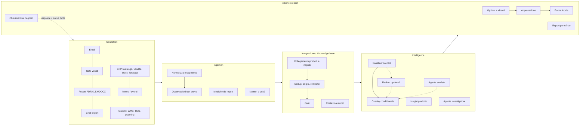

# RFC-001: Tesseract, piattaforma modulare dai segnali dei negozi alle decisioni

| | |
|---|---|
| **Stato** | Draft revisionato dopo audit documentale; requisiti proposti, non funzionalità implementate |
| **Data** | 22 ottobre 2026 |
| **Nome** | "Tesseract" è un nome provvisorio (moduli come tessere di un mosaico). Pacchetto Python `tesseract` |
| **Sostituisce** | `project-design.md` §3–§8 per architettura, contratti, matematica e piano; §9 per il copione. Le formule operative sono quelle di questo RFC, corrette secondo `research-methods.md`; il vecchio §5 è solo storico |
| **Integra** | `proposta-rivista.md` (feedback qualitativi, raccolta guidata), `research-recommendation.md` (evidenze, astensione, agente investigatore), `research-fastweb-assets.md` (modelli) |
| **Fonti** | `findings.md`, trascrizioni in `sources/transcripts/` (Q&A con il referente, `needfinding.md`, `Idea_Gabri.md`), `api-guide.pdf`, `../generated/README.md` |

---

## 0. TL;DR

- **Il prodotto.** Una piattaforma web modulare. Fonti eterogenee entrano dai connettori: note vocali WhatsApp, email di chiusura, report PDF/Excel, ERP, magazzino, logistica, meteo ed eventi. Diventano **osservazioni atomiche con prova** (citazione o timestamp audio), poi vengono **collegate** a prodotti e negozi, **deduplicate** e aggregate in **casi**. Quando i dati lo consentono, i casi alimentano **scenari condizionali** affiancati al forecast esistente; altrimenti producono una verifica con baseline invariata. Dai casi nascono **opzioni operative verificate** (trasferimento, riassortimento, hold, verifica) e **report per ufficio**. L’umano approva una bozza locale; l’invio a un mock logistico è opzionale.
- **La modularità è insieme prodotto e metodo.** Ogni modulo ha un manifest (cosa consuma, cosa produce, reale o simulato) e un contratto dati comune. In dashboard basta una lista di moduli e stati; il grafo è un’estensione. Ogni modulo si sviluppa contro **fixture congelate** e si integra rispettando le dipendenze reali.
- **Principio.** *L'AI legge, il codice conta, l'umano decide.* I modelli Fastweb estraggono, collegano, trascrivono, indagano e scrivono. Ogni numero (forecast, quantità, ETA, unità perse) è calcolato da codice deterministico e tracciabile.
- **Demo verificabile.** Parser, estrazione, linking, dedup, casi e controlli operano sui file sintetici. Il replay riusa risposte AI realmente registrate; fixture scritte a mano restano nei test. UI e trace distinguono `live`, `recorded`, `fixture` e `unavailable`. Canali, risposte dei negozi e azioni sono simulati; approvare crea di default una bozza locale.
- **Piano sostenibile.** Quattro persone, una vertical slice entro +12 h, freeze a +16 h, ultime 8 ore per valutazione, correzioni e demo. Budget pianificato: 48 ore-persona su 64 utili; 16 di riserva. I 58 ID originari restano un backlog tracciabile, non 58 PR obbligatorie (§6).
- **Stack deciso (OQ-1).** Backend Python (FastAPI, Pydantic, SQLite, pandas). Frontend React con Vite e TypeScript. SDK `openai` puntato all'endpoint Fastweb. Motivazioni in §4.1; scaffold creato (PLT-01). Piano operativo a fasi, owner e dipendenze in [`PLAN.md`](PLAN.md).

---

## 1. Contesto

### 1.1 Il problema in una frase

Nel contesto descritto dal referente, forecast storico e consuntivi certificati non incorporano subito alcune osservazioni dei negozi: richieste non soddisfatte, motivi riportati di mancato acquisto ed eventi locali. Le note possono renderle utilizzabili prima o spiegare un dato già disponibile. Non è una proprietà di tutti i forecast o di tutte le reti: nel needfinding i negozi diretti hanno già dati quantitativi centralizzati e la logistica resta lenta. Il valore da verificare è la qualità delle decisioni e il tempo utile prima del cutoff, non un anticipo garantito.

### 1.2 Cosa abbiamo imparato (sintesi; dettagli in `findings.md`)

| Fonte | Cosa conta per il design |
|---|---|
| Brief della track e Q&A con il referente | Forecast e transazionale non si toccano. Il Q&A descrive sia riaddestramento sia supporto alle decisioni come possibili letture; questo prototipo sceglie il secondo senza modificare i sistemi esistenti. Obiettivo: sapere prima dei consuntivi che serve agire. Lo stockout danneggia anche l'immagine. Spostare stock nel breve, produzione nel lungo. Decide l'umano. I vendor espongono i gestionali via MCP. "Non citateci". |
| `needfinding.md` (ex manager di più brand del lusso) | Nei negozi diretti i dati quantitativi sono già centralizzati. **Manca il qualitativo**: guardato, toccato, provato e non comprato, fit, tessuto. Già tentati piloti con vocali WhatsApp e 3–4 domande guida: **l'adozione è il vero tema**. La logistica è lenta anche con dati in tempo reale. Il franchising ha sistemi e report propri e diversi. |
| `Idea_Gabri.md` | Report vocale di fine giornata per dipendente, incrociato nello stesso negozio e giorno. Un **layer di ingestion comune** verso una knowledge base strutturata. **Output personalizzabili** per ufficio, priorità, prodotto o stagionalità. Il report mostra i motivi riportati e le prove; la soluzione la sceglie l’umano, senza deduzione automatica di causalità. |
| `research-*.md` | Prove indipendenti e non conteggio di menzioni. Astensione. `available_at` contro il leakage. Scenari dichiarati al posto di falsi intervalli. Simulazione giornaliera delle opzioni. Agente con budget di chiamate. Modelli e limiti dell'API Fastweb. |
| `api-guide.pdf` | API OpenAI-compatible: chat con vision e tool calling, embedding testo e immagine, trascrizione Whisper. TTS non documentato. Limiti di rate e budget non documentati. |
| `../generated/` | Mondo sintetico controllato: 39 negozi, 2.056 email in 10+ lingue, chat, report, ERP, sistemi con mock REST, meteo, eventi. Risposte nascoste in `ground_truth/`. Split dev e hold-out. **Non contiene audio.** |

### 1.3 Assunzioni di questo RFC

- **A1.** Team ipotizzato di 4 persone, hackathon di 24 ore. Le ore sono relative all’avvio; l’assistenza di coding non moltiplica automaticamente capacità umana, revisione e integrazione.
- **A2.** Input ammessi: `generated/sources/`, estensioni sintetiche del team etichettate, risposte simulate e loro copie sanitizzate; proiezioni e cache in `data/`. "Oggi" è il 22 ottobre 2026; la demo è un replay di giornate passate.
- **A3.** Primo utente: **merchandising e allocation HQ**. Gli altri uffici (retail ops, marketing, product/quality) ricevono viste e report dallo stesso stato.
- **A4.** Rete di negozi diretti. Franchising e multimarca restano roadmap: disponibilità dei dati e autorità sui movimenti non sono le stesse; nel needfinding il multimarca può non condividere affatto i dati.
- **A5.** Rispetto a `proposta-rivista.md`, questo RFC conserva un **overlay opzionale di scenari** come scelta progettuale, non come requisito imposto dal brief. Se quantità, periodo o granularità non sono risolti, il caso produce verifica/report con baseline invariata. Non si sovrascrive né si riaddestra il forecast.
- **A6.** Raccolta guidata facoltativa per negozio/turno, con 3–4 domande su interesse, motivi dichiarati, indisponibilità e rettifiche. Non cinque minuti obbligatori per dipendente. L’adozione e il beneficio incrementale dei vocali restano ipotesi; non si promette «i negozi non cambiano nulla».

**Precedenza.** Brief ufficiale e contratti dei dati fissano i vincoli; trascrizioni ASR e interviste informano le ipotesi. Questo RFC definisce le scelte di implementazione; ricerche e bozze restano contesto. Divergenze risolte e copertura di tutti i documenti sono in Appendice B. Non si deduce un requisito dalle promesse delle bozze.

---

## 2. Obiettivi, non-obiettivi, principi

### 2.1 Obiettivi della demo (verificabili)

| ID | Obiettivo | Come si vede |
|---|---|---|
| OBJ1 | **Lettura** di fonti eterogenee | Email in almeno 2 lingue, un report CSV/XLSX e una fonte esterna realmente letti; un vocale con ASR verificato o fallback dichiarato; prodotto ambiguo → verifica. La validità della citazione non prova correttezza semantica |
| OBJ2 | **Integrazione** senza amplificare il rumore | Forward e duplicati diventano "N documenti, M origini"; le rettifiche sostituiscono il fatto solo dal proprio timestamp, preservando la storia; i conflitti restano visibili |
| OBJ3 | **Anticipo utile** misurato | Confronto sullo stesso evento con baseline vendite e baseline operativa con stock; anticipo anche nullo o negativo, più margine prima della scadenza. «Non rilevato entro T_end» se pertinente |
| OBJ4 | **Scenari** spiegabili quando ammissibili | Baseline e scenari oppure motivo di astensione; ogni scostamento ha unità, ipotesi, evidenze e scadenza. Miglioramento non presunto |
| OBJ5 | **Decisione** controllabile | Hold/verifica sempre disponibili; movimenti solo se tutti i controlli obbligatori passano, approvazione versionata → bozza locale. Dispatch REST opzionale |
| OBJ6 | **Report** per ufficio | Brief giornaliero con viste configurabili, ogni affermazione con citazione cliccabile |
| OBJ7 | **Piattaforma modulare** | Lista dei moduli; disattivarne uno e rieseguire rimuove i suoi contributi nel nuovo run. Grafo opzionale |

### 2.2 Non-obiettivi

- Nessun riaddestramento o nuovo modello di forecast di lungo periodo; nessun foundation model per serie temporali.
- Nessuna integrazione reale con WhatsApp Business, caselle email, Drive o ERP: i canali sono cartelle e upload.
- Nessun parsing universale di qualsiasi PDF o PPTX: solo i formati presenti nei casi demo.
- Nessuna stima di ROI reale; nessuna probabilità calibrata se non ne abbiamo i dati.
- Multi-tenant e autenticazione: fuori scope. La "configurabilità per business" si mostra con un file di dominio (§3.3).

### 2.3 Principi di design (vincolanti per ogni PR)

1. **L'AI legge, il codice conta, l'umano decide.** Un LLM non produce mai un numero che finisce in un calcolo o in una card senza passare da un validatore deterministico.
2. **Ogni fatto ha una prova.** Ogni osservazione ha `evidence` (citazione con offset verificati, più intervallo audio se disponibile). Senza prova verificata il candidato resta nel registro degli errori/astensioni e non entra nei calcoli.
3. **Tempo esplicito.** Ogni record ha `available_at` (quando potevamo saperlo) e, se applicabile, il periodo del fatto. Il filtro per `as_of` vive nel livello di accesso al DB, non nella UI (README R5, `research-methods.md` §8).
4. **Simulare solo ai confini, e dichiararlo.** I moduli di logica (estrazione, linking, casi, forecast, opzioni, report) sono reali. Canali, sistemi aziendali ed esecuzione possono essere mock, con badge in UI.
5. **Un modulo, un contratto.** I moduli comunicano solo tramite le tabelle e i tipi di §4.5. Nessun modulo importa il codice interno di un altro.
6. **Replay verificabile.** Cache persistente di risposte AI e letture esterne, input e versioni congelati; codice deterministico rieseguito. Un input nuovo può produrre cache miss: non si promette ASR o dialogo libero offline.
7. **Nessun leakage.** Il prodotto non legge `generated/ground_truth/` né `generator/`. Solo `eval/` legge le risposte.

### 2.4 Cosa è reale e cosa è simulato

| Elemento | In demo | Implementazione |
|---|---|---|
| Email, report, ERP e fonte esterna del percorso minimo | **Dati sintetici, elaborazione reale** | Connettori veri sui file selezionati di `generated/sources/`; chat e altri formati opzionali |
| Note vocali "WhatsApp" | Audio del team; ASR live/registrato se verificato | Trascrizione manuale = `fixture`, non chiamata ASR reale |
| Canali (mailbox, WhatsApp, Drive) | Simulati | Cartelle "inbox"; upload da UI opzionale |
| Estrazione, linking, dedup, casi, opzioni e report | **Implementati nel percorso minimo** | Codice rieseguito; risposte LLM registrate e validate; scenari solo se ammissibili |
| WMS/TMS nel percorso; altri sistemi opzionali | Simulati | Mock REST fornito o adapter locale sugli stessi file con filtro temporale (§4.11) |
| Esecuzione dell’azione approvata | Simulata | Bozza locale per default; POST logistico soltanto nel percorso opzionale verificato (§4.11) |
| Risposte dei negozi ai chiarimenti | Simulate | Dialogo completo opzionale; in replay solo risposte registrate, in ramo interattivo risposta dell’operatore |
| Orologio | Replay | `as_of` selezionabile in UI |

---

## 3. Il prodotto: piattaforma a tessere

### 3.1 I cinque layer



Il disegno rappresenta l’architettura complessiva, comprese estensioni: non tutti i nodi sono MVP. Il ciclo dei chiarimenti, se attivato, rientra in **un nuovo run**; il DAG del singolo run resta aciclico (§4.4).

### 3.2 Catalogo dei moduli

Priorità: **Core** = versione minima obbligatoria di §6; **Should** = estensione dopo il gate; **Could** = roadmap. Le fixture consentono lo sviluppo, ma non sostituiscono i Core alla verifica finale. ASR indisponibile è un limite dichiarato, non un gate superato con dati inventati.

| Modulo (id) | Layer | Cosa fa | AI | Priorità | Mock ok |
|---|---|---|---|---|---|
| `src.erp` | Connettori | Carica catalogo, assortimento, vendite giornaliere, stock, forecast, spedizioni, KPI con `available_at` | – | Core | No |
| `src.email` | Connettori | Parsing `.eml` (charset, HTML, allegati, thread, quote), segmenti con offset | – | Core | No |
| `src.voice` | Connettori | Audio e metadati → trascrizione; intervalli se disponibili | ASR se verificato | Core (demo input) | Fallback fixture dichiarato; ASR non dimostrato |
| `src.docs` | Connettori | Un CSV/XLSX con definizioni e locator; altri formati dopo | – | Core (thin) | No |
| `src.chat` | Connettori | Export WhatsApp, Teams, Kakao e simili → messaggi | – | Could | – |
| `src.external` | Connettori | Un provider/file pertinente → `ContextEvent` con disponibilità | – | Core (thin) | No |
| `sys.client` | Connettori | Adapter stock/ATP, lane e policy; dispatch opzionale | – | Core (thin) | Confine simulato, dati tracciati |
| `ing.extract` | Ingestion | Segmenti → `Observation` con evidenza verificata | Chat LLM | Core | No |
| `ing.numbers` | Ingestion | Quantità fisiche esplicite Core; valute e notazioni estese Should | – | Core (thin) | No |
| `ing.metrics` | Ingestion | Un mapping approvato → `MetricFact` con definizione; mapping LLM generico dopo | Opzionale | Core (thin) | No |
| `int.link` | Integrazione | Menzione → SKU, stile o taglia, oppure ambiguo o non collegato; alias, fuzzy, eventuali embedding, scelta LLM vincolata | LLM ed embedding | Core | No |
| `int.dedup` | Integrazione | Gruppi di origine, duplicati, rettifiche (`supersedes`) | – | Core | No |
| `int.cases` | Integrazione | Osservazioni → casi per negozio, prodotto, tipo e finestra; stato, owner, priorità, scadenza, conflitti | – | Core | No |
| `int.context` | Integrazione | Associa la fonte esterna a casi per geo/tempo; nessun uplift automatico | – | Core (thin) | No |
| `fc.baseline` | Intelligence | Vintage del forecast valido ad `as_of`, disaggregazione giornaliera | – | Core | No |
| `fc.nowcast` | Intelligence | Diagnostica residui su passato ammissibile; disattivata per default | – | Should | No |
| `fc.overlay` | Intelligence | Gate numerici, baseline invariata o scenari low/base/high con ipotesi e decadimento | – | Core (thin) | No |
| `ag.analyst` | Intelligence | Agente che sceglie template e intensità di correzione per un caso, con motivazione citata; il codice valida | Chat e tools | Should | – |
| `ins.product` | Intelligence | "Stesse vendite, motivi diversi": motivi e funnel per prodotto, più codici di reso POS | – | Should | – |
| `ag.investigator` | Azioni | Agente che sceglie la verifica successiva (stock, ETA, chiarimento) e propone l'opzione | Chat e tools | Core | No (fallback a DAG fisso) |
| `act.options` | Azioni | Hold/verifica e un movimento domestico verificabile; DC/combo dopo | – | Core (thin) | No |
| `act.dispatch` | Azioni | Approvazione versionata e bozza locale Core; POST logistico Should | – | Core (thin) | Confine simulato |
| `out.reports` | Azioni | Brief per owner con citazioni; altre viste dopo | LLM opzionale | Core (thin) | No |
| `out.clarify` | Azioni | Domande al negozio nella sua lingua; risposta → nuova fonte | Chat LLM | Should | Sì (risposta da UI) |
| `mcp.server` | Piattaforma | Espone tool e knowledge base via MCP | – | Could | – |

**Minimo agentico:** almeno un percorso registrato con scelta effettiva del tool in funzione delle evidenze, più un percorso alternativo. Il DAG fisso è un fallback operativo, non prova di innovazione agentica. Se si usa solo il DAG, dichiarare la funzionalità agentica non dimostrata.

### 3.3 Personalizzazione per business ("la tessera giusta per ogni azienda")

Due file di configurazione rendono visibile la modularità senza costruire il multi-tenant:

```yaml
# config/pipeline.yaml: quali tessere sono attive e con quale implementazione
modules:
  src.email:      { enabled: true }
  src.voice:      { enabled: true, mode: recorded }  # live | recorded | fixture | unavailable
  src.docs:       { enabled: true }
  src.external:   { enabled: true, mode: live }
  int.link:       { enabled: true, params: { use_embeddings: false, top_k: 8 } }
  ag.investigator: { enabled: true, params: { max_tool_calls: 6 } }
  fc.nowcast:     { enabled: false }
  act.dispatch:   { enabled: true, target: local_draft }      # mock_logistics dopo verifica
```

```yaml
# config/domain.yaml: il significato è configurabile, la pipeline è la stessa
domain: fashion_retail_direct
owners:                       # chi riceve cosa
  unmet_demand: allocation
  stock_discrepancy: retail_ops
  product_feedback: product_quality
  traffic_change: retail_ops
  demand_shift: merchandising
  operational_issue: retail_ops
  customer_profile: marketing
  unknown: retail_ops
views:                        # le "viste" richieste in Idea_Gabri
  - { id: by_office,   group_by: owner }
  - { id: by_priority, group_by: priority }
  - { id: by_product,  group_by: [category, season_group] }
vague_quantifiers: { it: [tanti, molti, parecchi], fr: [plusieurs, beaucoup], en: [several, lots, many] }
reason_taxonomy: [fit, size_availability, colour, fabric_material, quality_defect, price, style, other]
```

### 3.4 Viste della dashboard

| Pagina | Contenuto | Priorità |
|---|---|---|
| **Pipeline** | Lista: stato, conteggi, modalità e interruttori per il prossimo run; selettore `as_of` | Core (pannello), Should (grafo) |
| **Casi** | Coda ordinata per priorità e scadenza, filtri per vista (ufficio, prodotto, negozio) | Core |
| **Dettaglio caso** | Cosa è cambiato, prove a favore e contro con citazioni, "N documenti, M origini", contesto, grafico forecast con baseline e scenari, trace dell'agente, opzioni con controlli, Approva/Rifiuta | Core |
| **Fonti** | Inbox dei documenti; dettaglio con versione canonica sanitizzata (testo o player audio), evidenze evidenziate, osservazioni e stato del link | Core |
| **Report** | Brief per vista, markdown con citazioni cliccabili | Core (thin) |
| **Prodotti** | Vendite affiancate ai motivi riportati per prodotto | Should |
| **Chiarimenti** | Chat simulata con i negozi | Should |

---

## 4. Architettura tecnica

### 4.1 Stack

| Livello | Scelta | Perché |
|---|---|---|
| Backend | **Python 3.12**, `uv`, **FastAPI**, **Pydantic v2**, **SQLAlchemy 2.0** su **SQLite**, `pandas` | Parsing robusto in stdlib e librerie mature (`email`, `openpyxl`, `pdfplumber`, `python-docx`, `python-pptx`). Il generatore e il mock server del dataset sono Python. Combinazione molto nota agli agenti di coding |
| LLM | SDK **`openai`** con `base_url=https://spod.ai-factory.fastweb.it/v1` | L'API Fastweb è OpenAI-compatible: un solo client per chat, tools, embedding e trascrizione |
| Matching | `rapidfuzz` più numpy in memoria (embedding) | Il catalogo ha 114 SKU-colore e 643 SKU-taglia: nessun vector DB necessario |
| Frontend | **React + Vite + TypeScript**, CSS/componenti già noti al team; un grafico semplice | Versioni compatibili fissate nel lockfile a G0. Tipi da OpenAPI; niente router, libreria di grafo o design system obbligatori per tre viste |
| Qualità | `ruff`, `pytest`, `tsc -b`, `oxlint` (default del template Vite) | Un comando `make check` prima di ogni PR, eseguito anche in CI |
| Esecuzione | `make dev`: backend `uvicorn` su :8000, web su :5173, mock server su :8088 | Nessun Docker obbligatorio |

**Motivazione della scelta.** Python riusa competenze e strumenti del dataset; il MVP richiede poche viste, quindi il team può usare componenti che conosce. **Deciso (OQ-1):** nessun cambio stack; le alternative (full-stack TypeScript, Streamlit) sono scartate.

### 4.2 Struttura prevista del repository

PLT-01 ha creato lo scaffold (pacchetti vuoti per layer, app Vite, `Makefile`, CI). Gli altri file si creano solo per i moduli effettivamente attivati; proprietà dei percorsi per lane in `PLAN.md` §1.

```
backend/
  pyproject.toml
  tesseract/
    core/           config.py clock.py contracts/ db.py repo.py
                    registry.py orchestrator.py llm.py cache.py prompts.py
    modules/
      sources/      erp.py email.py voice.py docs.py chat.py external.py systems_client.py
      ingestion/    extract.py numbers.py metrics.py
      integration/  link.py dedup.py cases.py context.py
      intelligence/ baseline.py nowcast.py overlay.py insights.py
      agents/       runtime.py tools.py investigator.py analyst.py
      actions/      options.py dispatch.py clarify.py
      outputs/      reports.py
    api/            main.py  routers/{modules,runs,documents,cases,forecast,options,reports,clarifications}.py
    cli.py          # `tesseract run|reset|export|smoke`
  prompts/          extract_observations.v1.md  link_product.v1.md  investigator.v1.md ...
  tests/            unit/  contract/  golden/
web/                # Vite app; src/api/schema.d.ts generato
eval/               # pacchetto separato: UNICO codice che legge generated/ground_truth
config/             pipeline.yaml domain.yaml eval_split.yaml demo.yaml
data/               # gitignored: tesseract.db, cache/, audio/  (eccezione: data/fixtures/ versionato)
scripts/            smoke_fastweb.py  make_voice_notes.sh  start_mocks.sh
AGENTS.md           # regole per agenti di coding (anche come CLAUDE.md)
Makefile
```

### 4.3 Runtime: snapshot immutabili e orologio di replay

`as_of` è un istante UTC; `D_store` è la sua data nel fuso IANA del negozio. Non esiste un unico giorno locale per tutti i negozi. L’ora selezionata in UI è un parametro del prossimo run, non uno stato globale mutabile usato dai job in corso.

- **Run immutabile.** `RunSpec = {run_id, scenario_id, as_of, stores, source_manifest_hash, config_hash, code_version, schema_version, mode}`. La richiesta fotografa anche moduli, prompt, modelli e fixture autorizzate. I dati derivati sono partizionati per `run_id`; tutte le GET, i tool e le decisioni indicano quel run. Una vista non mescola output di due run.
- **Ricalcolo minimo.** Import/parsing e chiamate AI si riusano per hash/versione; casi, link dipendenti dal contesto, forecast, opzioni e report si ricostruiscono dai soli input ammissibili. Disattivare un connettore, tornare indietro nel tempo o rettificare una fonte crea un nuovo run e invalida gli output dipendenti. «Elabora solo i documenti nuovi» non basta.
- **Pubblicazione atomica.** Un solo worker e un solo run scrivente per volta nel prototipo; sessione DB per job, mai condivisa fra thread. Gli output diventano consultabili come completi soltanto al termine; fallimenti e moduli bloccati restano espliciti. L’ultimo run completo resta consultabile con il proprio timestamp.
- **Dati durevoli.** Documenti acquisiti, risposte ai chiarimenti, decisioni, ledger e cache persistente non sono materiale ricostruibile dal solo dataset. `reset --run <id>` elimina soltanto proiezioni di quel run; il reset della sessione demo usa un nuovo `scenario_id`. Una ricostruzione dello schema richiede export/backup: `create_all` non aggiorna tabelle già esistenti.
- **Rettifiche temporali.** Documenti e osservazioni sono immutabili; `supersedes` e `retracts` sono relazioni con propria disponibilità. Lo stato attivo si deriva ad `as_of`, senza cancellare retroattivamente la versione precedente. Il nuovo run non modifica quello già approvato.

**Filtro prima del retrieval.** `Repo(run_spec)` applica disponibilità e perimetro a tabelle, ricerca, cache contestuali, tool e file multiriga. Il solo `available_at <= as_of` non basta per uno stato derivato: serve anche il `run_id` corretto. Ogni output conserva gli ID/versioni degli input e il massimo della loro disponibilità.

| Fonte | Regola di disponibilità |
|---|---|
| Vendite, POS, KPI, traffico, stock EOD | Almeno D−1 secondo il README; posting più tardo prevale. Ora 06:00 del giorno successivo nel fuso locale come **convenzione del prototipo**, non dato documentato. Conservare `availability_basis` |
| Forecast | Vintage con emissione ammissibile e target coperto. Se c’è solo `run_date`, stessa convenzione delle 06:00; per ogni giorno storico si usa il vintage disponibile allora |
| Email e allegati | `Date:` come proxy prescritto dal dataset; allegato non prima della mail. Data del fatto distinta dalla ricezione; non fidarsi solo dell’oggetto |
| Report | Emissione/ricezione, non fine periodo o `mtime`. Se manca, `availability_unknown`: escluso dal replay rigoroso; nessun «period_end + 3» inventato |
| Chat | Un documento per messaggio con timestamp, non un documento dell’intera giornata che espone messaggi futuri |
| Meteo/eventi | Osservazioni giornaliere solo a giornata conclusa secondo convenzione dichiarata; previsioni solo dopo `issued_at`. Il file di forecast del 22 ottobre non è disponibile nei replay precedenti |
| Sistemi e spedizioni | Timestamp e versione del singolo fatto. Un arrivo pianificato non è un arrivo reale; aggiornamenti di ETA, actual e rilascio dogana futuri sono esclusi anche se contenuti nella stessa riga |
| Chiarimenti | Nel ramo interattivo, `answered_at > asked_at`; il nuovo run deve avere `as_of >= answered_at`. Risposte e movimenti simulati non rientrano nel benchmark storico |

`computed_at` registra l’elaborazione reale odierna; `available_at` registra la conoscibilità simulata. Il replay misura anticipo informativo sotto queste convenzioni, non latenza di un deployment storico inesistente. Latenza reale di elaborazione e quota di timestamp assunti si riportano separatamente.

### 4.4 Contratto di modulo e dipendenze

`ModuleManifest` è un modello serializzabile: `id`, `version`, `layer`, `description`, `requires`, `optional_inputs`, `produces`, `enabled`, `mode`, `params_schema`; i valori di `params` e i parametri specifici degli adapter sono validati da quello schema. `mode` distingue `live`, `recorded`, `fixture`, `unavailable`; un sistema simulato ha inoltre `boundary="simulated"`. Cache di una vera chiamata e risposta scritta a mano non sono lo stesso tipo di prova.

`RunContext` è una dataclass interna che contiene `RunSpec`, repository, client e logger: non un modello Pydantic esportato in OpenAPI con connessioni e classi Python arbitrarie. I DTO ai confini sono Pydantic; il registro delle funzioni rimane interno.

Ogni artefatto ha un produttore logico e versione. Connettori diversi producono partizioni di `documents`; una fase esplicita ne costruisce la vista comune. L’orchestratore usa dipendenze **dichiarate**, non dedotte soltanto dai nomi delle tabelle. Ordine principale:

```text
fonti → segmenti → osservazioni → link → relazioni/dedup → casi
ERP → baseline ──────────────────────────────────────────┤
report e contesto ───────────────────────────────────────┤
                                                        ↓
                                                   scenari/opzioni → report
caso → investigatore → servizi di lettura e valutazione → trace
approvazione umana → decisione/bozza
risposta chiarimento → nuovo documento → nuovo run
```

I tool dell’investigatore chiamano servizi deterministici condivisi con `act.options`, non richiamano ricorsivamente l’orchestratore. Le opzioni iniziali possono essere calcolate prima dell’agente; il suo output registra un’indagine e la selezione di un’opzione valida. Chiarimenti e analista opzionale producono nuovi eventi/proposte, non archi ciclici nello stesso DAG.

`--modules int.link` include i prerequisiti oppure richiede artefatti compatibili dello stesso snapshot; non riusa tabelle residue senza verificarle. Disabilitare una dipendenza obbligatoria rende il modulo `blocked`, mentre una dipendenza opzionale produce un degrado dichiarato. Nessuna iniezione automatica di fixture nei run reali. L’esito di modulo contiene conteggi, errori, astensioni e stato `succeeded|degraded|blocked|failed`.

### 4.5 Modello dati e invarianti

Questo è il contratto normativo da tradurre in Pydantic e tabelle a G0. Congelare **il sottoinsieme MVP**, non tutti i moduli futuri. I cambi incompatibili richiedono versione nuova e rigenerazione delle proiezioni interessate; un campo aggiunto non è automaticamente innocuo se cambia i calcoli.

**Campi comuni:** ogni record sorgente ha `id`, `version`, `available_at`, `availability_basis`, riferimenti alla fonte e periodo del fatto se noto. Ogni record derivato ha inoltre `run_id`, `scenario_id`, `computed_at`, `input_refs` e versione del produttore. ID e hash sono stabili per contenuto/versione e includono la provenienza; due copie restano due documenti collegabili, non una sovrascrittura silenziosa. Tutti i timestamp sono timezone-aware, tutte le quantità finite.

| Contratto | Campi specifici obbligatori o esplicitamente nullable |
|---|---|
| `SourceDocument` | `source_type` (email, voice_note, chat_message, report, external_feed, system_api, clarification_reply), `connector`, `uri`, `content_hash`, `origin`, `author_ref?`, `language?`, `business_date?`, `event_start?`, `event_end?`, `thread_key?`, `parent_document_id?`, `text`, `text_version`, `meta`. `text` è il testo canonico sanitizzato; originale riservato separato |
| `Segment` | `document_id`, `text_version`, `idx`, `text`, `char_start`, `char_end`, `locator?`, `t_start_s?`, `t_end_s?`, `is_quoted`. Offset nel testo canonico; locator pagina/foglio/cella per report |
| `Evidence` | `document_id`, `document_version`, `segment_id`, `quote`, `char_start`, `char_end`, `t_start_s?`, `t_end_s?`. Deve valere `doc.text[start:end] == quote`; ogni prova appartiene al segmento indicato |
| `Quantity` | `kind=exact\|range\|vague\|unknown`, `value?`, `low?`, `high?`, `unit?`, `currency?`, `raw?`, `evidence_ref?`. Exact richiede value; range richiede estremi ordinati; vague/unknown vietano valori numerici imputati. Clienti, richieste, unità, visitatori, importi e percentuali sono unità distinte |
| `Observation` | `document_id`, `kind`, `store_id?`, `period_start?`, `period_end?`, `time_text?`, `product_mention?`, `quantity`, `direction`, `reason?`, `reason_text?`, `funnel_stage?`, `attribution`, `negated`, `evidence`, `extractor_version`. Tipi: unmet_demand, demand_up/down, stockout, low_stock, stock_discrepancy, product_feedback, traffic_change, customer_profile, operational_issue, sales_figure, local_event, other |
| `EntityLink` | `observation_id`, `status=linked\|ambiguous\|unlinked\|not_product`, `level=sku_size\|sku\|style\|category\|null`, `target_id?`, `candidates[]`, `decided_by`, `rationale`. Ogni candidato ha ID, metodo e score nella scala dichiarata; nessuno score è una probabilità |
| `EvidenceRelation` | `from_ref`, `to_ref`, `relation=duplicates\|possibly_same_episode\|supersedes\|retracts\|supports\|contradicts`, `basis`, `evidence_refs[]`. Una rettifica ha bersaglio a livello di fatto, non cancella tutta la mail |
| `Case` | `case_type`, `store_id?`, `scope_level=sku_size\|sku\|style\|category\|store\|unknown`, `scope_id?`, `window_start`, `window_end`, `status`, `owner`, `priority`, `priority_reason`, `decision_due_at?`, `first_available_at`, `last_received_at`, `last_independent_evidence_at?`, `valid_until?`, `supporting[]`, `contradicting[]`, `n_documents`, `n_origin_groups`, `n_unknown_origins`, `blocking_uncertainties[]`, `context_refs[]`. Le prove possono riferirsi a osservazioni, metriche o stock strutturati |
| `MetricFact` | `document_id`, `metric`, `definition?`, `value?`, `unit`, `currency?`, `vat_included?`, `gross_or_net?`, `scope`, `period_start`, `period_end`, `calendar?`, `fx_basis?`, `locator`, `mapping_version`, `comparability_status`. Definizione mancante o diversa impedisce aggregazione, non diventa zero |
| `ContextEvent` | `kind`, `store_ids`, `start`, `end`, `issued_at?`, `source_refs[]`, `magnitude?`, `description`, `role=context_only\|corroborating`. Un testo esterno non fornisce automaticamente un coefficiente causale |
| `StockFact` | `location_id`, `sku`, `size`, `ean?`, `snapshot_at`, `qty`, `basis=on_hand\|sellable\|atp`, `reservations_included`, `quality_holds_included`, `source_ref`. Una query aggregata per colore non certifica la disponibilità per taglia |
| `ForecastAdjustment` | `case_ids[]`, `store_id`, `sku`, `baseline_ref`, `horizon_start/end`, `status=computed\|unchanged\|not_estimable`, `reason?`, `series[]`, `components[]`, `proposal_source=code\|agent\|human`. Ogni punto ha data, baseline, low/base/high latenti e servibili, `actual?`; baseline nulla significa mancante, zero resta zero |
| `AdjustmentComponent` | `type`, `episode_refs[]`, `evidence_refs[]`, `params`, `unit`, `effective_from/until`, `reference_time`, `formula_version`, `explanation`. Include anche clipping e distribuzione giornaliera per riconciliare il totale |
| `ActionOption` | `case_id`, `forecast_ref?`, `kind=hold\|verify_stock\|ask_store\|replenish_dc\|transfer\|combo\|notify_owner`, `legs[]`, `checks[]`, `outcomes?`, `baseline_outcomes?`, `assumptions[]`, `valid_until`, `recommended`, `rationale`, `input_version_hash`. Outcome ignoto = null, non zero |
| `Leg` | `origin`, `dest`, `sku`, `size`, `ean?`, `qty` intero positivo, `pickup_at`, `eta_at`, `sellable_at`, `lane_id`, `cost_eur?`. La chiave SKU-size si risolve con catalogo e crosswalk, non con split arbitrari sulle stringhe |
| `Check` | `name`, `status=pass\|fail\|unknown\|not_applicable`, `mandatory`, `detail`, `source_refs[]`. Solo pass/not_applicable motivato soddisfano un requisito; assenza di dati blocca un movimento |
| `ScenarioOutcome` | `scenario_id`, `lost_units_dest`, `lost_units_donor`, `leftover_units_dest`, `leftover_units_donor`, `transport_cost_eur?`, `demand_basis`, `size_allocation_basis`. Perdita condizionata a scenario, non attesa probabilistica |
| `Decision` | `option_id`, `run_id`, `scenario_id`, `input_version_hash`, `decision=approved\|rejected`, `by`, `at`, `idempotency_key`, `note?`, `dispatch_status=draft\|pending\|accepted\|rejected\|unknown`, `request_ref?`, `response_ref?`. Approvazione, invio e prenotazione sono stati distinti |
| `Clarification` | `case_id`, `observation_refs[]`, `question`, `asked_at`, `answer_document_id?`, `answered_at?`, `status`, `simulated=true`. Il legame esplicito permette di correggere il link della menzione originaria |
| `Reservation` | `scenario_id`, `decision_id`, `location`, `sku`, `size`, `qty`, `status=pending\|committed\|released\|unknown`, `idempotency_key`, `external_ref?`, `created_at`. Mai condivisa fra rami what-if o replay indipendenti |
| `Report` | `view`, `markdown`, `citations[]`, `generated_by`, `input_version_hash`; run e as_of dal contratto comune |
| `AgentTrace` | `case_id`, `steps[]` (tool, argomenti validati, riferimenti input/output, durata, errore), `outcome`, `fallback_used`, `mode`, `tokens_in/out?`. Niente ragionamento interno grezzo |

Tabelle ausiliarie: cataloghi, vendite, POS, stock, vintage forecast, spedizioni, KPI; `runs`, `module_runs`, `llm_calls`, `system_calls`, `document_versions`, ledger e decisioni. Fonti strutturate hanno un riferimento di riga e hash, utilizzabile nei report allo stesso modo di una citazione testuale.

**Estrazione e prove.** L’LLM restituisce DTO candidati con citazione e attributi, non ID/offset finali. Il codice localizza la citazione nel segmento e assegna ID/offset; occorrenze multiple richiedono disambiguazione. Se si normalizzano Unicode/spazi, mantenere una mappa verso il testo canonico: non accettare una citazione normalizzata fingendo che sia una sottostringa dell’originale. Offset definiti in code point Unicode; il frontend converte verso UTF-16 oppure riceve porzioni già segmentate, evitando errori con emoji/CJK. Prove audio rimandano a intervalli realmente restituiti dall’ASR o annotati; niente timestamp inventati.

**Numeri.** Il codice verifica unità, segno, formato e corrispondenza con lo span. Solo `units` riferite a intenzioni di acquisto non convertite, periodo noto e episodi disgiunti alimentano scenari di domanda. «Cinque clienti» non diventa cinque pezzi senza evidenza. Importi e resi non alimentano il conteggio della domanda fisica.

**Dedup e casi.** Le copie certe condividono un gruppo di provenienza; autore/negozio/giorno/prodotto uguali o similarità testuale da soli non provano lo stesso episodio. Taglia, periodo, negazione e rettifica contano. Con sovrapposizione incerta, mantenere le segnalazioni separate e non sommare le quantità. Una nuova richiesta quotidiana può essere un nuovo episodio; una ripetizione non ringiovanisce il fatto. Conteggiare gruppi noti e origini ignote, senza promettere indipendenza statistica.

Un link ambiguo o assente produce un caso `verify` con scope `unknown` e candidati: non viene scartato prima dell’agente. Stato `open|verify|monitor|action_proposed|decided|closed`; assenza di report non chiude il caso. Una possibile discrepanza confronta stesso prodotto/taglia, definizione e tempi; stock vecchio positivo non smentisce una nota nuova. `customer_profile` va a marketing, `other` a revisione; nessun enum resta senza owner. I pattern cross-store sono viste su casi collegati, non una somma di domanda indipendente.

### 4.6 API HTTP e interfaccia

| Metodo e path | Contratto |
|---|---|
| `GET /api/modules` | Catalogo e configurazione; disponibilità reale delle capacità |
| `POST /api/runs` · `GET /api/runs/{run_id}` | Input RunSpec senza ID server; risposta 202 con ID, stato e snapshot config. Modifiche alla configurazione valgono per il prossimo run |
| `GET /api/runs/{run_id}/documents[/{id}]` | Fonti/segmenti/link di quel run; media solo con ID presente nel manifest, senza percorsi arbitrari |
| `GET /api/runs/{run_id}/cases[/{id}]` | Coda filtrata e scheda con evidenze, scenari e opzioni |
| `POST /api/runs/{run_id}/cases/{id}/investigate` | Job con snapshot immutabile; trace con propria versione e artefatti risultanti |
| `GET /api/runs/{run_id}/forecast?store=&sku=` | Vintage, baseline, scenari ammissibili e actual visibili |
| `POST /api/runs/{run_id}/options/{id}/decision` | ID opzione, hash input, decisione, attore, idempotency key. 409 per proposta obsoleta o risorsa insufficiente; validazione lato server |
| `GET /api/runs/{run_id}/reports?view=` | Brief dello snapshot; rigenerazione esplicita come artefatto versionato |
| `POST /api/clarifications/{id}/answer` | Risposta simulata, timestamp e scenario; restituisce documento e nuovo run quando il clock è avanzato abbastanza |
| `POST /api/uploads` | Should: file e metadati validati; ID opaco, limiti di formato/dimensione; nessun path del client usato direttamente |

MVP: coda/dettaglio, pannello fonti, breve report per owner e lista dei moduli. Niente pagina separata per ogni modulo. `FIXTURE_MODE=1` usa un namespace di sviluppo separato con banner; endpoint decisionali e dispatch non producono effetti fuori da quel namespace. Il clock in UI seleziona un run o ne richiede uno nuovo. Disattivare un modulo non cambia il significato di una decisione precedente.

### 4.7 Integrazione AI: API Fastweb

#### 4.7.1 Modelli e uso

| Uso | Endpoint | Modello iniziale | Note |
|---|---|---|---|
| Estrazione osservazioni, linking vincolato, testi di report e chiarimenti | `/v1/chat/completions` | `google/gemma-4-26B-A4B-it` (hosting EU) | Confermato da PLT-07 (`docs/smoke-fastweb.md`). Fallback `glm-5.3-flash` o `Qwen/Qwen3.5-397B-A17B-FP8` (hosting extra-EU) |
| Agenti (tool calling) | `/v1/chat/completions` con `tools` | Come sopra | Chat Completions e Responses sono documentati; si sceglie il primo per un solo adapter e stato gestito localmente |
| Retrieval candidati prodotto | `/v1/embeddings` | `Qwen/Qwen3-VL-Embedding-2B`, `dimensions=512` | Catalogo pre-calcolato una volta; confronto con 2048 solo se il recall è basso |
| Note vocali | `/v1/audio/transcriptions` | `openai/whisper-large-v3-turbo` | `verbose_json` documentato; presenza/precisione dei segmenti da verificare. `language` solo se nota per la registrazione, non dedotta rigidamente dal negozio (OQ-3) |
| Foto allegate (opzionale) | chat con `image_url` base64 | Come sopra | Solo immagini dev o fixture separate; immagini hold-out mai usate per sviluppare la vision (Could) |

#### 4.7.2 Client `tesseract.core.llm`

- `chat(messages, tools=None, model=None)`, `extract(schema: type[BaseModel], messages)`, `embed(texts, dimensions=512)`, `transcribe(path, language)`.
- **Output strutturato.** `extract()` espone lo schema Pydantic come unico tool (`submit_<schema>`), con `$defs` espansi inline (Gemma ignora i `$ref` annidati) e `tool_choice="required"` (con `auto` i Qwen a volte rispondono in testo; PLT-07), e valida gli argomenti con Pydantic. Se mancano o non sono validi, riprova una volta passando l'errore. Se fallisce ancora, solleva `ExtractionFailed`: il modulo registra l'astensione e non inventa. La guida documenta solo `tool_choice=auto`; PLT-07 ha verificato `required` su tutti i modelli chat, la forzatura per nome non è affidabile e il JSON Schema strict non è garantito. Il client deve tollerare risposta senza tool: retry entro budget, poi astensione. Alternative JSON attivate solo dopo smoke test e sempre validate.
- **Cache.** Cache persistente fuori dalle proiezioni, con chiave su provider/base URL, model ID/revisione nota, prompt/schema/tool e versioni, parametri di generazione, payload e hash/versioni delle fonti e del contesto ammissibile. Per ASR includere hash dei byte audio, lingua e formato; per embedding dimensioni e versione catalogo. Segreti esclusi dalla chiave e dai log. `LLM_MODE=live|record|replay`: `replay` non chiama mai la rete; un miss è un errore esplicito, e la demo gira così.
- **Robustezza.** Semaforo di concorrenza (default 4), backoff esponenziale su 429 e 503, timeout di 60 secondi, log di token e latenza per chiamata. La guida dice che le chiavi dello stesso account condividono il saldo; verificare l’assetto del team. Limiti globali di chiamate/token, massimo 2 retry e backoff entro deadline; 400 budget_exceeded e 401/403 non si ritentano. Selezionare campione dev e test prima dei risultati (OQ-9).
- **Prompt versionati** in `backend/prompts/<id>.v<N>.md` (Jinja). La versione entra nella chiave di cache e nel campo `extractor_version`.
- **Configurazione** da `.env`: `FASTWEB_BASE_URL`, `FASTWEB_KEYS_FILE`, `CHAT_MODEL`, `EMBED_MODEL`, `ASR_MODEL`. Fastweb rilascia **una chiave per modello** (con un altro modello risponde 404): stanno in `.secrets/fastweb_keys.json` (`{model_id: key}`, gitignored) e `Settings.api_key_for(model)` sceglie quella giusta. Le chiavi non vanno mai committate né loggate; `.env.example` è versionato. Le chiavi attuali scadono il 2026-10-25 00:00 UTC: registrare la cache della demo prima.

#### 4.7.3 Dove conviene altro (vantaggi concreti)

| Bisogno | Con Fastweb | Alternativa | Raccomandazione |
|---|---|---|---|
| Creare l'audio di test | Nessun endpoint TTS nella guida | Registrazioni del team; TTS solo se già disponibile nell’ambiente; `say` richiede macOS, servizi online richiedono rete | **Usare l'alternativa**: serve solo a creare i dati, non al prodotto. 2–3 registrazioni it/en bastano al MVP; TTS e altre lingue sono estensioni dichiarate |
| Testo e tabelle da PDF, XLSX, DOCX, PPTX | Vision sulle immagini delle pagine | `pdfplumber`, `openpyxl` o `pandas`, `python-docx`, `python-pptx` | **Librerie** per i formati selezionati: verificare tabelle, ordine di lettura, formule Excel e celle vuote; non garantiscono parsing esatto universale. Vision per scansioni resta fuori MVP |
| Prima generazione dei candidati prodotto | Embedding | `rapidfuzz` su alias e nomi stile o colore | **Prima `rapidfuzz`, poi gli embedding** come secondo segnale (recall su descrizioni come "the long black one") |
| Framework agentico | – | LangGraph, OpenAI Agents SDK, PydanticAI | **Loop minimo applicativo**: budget, trace, validazione e compatibilità verificata; nessuna stima affidabile in righe prima dell’implementazione |
| Vector store | – | Chroma, pgvector | **Nessuno**: matrice numpy in memoria |
| Provider alternativo | Modelli indicati nella guida, qualità da misurare | Altre API del team, solo se necessarie | Solo dopo decisione di scope (OQ-4): compatibilità SDK, credenziali, quote e hosting si verificano per provider/modello. Non basta cambiare `base_url`; non attribuire hosting extra-EU a ogni alternativa |
| Voce live da telefono | – | Upload o connettore Telegram, se già configurato e verificato | Could: richiede rete o ASR locale disponibile; connettori reali WhatsApp fuori MVP |

### 4.8 Investigatore e report verificabili

#### 4.8.1 Runtime comune

Loop limitato su Chat Completions: argomenti validati, tool allowlist, ID risolti nello snapshot, un risultato per `tool_call_id`. Budget totale comprensivo di retry: 6 tool call, 8 turni, 90 secondi; timeout delle singole richieste ridotto al tempo residuo. Stop senza nuove chiamate quando il budget termina. Tutte le operazioni mutanti restano fuori dai tool del modello, salvo la creazione idempotente di una **bozza** di chiarimento.

Testi dei documenti e risposte dei tool sono dati non fidati, mai istruzioni per cambiare policy o chiamare URL arbitrari. Il server valida sia gli argomenti sia l’opzione finale; il modello non può approvare, prenotare o superare un controllo `unknown`.

Il controllo «questo numero compare in un output» non basta: può essere il numero del negozio sbagliato. Le frasi quantitative sono renderizzate da riferimenti strutturati `(fact_id, field, unit, scope, period)` e template. La prosa LLM cita ID esistenti e visibili e non può aggiungere quantità o conclusioni causali; se non passa la verifica, si usa il template. La correttezza semantica delle spiegazioni si valuta anche manualmente.

Fallback deterministico: prove → eventuale ambiguità → disponibilità → lane → opzioni. Produce `verify` se manca un dato, mantiene i vincoli e registra `fallback_used=true`. Un trace registrato di vera scelta LLM dimostra il percorso storico; il solo fallback non dimostra autonomia agentica.

#### 4.8.2 `ag.investigator` (Core)

| Tool | Contratto |
|---|---|
| `get_case_evidence(case_id)` | Prove pro/contro, candidati, periodi, origini, incertezze; include conflitti dei possibili donatori |
| `get_available_stock(sku, size, locations)` | Stock/ATP con definizione, disponibilità, snapshot, riserve e quality hold; indisponibilità del servizio distinta da stock zero |
| `get_lane_and_eta(origin, dest, requested_at, required_by?)` | Calendari, cutoff locale, prima partenza, ETA vendibile, policy IBT, costi e incertezze |
| `evaluate_options(case_id, candidate_donors?)` | Motore deterministico con tutti i controlli di §4.10; candidati aggiunti dal modello nuovamente validati |
| `request_clarification(case_id, observation_ids, question)` | Bozza nella lingua del negozio con timestamp e ID stabile; nessun messaggio reale |
| `finish(option_id?, status, evidence_refs, rationale)` | Scelta valida nello stesso run, oppure verify/monitor. Non equivale ad approvazione |

D1 verifica la possibile discrepanza del donatore. Il percorso deve poter terminare con `verify_stock`: non si impone che MIL02 sia un donatore fattibile. D5 non può arrivare a un trasferimento finché l’identità resta ambigua. Due trace dev devono dimostrare che evidenze diverse cambiano le verifiche scelte.

#### 4.8.3 Analista opzionale

`ag.analyst` può scegliere un template enumerato e citare evidenze; il codice applica gli stessi gate e parametri di §4.9. È una proposta alternativa versionata, mai un componente da sommare alla proposta deterministica. Il motore delle opzioni usa un solo `forecast_ref` selezionato; in assenza di scelta usa la regola deterministica. Cambiare proposta invalida le opzioni precedenti. Nessun secondo agente è necessario per il percorso minimo.

### 4.9 Baseline e scenari quantitativi

**Target e orizzonte.** Forecast sorgente a SKU-colore × negozio × settimana, in unità. Conservare `forecast_target="sales_baseline"`: usarlo come proxy di domanda è un’ipotesi, non una ricostruzione della domanda latente. Orizzonte MVP: i 7 giorni locali D+1…D+7 coperti dal vintage disponibile; estensione a 14 giorni solo se coperta. Una serie incompleta è `not_estimable`, non riempita con zero. Non sommare forecast store, regione e SKU non riconciliati.

1. **Disaggregazione giornaliera.** `b_d = F_week * p_d`, con pesi non negativi e somma 1 sui giorni aperti della settimana completa; uniformi nel MVP. Su settimana parziale si selezionano i giorni dell’orizzonte senza redistribuire l’intero totale. Giorni chiusi = zero. Se tutti i giorni risultano chiusi ma F_week > 0, segnalare incoerenza.
2. **Residui opzionali, disattivati per default.** Ultimi 14 giorni ammissibili, con almeno 5 osservazioni complete: `r = clip((sum(y_d)+kappa)/(sum(b_v(d),d)+kappa), 0.5, 2)`, `kappa=5` unità. Si usano vendite lorde in unità e vintage disponibile prima del giorno previsto, non l’ultimo forecast retroattivo. On-hand > 0 la sera precedente **non prova** assenza di censura: escludere stockout, indisponibilità delle taglie pertinenti, giorni con movimenti/stock non riconciliati, dati incompleti e disruption. Anche saldo iniziale/finale positivo è solo un proxy dichiarato senza traiettoria intraday. Se non si può valutare la disponibilità, `r=1` e motivo esplicito. Zero forecast con vendite positive → caso cold-start/bias da verificare, non moltiplicatore risolutivo.
3. **Episodi numericamente ammissibili.** Conteggio esplicito di unità non convertite, SKU, finestra e provenienza risolti. Le quantità di episodi disgiunti si possono sommare; finestre sovrapposte o dipendenza incerta bloccano l’aggregazione. Un conteggio passato di richieste perse non è automaticamente domanda aggiuntiva futura né backlog.
4. **Una trasformazione per informazione.** Per SKU/negozio si seleziona il contributo documentato dell’episodio consolidato. Se lo stesso fenomeno può già essere nei residui, si usa l’overlay testuale con `r=1`, oppure il residuo senza overlay: mai sommare entrambi senza dimostrare periodi/fatti distinti. Evidenze a taglia, colore e stile dello stesso episodio non sono tre uplift. Nel MVP più episodi potenzialmente sovrapposti producono verifica, non somma automatica.
5. **Scenario incrementale opt-in.** Solo per un episodio ammissibile e sotto ipotesi esplicita che il suo tasso persista oltre la domanda già inclusa nella baseline: `u=n/g` unità/giorno, dove g sono giorni di apertura effettivamente coperti dal conteggio (g>0). `delta_low=0`, `delta_base=0.5*u`, `delta_high=u` sono coefficienti di policy, non stimatori calibrati. Senza questa ipotesi gli scenari coincidono con la baseline e resta il caso da verificare. Quantità vague, clienti/richieste non convertibili e semplice stockout non generano uplift numerico.
6. **Decadimento e scadenza.** `w_d = 2^(-age_d/7)`, con `age_d` giorni dalla fine dell’episodio o dall’ultima conferma indipendente, non dall’ultimo run/forward. Ogni overlay deve avere `valid_until`: termine esplicito del fatto, oppure massimo 7 giorni dalla conferma come policy di scenario dichiarata. Dopo la scadenza il contributo è zero; il caso può restare aperto. Il decorso del tempo cambia i valori anche senza nuovi documenti.
7. **Combinazione latente.** `latent_s,d = clip(r*b_d + delta_s*w_d, 0, 3*b_d)` sui giorni aperti. Cap 3× di policy, con contributo di clipping esposto. Se `b_d=0`, niente aumento nascosto: `not_estimable` per cold-start, da gestire fuori dal MVP. Verificare `low <= base <= high` e non negatività su ogni punto. Meteo corroborante resta contesto; nessun ε% sommato automaticamente.
8. **Esposizione locale distinta.** Una disruption può produrre scenari `servable_s,d = phi_s,d * latent_s,d`, con fattore in [0,1] e validità temporale. «Passaggio dimezzato» è un’ipotesi di esposizione, non una prova di vendite dimezzate. Non ridurre contemporaneamente il residuo sugli stessi giorni. I fattori devono preservare l’ordine low/base/high; se ignoti, niente quantificazione. Per opzioni si usa la domanda servibile; il grafico distingue le due serie.

Gli scenari non sono intervalli di confidenza né probabilità. Il numero di richieste dichiarate resta un fatto separato, non viene sostituito dai coefficienti dello scenario. Casi qualitativi di fit/tessuto producono spiegazioni e routing, non una domanda numerica inventata.

**Raccordo con la taglia.** Nessun forecast totale viene applicato per intero a ogni taglia. Nel MVP senza curva taglie verificata non si calcolano unità perse per taglia né si raccomanda un movimento numerico: si mostra disponibilità per taglia e si chiede conferma. Per abilitare un caso quantitativo, definire prima pesi `p_size >= 0`, somma 1, derivati da passato ammissibile sufficientemente disponibile oppure da una policy di scenario esplicitamente dichiarata; conservare provenienza e sensibilità a una curva alternativa. Il contributo specifico di una taglia si assegna solo a quella taglia e il totale colore deve riconciliare. Curva ignota/instabile = `size_demand_unknown` e movimento bloccato. Questo prerequisito vale anche per la protezione del donatore.

### 4.10 Motore delle opzioni

**Stato iniziale.** La simulazione parte dallo snapshot vendibile conoscibile, non finge che lo stock D−1 sia quello corrente. Consumo fra snapshot e inizio orizzonte, trasferimenti mancanti nell’ERP, riserve e arrivi intermedi devono essere ricostruiti con fatti disponibili o coperti da scenari espliciti; altrimenti `verify_stock`. Distinguere stock fisico, stock vendibile e ATP, senza sottrarre due volte riserve/quality hold già inclusi.

Per scenario, giorno, posizione e SKU-taglia:

```text
available_h = ending_stock_(h-1) + sellable_arrivals_h - outbound_h
# outbound non può superare lo stock disponibile: altrimenti opzione non fattibile
served_h = min(demand_h, available_h)
lost_h = demand_h - served_h
ending_stock_h = available_h - served_h
```

Arrivi prima delle vendite solo se disponibili in apertura; arrivo a chiusura → giorno seguente. La merce esce dal donatore al pickup ed entra nella destinazione a `sellable_at`. Le vendite perse non diventano backlog. Vietato reimpostare lo stock iniziale a ogni giorno o riusare gli stock storici futuri dopo un movimento simulato.

**Opzioni minime.** `hold`, `verify_stock`, `ask_store`, `notify_owner`, più un trasferimento domestico se identificazione, stock, curva taglie e lane sono adeguati. Enumerare quantità intere `1..q_max` con `q_max` limitato da disponibilità e policy, non scelto dal modello. Estensioni: DC, fino a tre donatori, combo. Le azioni informative hanno `outcomes=null` se non quantificabili: non competono nel ranking fingendo zero perdite.

**Controlli obbligatori per movimenti:** identità SKU/taglia/EAN e crosswalk, disponibilità e freschezza, prenotazioni, quality hold, min-presentation/safety stock, policy di scarsità/assortimento, donatore protetto, lane e IBT ammessi, calendario/cutoff, ETA vendibile entro termine utile, risorse condivise. Cross-border escluso nel MVP anche se la lane esiste; attivarlo richiederebbe controllo dogana/documenti. Una policy mancante è `unknown`, non permesso implicito. Produzione e scarsità strategica restano insight all’umano.

Proteggere il donatore lungo **tutto** l’orizzonte nello scenario high, con stock minimo di policy; confrontare danno aggiuntivo contro hold anche quando hold ha già stockout. In tutti gli scenari computabili mostrare perdite di destinazione e donatore, eccedenze e costo. Dati insufficienti su una controparte bloccano la raccomandazione numerica.

**Ranking trasparente.** Prima eliminare opzioni con fail/unknown obbligatori e quelle dominate. Fra le rimanenti: riduzione positiva delle unità non servite complessive rispetto a hold; costo entro un tetto di policy esplicito; a parità di beneficio meno costo e meno unità mosse. Costo ignoto → scelta umana, nessuna raccomandazione economica automatica. Non chiamare il risultato «ottimo» o ROI. Se il miglior movimento cambia fra scenari ammissibili, proporre verifica dell’ipotesi che lo fa cambiare, non imporre lo scenario base.

`decision_due_at` deriva dalla prima data utile di arrivo e dai calendari di partenza/ricezione, non dalla sola sottrazione di giorni. Dopo cutoff può essere disponibile il pickup successivo: ricalcolare ETA e verificare `required_by`. Non garantire un trasferimento nel caso D1 solo perché la demo lo vorrebbe.

**Approvazione e risorse condivise.** Le proposte sono alternative, non prenotano tutte lo stock. Approvare richiede stesso `scenario_id`, versione input ancora valida rispetto all’ultimo stato decisionale della sessione, tutti i controlli rieseguiti e idempotency key. Consultare un vecchio run resta possibile, approvarne un’opzione superata no. Una transazione atomica registra decisione e riserva nel ledger; due approvazioni concorrenti non possono usare la stessa unità. Se arrivano nuovi fatti o cambia ETA, la proposta precedente diventa obsoleta e deve essere ricalcolata. Ledger delle decisioni persistente per scenario; nessun effetto sul dataset storico o su altri rami.

### 4.11 Sistemi esterni simulati: contratto e limiti

Il README autorizza avviare `generator/systems/mock_agents/server.py --port 8088` come processo separato; il prodotto non ne importa il codice. L’interprete/venv va preparato in setup: `.venv/bin/python` non è garantito presente in un checkout nuovo. Base URL locale configurabile, mai il dominio `.example` indicato nell’OpenAPI.

`sys.client` implementa gli adapter dai contratti e dagli esempi in `generated/sources/systems/agents/`, con crosswalk da `systems/reference/`. Il README descrive un `asOf` giornaliero comune, ma gli OpenAPI espongono parametri diversi (`date`, `asOf`, `asOfUtc`, `requestedAtLocal`) e alcune route non hanno filtro temporale. Non assumere che aggiungere `asOf` sani tutto: filtrare la risposta per fatto/versione, o usare una lettura locale dei file sorgente ammissibili. Campi di provenienza mancanti → verifica, non certificazione temporale. P50/P90 osservati su tutto il periodo non sono conoscibili in un replay precedente: preferire lead time contrattuale o statistiche ricalcolate sul solo passato.

**Default MVP: bozza locale.** L’approvazione salva payload, controlli e ledger simulato; UI «approvata come bozza», nessuna promessa di prenotazione in WMS/TMS. Il POST `/logistics/v1/transfer-requests` riguarda IBT (inter-store), non è un endpoint universale per riassortimenti DC o combo.

**Dispatch REST opzionale.** Contratto: `source`, `dest`, `sku`, `size`, `qty`, `requestedAtLocal`, `requiredBy?`. Convalidare formato/fuso e mapping degli ID nell’adapter. Leggere stato applicativo (`ACCEPTED`, `ACCEPTED_NEXT_PICKUP`, `REJECTED`) oltre allo status HTTP. L’esempio ROM01→MIL01 accetta il pickup successivo al cutoff; quello BER01→PAR01 rifiuta perché non arriva entro `requiredBy`. Non promettere «dopo cutoff = 409» in ogni caso.

L’OpenAPI descrive validate/book ma non documenta un protocollo sufficiente a garantire persistenza, idempotenza e prenotazione atomica fra WMS e TMS. Prima di attivare il POST verificare black-box errori, doppio invio, persistenza e reset. Il ledger locale resta autorità della demo; non si presenta una risposta statica come transazione enterprise.

Il dispatch avviene dopo commit locale tramite outbox: su rifiuto certo si rilascia la riserva; su timeout/esito ambiguo `dispatch_status=unknown`, riserva congelata e nessun retry mutante automatico senza riconciliazione. Combo e più sistemi richiederebbero gestione di successi parziali: fuori dal MVP. Non chiamare anche `/warehouse/v1/reservations` senza aver definito quale sistema possiede la prenotazione, per evitare doppio impegno.

Replay offline: GET registrate o adapter locali deterministici; POST rimane bozza locale. Nessun fallback live silenzioso. MCP è Could: esporre tool di lettura tramite un adapter non dimostra integrazione con veri agenti aziendali.

### 4.12 Riservatezza e rappresentazione pubblica

`findings.md` richiede nome neutro e brand fittizio anche per dati/repo/demo pubblici. Un semplice replace del nome in UI non copre domini email, nomi file, stile, loghi, allegati, audio o download originali. Le fonti riservate restano intatte e non vengono pubblicate.

Preparare un bundle demo derivato e sanitizzato separato: nomi fittizi coerenti, riferimenti opachi, header/URL e metadati ripuliti, audio registrato senza persone/clienti reali. Calcolare testo canonico e offset **dopo** sanitizzazione, conservando internamente il mapping; l’evidenza mostrata appartiene alla stessa versione del testo. Etichettare «esempio sintetico, nomi sostituiti». Verificare anche export, report, screenshot e video. Non basta nascondere il nome nell’intestazione.

Non raccogliere nomi dei clienti; pseudonimizzare gli autori se serve la provenienza. Redazione deterministica prima di LLM, cache e log; un LLM che riconosce PII dopo l’invio non è prevenzione. Fonti non sanitizzabili escluse dal bundle pubblico. Backend locale senza autenticazione non va esposto pubblicamente: auth e integrazioni con dati reali restano fuori scope.

---

## 5. Dati, audio e casi demo

### 5.1 Perimetro e split

- **Dev fissato:** MIL01, MIL02, PAR01, LON01, MUN01, MAD01, NYC01, TYO01, SEL01, SHA01, HKG01, SYD01. Gli altri store non elencati non diventano implicitamente dati di tuning.
- **Hold-out fissato:** ROM01, PAR02, LON02, ZRH01, NYC02, TYO02, SEL02, BJS01, TPE01, DXB01. Gli scenari sono già descritti nel README e nei docs: sono negozi esclusi dalla taratura, non storie scoperte alla cieca. Le fonti hold-out non si usano per prompt, fixture, script audio, copione o debug prima del freeze.
- **Campionamento:** manifest di file, negozi, finestre e origini temporali congelato prima dell’eval. Il campione include casi senza segnale, rumore e giorni senza report; non solo file «necessari» a confermare i casi trovati. Se il budget impone un sottoinsieme, dichiarare criterio e numerosità prima di vedere gli esiti.
- **Perimetro MVP:** due lingue, D1 più caso ambiguo/negativo, un CSV/XLSX reale da `sources/reports/`, una fonte esterna pertinente allo stesso percorso decisionale. Un memo HQ `.eml` non sostituisce il requisito di leggere un report eterogeneo. File e disponibilità si scelgono dalle fonti; se non pertinenti a D1 si usa un secondo caso dev con tutte le fonti, senza forzare causalità.
- **Contesto quantitativo:** importare soltanto lo storico necessario, ma includere catalogo, POS/taglie quando richiesti, stock e forecast di tutti i possibili donatori. Non filtrare via il donatore solo perché non è nella coda casi della destinazione. Donatori hold-out seguono lo stesso protocollo congelato e non diventano materiale di tuning.
- **Fonti ammesse:** dataset in sola lettura e fixture aggiuntive del team etichettate. Non aprire `ground_truth/` né i builder per sviluppare il prodotto. Il README menziona una copia degli alias da `generator/config.py`; per evitare di attraversare il generatore si redige qui un dizionario limitato dalle fonti dev/catalogo, con provenienza.

### 5.2 Note vocali e raccolta guidata

MVP: 2–3 registrazioni del team da 20–60 secondi, it/en, senza riferimenti identificativi reali. Estensione: 8–12 note e altre lingue. Nessuna dipendenza da `say` su Linux o da un servizio TTS non verificato. Registrare WAV/MP3; OGG/Opus solo dopo smoke test. Conservare audio, hash, durata, lingua se nota, `store_id`, autore pseudonimo, `sent_at` con offset e fuso IANA, `fixture_kind`, relazione con le fonti di partenza.

Due usi distinti:

1. **Parafrasi di una mail dev:** stessa origine/episodio, serve a provare ASR e dedup; non dimostra valore informativo aggiuntivo.
2. **Nota indipendente del team:** feedback assente dall’email, inventato come esempio di raccolta. Etichettato `synthetic_extension`, in scenario separato; non altera la ground truth storica e non entra nel WAPE del dataset. Contenuto e correttezza hanno etichette manuali proprie.

File in `data/fixtures/voice/`, non in `generated/sources/`. Manual transcript = fixture; registrazione di una vera risposta Whisper = recorded. La guida documenta `verbose_json`, ma segmenti e allineamento vanno provati. Senza timestamp affidabili la UI mostra la trascrizione e l’intero audio, senza salto preciso fittizio.

Offline si possono riprodurre gli audio già processati; un vocale nuovo richiede rete o ASR locale già installato e testato. Non si registra un copione scritto per imporre il risultato del forecast. La qualità dei vocali va valutata su audio separato da quello usato per correggere prompt/alias, inclusi errori sui nomi prodotto.

### 5.3 Casi e criteri, non risultati garantiti

| ID | Caso candidato dalle fonti documentate | Esito da verificare | Priorità |
|---|---|---|---|
| D1 | MIL01 cardigan M, nota di indisponibilità e possibile discrepanza MIL02 | Episodio deduplicato; indagine sul donatore; verifica o movimento solo con prerequisiti di §4.10. Nessun donatore o quantità preimposti | Core |
| D2 | Aurea nera, note multilingue PAR01/MIL01 | Linking, periodo, contesto/report pertinente e baseline; overlay solo con quantità ammissibili. Non trasformare «turisti coreani» in clienti certi o uplift | Should; utilizzabile per copertura fonti Core |
| D3 | MUN01, freddo e osservazioni del negozio | Meteo storico disponibile e nota collegata; senza conferma rimane contesto. Anomalia calcolata su riferimento storico già disponibile | Should; una fonte esterna pertinente resta Core |
| D4 | VEL qualità/zip e ARTEM vestibilità | Motivi riportati, fonti HQ, eventuali resi POS; non affermare «stesse vendite» senza un confronto su periodo/unità coerenti. Nessun tasso di conversione senza denominatore | Should; sezione thin del report per feedback qualitativo |
| D5 | Menzione ambigua in una mail dev | Caso verify con candidati e domanda; nessun match imposto dall’esempio del README. Risposta simulata in nuovo scenario/run | Core (astensione); dialogo completo Should |
| D6 | ROM01 cantiere | Solo valutazione congelata: distinguere esposizione locale e domanda latente | Hold-out, non sviluppo/copione iniziale |

`config/demo.yaml` contiene file, timestamp con fuso e aspettative di controllo, non risposte numeriche da servire al prodotto. Fissarlo sui dev prima dell’eval. D6 può essere mostrato soltanto dopo l’export congelato dei risultati; qualunque modifica motivata dal suo esito lo rende regressione e richiede un nuovo test indipendente. Un caso D1 che termina correttamente con verifica è un risultato valido; una dimostrazione positiva di trasferimento può usare un altro caso dev o un ramo what-if dichiarato.

### 5.4 Fixture e registrazioni

A G0 bastano fixture valide per documento/segmento, osservazione/link, rettifica, caso, baseline, opzione bloccata, hold e bozza. Una fixture numerica separata verifica il trasferimento fattibile. Non scrivere una fixture per ogni futuro contratto per superare un gate artificiale.

Le fixture manuali servono a test e sviluppo UI. Il gate finale usa fonti reali del dataset e risposte AI registrate con hash/versioni; il test a rete disattivata parte da proiezioni vuote, ricostruisce la pipeline e non si limita ad aprire `demo.db`. Cache, audio, manifest e mock locali fanno parte del bundle. Chiarimenti offline limitati a risposte registrate; testo libero non in cache produce errore esplicito o percorso deterministico dichiarato.

---

## 6. Piano di lavoro rivisto

> **Piano operativo:** fasi, owner per lane, dipendenze "needs merged" contro "builds against" e regole anti-conflitto sono in [`PLAN.md`](PLAN.md), che sostituisce §6.3–§6.5 per ordine e assegnazione e §6.1 per la ripartizione: il team è di **5 persone** (80 ore utili, stesso scope Core, più riserva). Gate (§6.2), tagli (§6.6) e convenzioni (§6.7) restano validi.

### 6.1 Capacità e scelta dello scope

Il vecchio backlog contiene **58 task, 106 ore-persona**: 74,5 Core (incluso Core thin), 24 Should, 7,5 Could. La somma Core supera già le **64 ore utili** ipotizzate (4 persone × 16 ore). Due agenti per persona non rendono automaticamente disponibili 85–95 ore umane; contratti, merge, debug e review restano colli di bottiglia. Il precedente impegno non era sostenibile senza tagli.

Si pianificano **48 ore-persona**, 12 per persona, lasciando **16 ore di riserva** su quelle 64. Sono budget da verificare ai gate, non tempi misurati. Il resto della finestra di 24 ore include pause e vincoli dell’evento. Assistenza AI facoltativa, nessun aumento presunto di capacità. I task di §6.5 sono ID di tracciamento da accorpare nelle PR della vertical slice; non si realizzano 58 moduli completi.

| Persona | Pacchetto MVP e budget (incluse verifiche locali) |
|---|---|
| A — Dati e lettura | ERP/email 3 h; estrazione/prove/quantità 3 h; report e contesto thin 2 h; audio/fallback 1 h; etichette e verifica lettura 3 h = **12 h** |
| B — Evidenze e decisioni | Linking/dedup/casi 4 h; baseline/scenari condizionali 2 h; hold/verifica + un trasferimento con vincoli 4 h; regressioni temporali/numeriche 2 h = **12 h** |
| C — Piattaforma e agente | Contratti/repo/run/API thin 4 h; client AI e smoke 2 h; adapter sistemi e investigatore 3 h; approvazione/ledger locale 1 h; isolamento e replay 2 h = **12 h** |
| D — UI, valutazione e demo | Coda/dettaglio/fonti 4 h; report template/lista moduli 1 h; harness e confronto congelato 3 h; bundle neutro, pitch, prova/video 4 h = **12 h** |

Se il lavoro effettivo supera il budget, si riduce la varietà dei dati e si rinviano estensioni. Non si azzerano controlli o valutazione per mantenere tutte le schermate. Uno scenario non quantificabile resta una decisione di verifica.

### 6.2 Gate

| Gate | Ora obiettivo | Criterio misurabile |
|---|---|---|
| G0 — Contratto minimo | +2 h | RunSpec, provenienza, casi/option DTO, fixture essenziali e interfacce condivise; smoke chat+tool avviato. ASR e embedding non bloccano il percorso testuale |
| G1 — Skeleton | +6 h | Una email realmente letta → osservazione con prova → link/astensione → caso e UI. Fixture ancora ammesse per confini non pronti, con banner; elenco delle parti mancanti |
| G2 — Vertical slice | +12 h | Percorso Core sui dev con dedup/rettifica, report e contesto reale, baseline, agente che sceglie tool, opzioni validate e bozza; caso ambiguo e negativo. Esito non numerico ammesso se corretto |
| G3 — Freeze | +16 h | Nessuna nuova feature; config/prompt/fonti/campione congelati. Test temporali e di stock verdi, export predizioni e replay riproducibile |
| G4 — Valutazione e demo | +22 h | Eval separata su campione congelato, errori e limiti riportati, bundle pubblico sanitizzato, prova e video; 2 h finali di margine |

Se G2 non è raggiunto si applicano i tagli di §6.6. Un Core sostituito da fixture non supera il gate: si dichiara il requisito non dimostrato. Un errore trovato dopo il test permette un bugfix, ma i dati che lo hanno rivelato diventano regressione; risultati precedenti conservati e nuova valutazione indipendente se si vogliono claim fuori campione.

### 6.3 Metodo di integrazione

Una persona è owner dei contratti, ma non implementa da sola ogni adapter e ogni test. Le quattro persone lavorano contro gli stessi DTO e fixture di sviluppo; codice e verifica del flusso reale si integrano progressivamente. Freeze del sottoinsieme necessario, no infrastruttura plugin generale prima della prima scheda.

PR piccole per cambi coerenti; ogni PR può chiudere più ID del backlog. Una dipendenza può essere sviluppata su fixture ma resta obbligatoria per l’integrazione reale. Il copione e le lingue supportate si limitano in base al risultato dello smoke e dei primi parser.

### 6.4 Dipendenze da rispettare

- PLT-01/02 + DATA-01/02 definiscono ambiente, contratti minimi, manifest e fixture.
- PLT-03/04/05/06 abilitano letture temporali, run, cache e API. WEB-01/02 possono iniziare da fixture.
- ING-01/02/04/09 → INT-01 → INT-02 → INT-03/04. **Dedup prima dei casi**, non il contrario; casi ambigui non dipendono da un link accettato.
- ING-05/06 e ING-08/INT-06 thin convergono sulla stessa scheda prima di G2. ING-03 dipende da DATA-03 e smoke ASR, con fallback esplicito.
- FC-01 + casi → FC-03; FC-02 è input opzionale, non una dipendenza obbligatoria. ACT-01/02 dipendono da baseline, casi, mapping taglia e ACT-04 realmente verificati.
- PLT-05 → AG-01/03; `evaluate_options` è lo stesso servizio di ACT-02. ACT-03 riceve solo opzioni validate; OUT-01/WEB-04/05 mostrano gli stessi artefatti.
- EVL-01 e annotazioni dev si costruiscono da G0; EVL-02/04 sono obbligatori prima del pitch. DEMO-02 richiede il replay dei run congelati, non soltanto un dump del DB.

Non si assegna una durata al «percorso critico» ignorando il carico per persona. Il checkpoint G1 misura tempi reali e rialloca la riserva; i contratti da soli non eliminano le dipendenze semantiche.

### 6.5 Backlog tracciabile (58 ID conservati)

**M** = sottoinsieme MVP incluso nei budget di §6.1; **S** = estensione dopo G2 solo se resta riserva; **C** = roadmap. La descrizione limita esplicitamente il lavoro; non eredita le vecchie stime o tutti i formati originari.

| ID | Classe | Risultato e accettazione |
|---|---|---|
| PLT-01 | M | Scaffold minimo, lockfile, `.env.example`, comandi check/run/export/eval; regole dataset per chi sviluppa |
| PLT-02 | M | DTO di §4.5 necessari al percorso, JSON Schema/OpenAPI validi, null/unknown e unità testati |
| PLT-03 | M | Repo per RunSpec; filtro prima del retrieval, storico rettifiche, round-trip e rollback temporale |
| PLT-04 | M | Sequenza moduli esplicita; un worker; invalidazione per on/off e config; pubblicazione atomica |
| PLT-05 | M | Client chat/tools e cache completa, miss offline esplicito, retry e budget limitati |
| PLT-06 | M | API thin con run_id e fixture isolate; tipi web coerenti |
| PLT-07 | M | Chat/tool round-trip reale, capability log senza segreti; piccolo confronto dev. ASR opzionale testato, embedding se usato |
| PLT-08 | M | API su dati di run completi, nessuna mescolanza fra snapshot o sessioni |
| DATA-01 | M | Fixture minime valide: positivo, ambiguo, duplicato/rettifica, stock ignoto, movimento fattibile isolato |
| DATA-02 | M | Config e manifest versionati, split, alias da dev, parametri/soglie con unità |
| DATA-03 | M | 2–3 audio/sidecar; parafrasi distinta da estensione sintetica; trascrizione manuale dichiarata se ASR manca |
| ING-01 | M | Catalogo, stock, forecast e storico necessario; posting/fusi/crosswalk; niente record futuri nei tool |
| ING-02 | M | MIME e charset delle 2 lingue dev, quote e allegati, offset; errore esplicito sugli altri formati non supportati |
| ING-03 | M | Audio registrato con ASR verificato o fallback fixture; intervalli solo se reali, cache per byte audio |
| ING-04 | M | Estrazione candidata → validazione span/unità/periodo → osservazioni o astensione; metriche manuali dev |
| ING-05 | M | Un report CSV/XLSX con locator, note e disponibilità; niente parser universale |
| ING-06 | M | Un mapping di report confermato e versionato; definizione, periodo, valuta/IVA e non comparabilità |
| ING-07 | C | Chat per messaggio con timestamp; nessun uso anticipato di ROM01 |
| ING-08 | M | Un feed esterno pertinente, schema/unità/timestamp verificati; niente meteo futuro retrodatato |
| ING-09 | M | Parser di quantità fisiche usate nel MVP; notazioni monetarie estese S, importi fuori dai conti della domanda |
| INT-01 | M | Alias/fuzzy e scelta vincolata con fallback catalogo globale, astensione, taglia coerente con famiglia |
| INT-02 | M | Copie certe, sovrapposizioni possibili, rettifiche atomiche con timestamp; duplicare non gonfia il caso |
| INT-03 | M | Casi anche non collegati, owner per ogni tipo, origini note/ignote e periodo coerente |
| INT-04 | M | Conflitti con fatti strutturati e date, nessuna chiusura per silenzio/stock vecchio; deadline se stimabile |
| INT-05 | S | Embedding 512 vs 2048 sullo stesso k; fondere ranking, non `max(fuzzy,cos)` fra scale diverse; recall@k e astensioni |
| INT-06 | M | Collegamento geo/tempo del contesto, distinguendo corroborazione e sola pertinenza |
| INS-01 | S | Motivi e resi per prodotto con denominatori coerenti; sintesi thin nel report MVP |
| FC-01 | M | Vintage e target, disaggregazione conservativa e orizzonte coperto; test settimana parziale e forecast mancante |
| FC-02 | S | Residui con vintage storico e censura esplicita; default disabilitato, r=1 se non stimabile |
| FC-03 | M | Gate quantitativi e astensione, un overlay per informazione, decadimento dall’episodio, cap riconciliato |
| AG-01 | M | Loop con tool allowlist, budget incluse retry, trace e fallback; validazione delle scelte finali |
| AG-02 | S | Analista propone un’alternativa, non la somma al forecast; stessi gate di FC-03 |
| AG-03 | M | Investigatore reale registrato; due percorsi dev diversi, ambiguità/stock ignoto non diventano movimento |
| AG-04 | C | MCP di sola lettura; nessun claim di interazione con agenti reali |
| ACT-01 | M | Hold/verifica e confronto contro un movimento domestico; simulazione con stock finale ricorsivo |
| ACT-02 | M | Gate taglia, donatore, ETA, policy, riserve; una coppia di negozi. Più donatori, DC e combo S |
| ACT-03 | M | Approvazione/hash/idempotenza + ledger e bozza locale; POST esterno S con outbox e riconciliazione |
| ACT-04 | M | Adapter stock/lane da contratti e crosswalk; timestamp verificati, route mancanti = unknown |
| OUT-01 | M | Report per owner da stessi fatti e citazioni; template numerico, prosa LLM opzionale |
| OUT-02 | S | Bozza chiarimento già nel Core agente; risposta → documento legato alla menzione → nuovo run/scenario |
| WEB-01 | M | UI con scelta run/as_of locale e badge synthetic/live/recorded/fixture; niente clock globale mutante |
| WEB-02 | M | Coda e scheda con priorità, incertezza, fonti e verifiche |
| WEB-03 | M | Lista moduli/stati e configurazione del prossimo run; off rimuove contributi nel nuovo risultato |
| WEB-04 | M | Evidenze nel testo canonico sanitizzato; media autorizzati per ID; offset Unicode corretti |
| WEB-05 | M | Baseline/scenari o motivo di astensione, trace, opzioni e approvazione locale; input obsoleti rifiutati |
| WEB-06 | S | Grafo pipeline da manifest verificato; la lista è sufficiente al MVP |
| WEB-07 | M | Brief con citazioni dello stesso run, anche come pannello nella scheda |
| WEB-08 | S | Vista prodotti, senza inventare conversioni o causalità |
| WEB-09 | S | UI risposta simulata con nuovo timestamp e run; offline solo risposte ammesse dalla cache |
| EVL-01 | M | Harness separato, export congelato, test di accesso file/oracolo e record dei manifest |
| EVL-02 | M | Precision/recall, link errati fra accettati, astensioni, evidenze e qualità ASR se attiva; conteggi per lingua |
| EVL-03 | S | WAPE/MAE su universo fissato, orizzonti maturi, baseline/no-change e decoy inclusi (§7) |
| EVL-04 | M | Anticipo sullo stesso evento, baseline operativa, vincoli, duplicati/rumore/rettifiche e falso positivo |
| EVL-05 | M | Tabella dei risultati eseguiti con N, errori, esclusioni e limiti; nessuna metrica attesa spacciata per risultato |
| DEMO-01 | M | Copione dev di 4 minuti, scelto prima del test; non obbliga trasferimenti o uplift |
| DEMO-02 | M | Cache registrata, proiezioni ricostruite offline, mock isolati, reset sessione e cache miss provato |
| DEMO-03 | M | Bundle pubblico neutro, pitch, prova cronometrata e video; revisionare anche metadati/export |
| DEMO-04 | C | Vocale live/Telegram solo con rete e servizio verificati; non parte del replay offline |

### 6.6 Ordine dei tagli

Prima C, poi secondo agente, embedding, grafo, viste separate, multiformato/multilingua estesi, report LLM, DC/combo e dispatch REST. Poi FC-02 e valutazione quantitativa FC estesa: restano baseline, scenari condizionali e astensione spiegata. Il dialogo completo può ridursi a domanda in bozza; ASR indisponibile a trascrizione dichiarata.

**Restano obbligatori:** email + ERP + un report + una fonte esterna pertinente; prove/linking con astensione; dedup/rettifiche temporali; caso e indagine; hold/verifica e controlli per qualunque movimento; approvazione locale; valutazione di lettura e decisioni; replay; comunicazione dei limiti. Non si tagliano report e dati esterni lasciando il pitch invariato. Non si spaccia un DAG per agente o una fixture per chiamata reale.

### 6.7 Convenzioni

Branch e PR con ID del backlog, owner chiaro e criteri di accettazione. Contratti/schema versionati; query solo attraverso repository e adapter temporali. Prompt, policy e mapping congelati prima del test. Gli agenti di coding ricevono RFC, README del dataset e sole fonti dev autorizzate; nessun answer key nei prompt o negli indici.

Verifiche mirate al rischio: span/semantica/unità per estrazione, provenienza e tempo per integrazione, conservazione stock e concorrenza per decisioni. Non basta testare che una fixture replica se stessa. `make check` deve includere le invarianti di §7; l’eval con oracolo si esegue separatamente.

---

## 7. Valutazione e invarianti di accettazione

### 7.1 Protocollo

Congelare prompt, modelli, alias, parametri, manifest delle fonti, origini temporali e universo negozio×SKU **prima** delle metriche hold-out. Esportare predizioni, casi e opzioni con hash; solo `eval/` apre l’oracolo dopo l’export. Un grep sugli import non impedisce `open()` o accessi indiretti: eseguire il prodotto con sole directory di input ammesse e aggiungere un test di accesso negato ad answer key/generatore. Il mock autorizzato è processo separato con input `sources/`; nessun suo codice o risposta nascosta entra nei prompt.

Il dataset è sintetico e i casi sono noti dai docs. Etichette dell’answer key non sono automaticamente annotazioni complete di ogni claim: verificare manualmente il campione, includendo negazioni, rettifiche e ambiguità. Per ASR usare annotazioni indipendenti dai copioni dev e misurare anche errori sui nomi prodotto. Fixture vocali nuove e risposte simulate si valutano separatamente dal replay storico.

Confronti principali: B0 dati strutturati + policy stock; B1 stesso sistema con estrazione senza dedup/astensione; B2 pipeline completa. Stessi timestamp, vincoli, orizzonti e budget di fonti. B1 è una variante di benchmark isolata e non abilita invii/approvazioni. Aggiungere confronto email contro email+voce solo nel dataset audio dedicato; una parafrasi non è informazione nuova. Se un confronto non viene implementato, non rivendicarne il risultato.

### 7.2 Metriche

| Domanda | Misura e limite |
|---|---|
| Leggete correttamente? | Precision/recall delle osservazioni con denominatore etichettato; evidenze valide; errori fra link accettati **insieme** a quota accettata/astensione. N per lingua/tipo, errori e file esclusi. Uno span valido non dimostra semantica corretta |
| I casi sono utili? | Casi corretti nei primi K, eventi mancati, falsi alert per store-day, verifiche richieste, chiamate/token/latenza per caso. Nessuna deduzione di clienti unici dal conteggio di note |
| Vedete prima, in tempo per agire? | Confrontare il primo alert valido sullo stesso evento con baseline operativa stock e detector vendite; soglie fissate sul dev a carico di falsi alert comparabile. In UTC: `t_baseline - t_pipeline`, più `decision_due_at - t_pipeline`. Distinguere rilevare stockout e quantificare domanda persa |
| Nessun alert nel confronto? | «Non rilevato entro T_end», eventuale limite inferiore dell’anticipo; non infinito e non una media artificiale. Anticipo nullo/negativo riportato |
| Gli scenari migliorano la previsione? | EVL-03 opzionale: stessi negozi×SKU/origini **preselezionati**, inclusi nessun caso e decoy; non solo SKU su cui il sistema ha emesso alert. H=1/3/7 separati, solo target interamente disponibili nell’oracolo; origini finali incomplete = pending |
| Come calcolare l’errore? | Aggregare forecast e domanda realizzata allo stesso giorno/SKU-colore; WAPE `sum(abs(y-f))/sum(y)`, con zero denominatore → non definito, riportare MAE e volumi. Base fissata ex ante, astensione = baseline per confronto e coverage separata; nessuna scelta post hoc dello scenario più vicino |
| Riconoscete unmet demand? | Recall di episodi/store×SKU×size×periodo con lost sales nell’oracolo, secondo matching predefinito; non chiamare «recall» una quota indefinita di unità perse stimate. Tenere separata la quantificazione |
| Le opzioni rispettano i vincoli? | Verificatore indipendente ricalcola dai fatti stock, taglia, riserve, policy, ETA e donatore; controlli verdi autodichiarati non bastano. Riportare vincoli implementati e ignoti, danno al donatore, costo e variazione rispetto a hold |
| Resistete al rumore? | Duplicazione, nuova richiesta distinta, rettifica successiva, rimozione prova, report ritardato, modulo off, replay a ritroso. Controllare casi, scenari e opzioni, non solo conteggi |

Dati sovrapposti nel tempo non sono repliche indipendenti. Nessun ROI, «fatturato recuperato» o ottimalità su realtà aziendale dai replay. Per esiti controfattuali serve simulare nuove traiettorie: non modificare i trasferimenti riutilizzando poi stock storici immutabili. In assenza di simulatore completo riportare fattibilità e ranking **sotto gli scenari**.

### 7.3 Test che bloccano il gate

1. T1 → T2 con rettifica → T1 restituisce lo stato originale; nessun dato T2 nel retrieval, cache contestuale, report o tool di T1.
2. Spegnere voce e rieseguire rimuove solo le sue evidenze/conseguenze; nessun caso residuo del run precedente.
3. Copia/forward non incrementa quantità o rinnova decadimento; nuova richiesta distinta non viene eliminata; origine incerta non si somma.
4. Prodotto/taglia ambigui, stock assente e controllo sconosciuto bloccano movimenti e producono verifica, non scompaiono dalla coda.
5. Test numerico di conservazione: stock 2, domanda 1 per tre giorni, nessun arrivo → served totale 2, lost totale 1, ending 0. Un arrivo tardivo non recupera una vendita persa prima.
6. Quantità per taglia sommano al colore; curve mancanti bloccano stime per taglia; forecast zero/mancante, giorni chiusi e orizzonte parziale gestiti esplicitamente.
7. Due approvazioni concorrenti sulla stessa unità: una sola riserva; ripetere la stessa idempotency key non duplica; opzione obsoleta rifiutata. Timeout dispatch opzionale → unknown, non retry cieco.
8. Cutoff con pickup successivo fattibile e cutoff con `required_by` mancata hanno esiti diversi; costi/ritardi futuri non vengono letti dal replay passato.
9. Budget agente realmente esauribile; documento che invita a ignorare vincoli non cambia policy; citazione di un numero corretto ma di altro negozio non passa il renderer quantitativo.
10. Replay da proiezioni vuote senza rete, incluso report/trace; cache miss esplicito. Il bundle pubblico non espone fonti private attraverso download, percorsi, audio o metadati.

Sono criteri richiesti, **non risultati già ottenuti**. Questa revisione modifica documentazione, non implementa né misura la piattaforma.

Claim massimo, soltanto per funzionalità ed esperimenti realmente eseguiti: «Su replay sintetici con disponibilità temporale dichiarata, colleghiamo fonti eterogenee a casi, conserviamo conflitti e astensioni e confrontiamo opzioni sotto ipotesi esplicite. Misuriamo errori, anticipo utile e vincoli su un campione non usato per la taratura». I numeri arrivano dall’eval, anche se non mostrano un miglioramento.

---

## 8. Rischi e risposte operative

| Rischio | Effetto | Risposta |
|---|---|---|
| Scope superiore alla capacità | Flusso incompleto e poca verifica | Budget 48 h + 16 h riserva, gate e tagli di §6; nessun moltiplicatore di produttività presunto |
| Accesso/quote Fastweb o tool calling non verificati | Estrazione/indagine indisponibili | Smoke subito; cache registrata, budget e fallback; dichiarare se la parte agentica non è dimostrata |
| ASR non accessibile o timestamp assenti | Audio non navigabile o mal trascritto | Registrazioni minime, fixture dichiarata, nessun seek inventato; non bloccare il percorso testuale |
| Dati insufficienti per forecast/taglia/stock corrente | Falsa precisione e movimenti dannosi | Baseline invariata, scenari dichiarati, `unknown` e verifica come output valido |
| Revisioni o mock non temporalmente affidabili | Leakage e anticipo spurio | Snapshot/versioni, filtro per campo/riga, convenzioni esplicite, adapter locale o esclusione |
| Decisioni concorrenti o timeout | Doppia prenotazione | Ledger transazionale, idempotenza locale, outbox e riconciliazione; draft-only default |
| Hold-out già illustrato o usato per debug | Generalizzazione sovrastimata | Dichiarare scenario noto, freeze prima del test, set indipendente per nuove iterazioni |
| Raccolta non adottata o tempi logistici lunghi | Più dati senza beneficio operativo | Gesto facoltativo, motivi qualitativi, misurare margine prima del cutoff e tempo umano |
| Brand/PII ancora negli originali o export | Pubblicazione riconoscibile | Bundle sanitizzato e revisione anche di allegati/audio/video; niente pubblicazione del raw |

---

## 9. Decisioni e questioni aperte

I default permettono di partire; le verifiche mancanti limitano i claim, non autorizzano ad assumere un successo.

| ID | Questione | Default / criterio di chiusura |
|---|---|---|
| OQ-1 | Stack | **Deciso:** Python 3.12/uv/FastAPI/SQLite + React/Vite/TypeScript; versioni bloccate nei lockfile di PLT-01 |
| OQ-2 | Chat e output strutturato | **Chiuso da PLT-07** (`docs/smoke-fastweb.md`): Gemma, tool singolo con schema inline e `tool_choice="required"`, validazione Pydantic e un retry |
| OQ-3 | ASR e segmenti | Accesso **non disponibile** (nessuna chiave Whisper, PLT-07): rinviato ad ASR-01 (`docs/PLAN.md` §4); `verbose_json` documentato, qualità/allineamento da misurare. Fallback fixture dichiarato |
| OQ-4 | Vincoli infrastruttura | Fastweb nel percorso minimo, coerente col criterio scritto. Un provider alternativo richiede adapter/accesso e proprietà documentate, non solo cambio URL |
| OQ-5 | Azioni per taglia | Nessun movimento quantitativo nel MVP senza curva/assunzione documentata e sensibilità per destinazione e donatore (§4.9). Altrimenti verify |
| OQ-6 | Analista alternativo | Fuori MVP. Se introdotto, una sola proposta selezionata alimenta opzioni versionate |
| OQ-7 | Dispatch del mock | Bozza locale default. POST IBT opzionale soltanto dopo test del comportamento; nessuna garanzia di prenotazione persistente desunta dall’OpenAPI |
| OQ-8 | Embedding | Disabilitati finché non migliorano recall@k sul dev a parità di k e compatibilità verificata |
| OQ-9 | Budget/numero fonti | Misurare latenza/costo sul campione dev e congelare manifest di test prima degli esiti; budget per account da verificare |
| OQ-10 | Trace visibile | Tool, parametri, fonti, esiti, tempi, breve motivazione; niente ragionamento interno grezzo |
| OQ-11 | FastwebAI Agents/MCP | API dirette; integrazione di piattaforme e MCP solo estensione. Guida non prova disponibilità di ogni workspace |
| OQ-12 | Brand e fonti pubbliche | Brand fittizio e bundle sanitizzato per default. Originali fuori dal bundle, nessuna deroga implicita perché sintetici |
| OQ-13 | Personalizzazione | YAML per dominio/viste; niente editor o multi-tenant nel MVP |
| OQ-14 | Ora di disponibilità non fornita | Convenzione registrata per ERP/forecast; fonti con disponibilità sconosciuta escluse dal replay rigoroso. Revisione a G0 |

---

## Appendice A: corrispondenza con il design precedente

| `project-design.md` | Decisione in questo RFC |
|---|---|
| M0 simulatore | Dataset esistente, mai rigenerato; audio aggiuntivo separato dalla valutazione storica |
| M1–M4 intake, pre-process, claim, linking | Parser ristretti, redazione prima del modello, prove canoniche, candidato fuori assortimento e astensione |
| M5/M6 stato e pattern | Relazioni versionate e dedup prima dei casi; cross-store come vista, non evidenze automaticamente indipendenti |
| M7 report | Un mapping e un formato realmente letti obbligatori; riconciliazione universale rinviata |
| M8 contesto | Una fonte pertinente obbligatoria; nessun boost automatico della domanda |
| M9 matematica | §4.9 sostituisce vecchio ratio/quantile: target e unità espliciti, overlay ammissibile, baseline anche invariata |
| M9b cold start | Roadmap; zero baseline non risolto da un cap moltiplicativo |
| M10 azioni | §4.10: stock ricorsivo, domanda per taglia documentata, donatore/costi/vincoli e risorse condivise |
| M11/M12 scheda e UI | Coda, scheda, fonti e brief sullo stesso run; dashboard estesa rinviata |
| M13 investigatore/chiarimento/handoff | Un investigatore con trace; bozza locale Core, loop di risposta/POST/MCP estensioni |
| M14 valutazione | Lettura e decisioni Core; forecast opzionale su universo fisso, niente tuning sul test |

## Appendice B: audit documentale e motivazione delle correzioni

Audit del 22 ottobre 2026 su tutti i 19 file in `docs/` (RFC incluso), PDF estratto integralmente ed edizioni HTML comprese. Consultati inoltre README del dataset, OpenAPI pubblici ed esempi/crosswalk in `generated/sources/systems/`. Nessun answer key o builder del generatore letto, nessuna chiamata autenticata Fastweb o prova del mock effettuata: capacità documentate e comportamento effettivo restano distinti.

### B.1 Copertura delle fonti

| Documenti confrontati | Conseguenza per l’RFC |
|---|---|
| [README](README.md) | RFC come piano corrente; fonti storiche preservate, indice aggiornato al perimetro corretto |
| [Brief ufficiale](sources/track/track.html) | Numeri, commenti, report e dati esterni devono contribuire a un’indicazione concreta; nuovo prodotto/integrazione agenti esterni nice-to-have |
| [Metodo di voto](sources/track/eval.html) | Completezza/fattibilità 40%, innovazione agentica 20%; non dedurre punteggio garantito da un DAG |
| [Pitch trascritto](sources/transcripts/Poke%20House.md), [Q&A](sources/transcripts/Poke%20House%202.md) | Non citare brand/referente; scelte di focus aperte e decisione umana. ASR incerto non trasformato in vincolo tecnico universale |
| [Needfinding](sources/transcripts/needfinding.md), [Idea Gabri](sources/transcripts/Idea_Gabri.md) | Qualitativo, adozione, dipendenza fra testimonianze e viste per ufficio; nessuna automazione che ricostruisca fatti mai riferiti |
| [Proposta rivista](proposta-rivista.md) | Raccolta guidata facoltativa e motivi riportati, non causalità; overlay scelto e condizionale, non requisito obbligatorio |
| [Findings](findings.md) | Vincoli, taglie, report eterogenei, scarsità, anonimato e ruolo umano; «stores change nothing» superato dall’introduzione della voce |
| [Design](project-design.md), [bozza v0](drafts/fastweb.md) | Conservati intenti e modularità, sostituiti matematica operativa, stack, piano e copione incoerenti con i dati correnti |
| [Raccomandazione](research-recommendation.md) | Una vertical slice, investigatore, astensione e baseline operativa; valore decisionale prima della quantità di feature |
| [Data fusion](research-data-fusion.md) | Identità cross-system, dipendenza incerta, rettifiche atomiche, candidati fuori assortimento; niente fusione ingenua di score |
| [Metodi](research-methods.md) | Censura, vintage, quantità/periodi, conservazione dello stock, costo/donatore, no doppio conteggio e valutazione temporale |
| [Asset](research-fastweb-assets.md), [guida API locale](api-guide.pdf) | ID e hosting secondo documento; API supportate ≠ accesso testato; tools/ASR/quote verificati a G0, cache e fallback |
| [Sintesi HTML](research-summary.html), [edizione completa HTML](ricerca-fastweb.html) | Confermano focus stretto e assenza di risultati misurati; l’edizione completa riproduce le quattro ricerche, non è una validazione aggiuntiva |

### B.2 Criticità risolte

| Criticità dell’RFC precedente | Correzione normativa |
|---|---|
| 74,5 h Core contro capacità 64 h, guadagno da agenti presunto | §6: 48 h pianificate + 16 h riserva, scope thin e 58 ID come backlog |
| Report ed esterni tagliabili pur richiesti dal brief | §2–3/5–6: una lettura reale di ciascuno nel percorso minimo |
| Correzione forecast presentata «come richiesta», contro proposta rivista | §1/4.9: scelta opzionale, astensione e baseline invariata ammesse |
| Stato globale e upsert rendono il replay a ritroso incoerente | §4.3: snapshot/run immutabili, relazioni temporali, invalidazione completa |
| Disabilitare voce lasciava osservazioni/casi vecchi | §4.3/4.4: ricalcolo delle proiezioni e dipendenze dichiarate |
| Contratti privi di provenienza derivata e riferimenti ai fatti ERP | §4.5: campi comuni, evidenze strutturate, versioni e unknown esplicito |
| Osservazioni ambigue escluse prima dei casi | §4.5: scope unknown con candidati e percorso verify |
| Dedup per autore/giorno o quantità diversa scambiata per episodio nuovo | §4.5: copie certe distinte da sovrapposizione possibile, correzioni per fatto |
| Parsing/normalizzazione che perde offset e timestamp | §4.5: testo canonico versionato, mapping Unicode, prove audio reali |
| Quantità clienti/richieste usate come unità e stock positivo come non censura | §4.5/4.9: gate dimensionali e temporali; censura non identificabile dichiarata |
| Residui/testo/meteo duplicavano lo stesso fenomeno; decay ripartiva a ogni run | §4.9: una trasformazione per informazione, contesto separato, riferimento all’episodio |
| Orizzonte D+1→fine settimana successiva dichiarato 8–14 (in realtà 7–13) | §4.9: 7 giorni fissi e copertura vintage verificata |
| Forecast colore usato per movimenti di taglia senza raccordo | §4.9/4.10: pesi con provenienza e conservazione, altrimenti nessuna quantità raccomandata |
| Formula stock riusava stock iniziale ogni giorno | §4.10: stock finale ricorsivo, vendite perse non recuperate da arrivi tardivi |
| Snapshot D−1 trattato come stock corrente; costi/scarsità omessi | §4.10: bridge temporale, policy, donatore, costi e stato unknown |
| POST assunto persistente, cutoff sempre 409, asOf universale | §4.11: adapter per endpoint, stati applicativi, pickup successivo, draft-only default |
| Approvazione non protegge da concorrenza, retry o input cambiati | §4.10/4.11: transazione, versione, idempotenza, outbox e riconciliazione |
| Reset avrebbe cancellato cache, risposte e decisioni | §4.3/5.4: separare registro durevole e proiezioni ricostruibili |
| Offline promesso anche per audio e risposte mai viste | §4.7/5.4: cache miss esplicito, replay limitato agli input registrati |
| Check numeri presenti non prova relazione corretta | §4.8: riferimenti fact/field/unit/scope e renderer deterministico |
| Eval solo sugli SKU con caso, target incompleti, «recall» non definito | §7: universo ex ante, target maturi, astensioni/decoy e matching definito |
| ROM01 hold-out usato per sviluppo/copione; audio nuovo contro oracolo vecchio | §5/7: freeze, niente tuning su D6, estensioni in scenario/eval separati |
| Alias UI insufficiente per anonimato | §4.12: bundle derivato sanitizzato, incluse prove/media/export, originali preservati |
