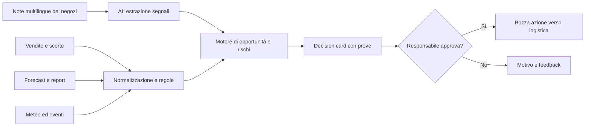

# FastwebAI Hackathon 2026 — Traccia Moncler e proposta progettuale

**Documento di lavoro del team**  
**Evento indicato sulla scheda:** 20 ottobre 2026  
**Focus scelto:** Moncler  
**Stato:** trascrizione revisionata + interpretazione della challenge + proposta per un prototipo da hackathon

> **Nota sulle fonti e sull'accuratezza.** Questo documento parte dalle due fotografie della scheda «FastwebAI Hackathon – Schede use case» e dal file caricato `Poke House(1)(1).md`, che contiene una trascrizione automatica di circa 12 minuti e 21 secondi. **Nonostante il nome del file, l'audio trascritto parla di Alpitour World e Moncler, non di Poke House.** La seconda foto inizia a metà frase: il titolo e l'inizio del contesto della challenge Moncler non sono visibili. Separiamo pertanto il **testo originale leggibile**, la **trascrizione ripulita del parlato** e le **nostre proposte**, che non sono richieste ufficiali degli organizzatori. Nei passaggi in cui l'audio automatico non consente una ricostruzione attendibile, lo dichiariamo invece di inventare parole.

---

## 1. La traccia ufficiale Moncler — testo visibile nelle foto

> **Trascrizione del testo stampato**, senza aggiungere contenuti mancanti. L'attribuzione a Moncler deriva dalla presentazione orale contenuta nella registrazione; l'intestazione della scheda non è fotografata. Il brano comincia letteralmente a metà frase.

**[Inizio del paragrafo «Il contesto» non visibile]**

> in formati diversi (PDF, Excel, slide), con metriche definite in modi diversi e a volte in contraddizione, e i dati che l'azienda non ha ma il mondo sì: eventi, meteo, flussi turistici, calendari, tendenze.

**La sfida.** *E se numeri, commenti, report e dati esterni lavorassero insieme, parlando con tutto il resto?* Magazzino, logistica, marketing e pianificazione hanno i propri strumenti e, sempre più spesso, i propri agenti: nessuna decisione resta dentro un solo sistema. Costruire un sistema che unisca forecast, segnali dei negozi, report e dati esterni, e trasformi tutto questo in indicazioni utili a chi decide.

**Spunti di partenza.**

- Lettura dei commenti liberi dei negozi, multilingue, per estrarre segnali (richieste, rotture di stock, eventi locali) e incrociarli con le vendite.
- Unificazione dei report eterogenei (PDF, Excel, slide), segnalando metriche diverse o contraddittorie.
- Arricchimento con dati esterni (eventi, meteo, flussi turistici, calendari, tendenze) uniti a quelli interni.
- Attenzione ai prodotti senza storico: per novità e collezioni stagionali, per qualche settimana i commenti dei negozi sono l'unico indizio.
- Dialogo con gli agenti degli altri sistemi (magazzino, logistica, marketing, pianificazione) per portare l'indicazione fino alla decisione.

**Il valore.** Vedere prima ciò che i numeri mostreranno dopo: decidere meglio cosa riassortire, dove spostare la merce e cosa raccontare ai clienti.

**Cosa ci aspettiamo.** Un concept con prototipo funzionante che mostri come numeri, commenti, report e dati esterni, lavorando insieme, producano un'indicazione concreta. Come *nice to have*: gestione dei prodotti nuovi e integrazione con altri agenti.

---

## 2. Registrazione audio — trascrizione revisionata e organizzata

> **Importante:** questa sezione non pretende di essere una trascrizione parola per parola. È una **versione corretta nella grammatica e resa leggibile**, che preserva il contenuto ricostruibile dall'ASR originale, ma elimina ripetizioni, false partenze e passaggi privi di significato. Gli intervalli sono approssimativi. Per citazioni letterali, nomi propri e parole indicate come incerte va ascoltato il file audio originale, non allegato a questo documento.

### 2.1 Alpitour World (00:00–05:23) — contesto della prima parte della registrazione

**00:00–01:20 — Presentazione del gruppo.** Alpitour viene presentata come un gruppo turistico con vari marchi, fra cui Alpitour, Francorosso, Eden Viaggi, Bravo e Turisanda. L'intervento ricorda anche la compagnia aerea Neos, strutture alberghiere, attività di *incoming* (servizi organizzati nella destinazione di viaggio) e la rete di agenzie Welcome Travel in joint venture con Costa Crociere. L'apertura e alcuni dettagli sono poco chiari nella trascrizione automatica.

**01:20–02:36 — Programma di AI e Relevance.** Il gruppo descrive un programma denominato **AI Cube**, articolato in tre direzioni: efficienza operativa, miglioramento della *customer experience* e **Relevance**. Quest'ultima è la base della sfida: saper intercettare tempestivamente gli argomenti e i bisogni che contano per i viaggiatori, invece di limitarsi alla produzione o alla lettura superficiale di contenuti.

**02:36–04:17 — La «Content Antenna».** L'obiettivo è costruire una *proof of concept* che raccolga segnali da social, blog e altre fonti, distingua trend realmente utili dal rumore e li trasformi in indicazioni concrete. Vengono fatti esempi: l'interesse crescente per il tennis e per resort con campi da tennis; la popolarità di alcune destinazioni; le lamentele legate alla presenza stagionale di alghe sargasso in aree turistiche messicane. Non basta individuare un trend: bisogna capire quale bisogno esprima e come il business possa reagire.

**04:17–05:23 — Dal segnale all'azione.** Le raccomandazioni possono riguardare la comunicazione (valorizzare un prodotto già disponibile) oppure il prodotto (sviluppare o testare un'offerta nuova). L'intervento indica come riferimento principale il mercato italiano e afferma che circa **l'85% del business è intermediato da agenzie di viaggio** e il **15% è diretto**. Sono valori riferiti dall'oratore nella registrazione, non verificati qui su dati aziendali pubblici.

### 2.2 Moncler (05:23–10:45) — parte centrale per il nostro progetto

**05:23–06:27 — Introduzione e riservatezza.** Viene presentato un rappresentante di Moncler, indicato dalla trascrizione automatica come «Danilo Lofreno» (**cognome da verificare**). La persona dichiara di occuparsi di AI e Data Science. Il parlato include un riferimento a vincoli di comunicazione aziendale, ma quel tratto dell'ASR è troppo confuso per ricostruire con sicurezza la prescrizione esatta. **Prima di usare pubblicamente nome, logo o citazioni, chiedere conferma agli organizzatori.**

**06:27–07:00 — Il ruolo del team Data & AI.** Il team è stato creato da poco e lavora per centralizzare iniziative di intelligenza artificiale che altrimenti resterebbero distribuite fra reparti. L'obiettivo è unire gli strumenti più recenti di AI con ciò che l'azienda svolge già tramite data science e *machine learning*, incluse le previsioni di vendita (*forecast*).

**07:00–07:31 — Il problema è end-to-end.** La challenge riguarda una filiera complessa che va dalla creazione del prodotto alla produzione, alla distribuzione, al marketing e alla vendita. I negozi sono distribuiti in regioni, fusi orari e lingue differenti. Il problema non è solo analizzare un file: è fare dialogare informazioni che oggi attraversano processi e sistemi distinti.

**07:31–08:34 — Forecast, evergreen e prodotti stagionali.** I negozi e la sede usano previsioni su orizzonti temporali differenti. Si distinguono prodotti **evergreen**, con uno storico ripetibile, e prodotti **stagionali o nuovi**, più difficili da prevedere perché hanno meno dati. Le condizioni climatiche, la geopolitica e i cambiamenti della domanda possono richiedere di rivedere le stime o **spostare merce fra regioni e magazzini**.

**08:34–09:37 — I negozi vedono prima ciò che i modelli apprendono dopo.** Un sistema di forecast può rilevare con ritardo i cambiamenti in corso. I negozi, invece, osservano direttamente le richieste dei clienti e i problemi quotidiani. A fine giornata inviano report testuali in lingue e formati differenti: possono contenere informazioni su domanda, condizioni locali, anomalie, difficoltà operative ed episodi imprevisti. Queste osservazioni non strutturate sono importanti, ma difficili da analizzare in modo sistematico.

**09:37–10:09 — Mettere in relazione le fonti.** Il valore nasce dal collegamento di report dei punti vendita, previsioni, dati di vendita, marketing, social e informazioni esterne. I segnali devono supportare decisioni di riassortimento, riallocazione delle scorte, pianificazione e comunicazione, senza rimanere isolati in un singolo reparto.

**10:09–10:45 — Che cosa viene chiesto ai partecipanti.** Si chiede di immaginare e prototipare un sistema che consideri il processo nel suo insieme, combini le varie fonti e **aiuti il quartier generale a prendere decisioni più informate sui prodotti evergreen e stagionali**. L'oratore si rende disponibile a rispondere alle domande.

### 2.3 Chiusura (10:45–12:21)

Segue un breve scambio scherzoso e poi interviene la moderazione. Viene ribadito che i referenti delle aziende possono dare feedback e aiutare i gruppi a capire se un'idea, anche leggermente diversa dalla descrizione iniziale, possa essere utile. La chiusura della registrazione è tronca. **L'ASR di questa parte è troppo incerto per una ricostruzione letterale attendibile.**

---

## 3. La challenge Moncler in parole semplici

Moncler non chiede un altro chatbot che risponda a domande sui report. Chiede di dimostrare che un sistema possa **mettere insieme segnali deboli e dati disomogenei per suggerire una decisione concreta, prima che il problema sia evidente nelle vendite**.

Esempio: il forecast segnala una domanda ordinaria per una giacca in un negozio; i dipendenti iniziano però a scrivere, in più lingue, che molti clienti chiedono proprio quel modello e quella taglia. Contemporaneamente sono previste temperature molto più basse del normale. Il sistema collega la nota al prodotto corretto, controlla la disponibilità locale e in altri negozi, rileva una possibile futura rottura di stock e propone un trasferimento **quantificato e giustificato**. Un operatore conferma o rifiuta la proposta.

**La sequenza richiesta è:** fonti eterogenee → interpretazione → riconciliazione → rilevazione di un segnale → decisione motivata → approvazione umana.

### Requisiti espliciti, impliciti e opzionali

| Livello | Elemento | Cosa significa nella demo |
|---|---|---|
| Centrale | Combinare numeri, commenti, report e fonti esterne | Far vedere almeno 3-4 fonti che contribuiscono alla stessa raccomandazione |
| Centrale | Produrre un'indicazione concreta | Mostrare **quale negozio, quale SKU/taglia, quanti pezzi, perché** |
| Esplicito negli spunti | Commenti multilingue | Almeno una nota in francese/inglese e una in italiano, interpretate in modo uniforme |
| Esplicito negli spunti | Report eterogenei e metriche incoerenti | Un piccolo import PDF/CSV/XLSX oppure una demo chiara di conflitto fra definizioni |
| Esplicito negli spunti | Dati esterni | Meteo reale o dataset di eventi dichiaratamente simulato |
| *Nice to have* | Prodotti nuovi senza storico | Segnale iniziale per una nuova collezione con incertezza dichiarata |
| *Nice to have* | Comunicazione con altri agenti | Simulare un handoff strutturato al sistema logistico, **senza eseguire movimenti reali** |

**Attenzione:** non conosciamo i criteri ufficiali di valutazione della giuria. Le priorità qui proposte sono una strategia per costruire un progetto convincente, non un regolamento dell'hackathon.

---

## 4. Idee progettuali per distinguersi

### Idea A — **MONCLER PULSE: Signal-to-Decision** (consigliata)

Un *control center* che unisce report dei negozi, stock, vendite, forecast e condizioni esterne per creare **decision cards**: ogni scheda mostra un rischio o un'opportunità, la spiegazione, le fonti e l'azione suggerita.

**Elemento distintivo:** il sistema non si ferma a «la domanda potrebbe aumentare»; propone una **riallocazione realizzabile**, verificando giacenze, fabbisogno del negozio di origine e tempi logistici, e richiede un'approvazione esplicita.

**Perché è forte:** copre quasi tutte le richieste della traccia, ha una demo molto visiva e un percorso completo dal testo libero a una decisione aziendale.

**Rischio principale:** diventare troppo ampio. Risolverlo implementando bene **un solo caso end-to-end** anziché cinque workflow abbozzati.

### Idea B — **Cold Front Radar**

Concentrare il prototipo sulla domanda influenzata dal meteo. Un calo previsto delle temperature attiva un controllo incrociato su vendite, note dei negozi e scorte, suggerendo anticipi di consegna o spostamenti.

**Punti forti:** semplice da visualizzare su mappa, integra dati reali e ha una storia intuitiva per capi invernali.  
**Limite:** rischia di sembrare un normale sistema meteo + forecast se non mostra interpretazione dei commenti e ragionamento operativo.

### Idea C — **New Collection Radar**

Concentrarsi sui nuovi SKU senza storico. Il sistema legge note multilingue dei negozi, cerca richieste ripetute, confronta articoli simili e identifica i primi segnali che un prodotto sta funzionando o non sta funzionando.

**Punti forti:** risolve un problema enfatizzato nell'intervento orale e valorizza l'AI.  
**Limite:** difficile stimare quantità affidabili con pochi dati: meglio mostrare incertezza e proposte di test, non previsioni millimetriche.

### Idea D — **Metric Truth / Report Reconciler**

Un motore che legge report PDF, Excel e slide, riconosce le definizioni dei KPI, individua unità differenti e mette in evidenza contraddizioni prima che qualcuno prenda una decisione.

**Punti forti:** problema enterprise concreto e dimostrabile.  
**Limite:** da solo appare più vicino a un sistema di document processing che alla decision intelligence chiesta da Moncler.

### Scelta proposta

Realizzare **MONCLER PULSE**, usando **Cold Front Radar** come *storytelling* della demo e aggiungendo, solo se resta tempo, un esempio di **New Collection Radar**. Il risultato combina una narrazione comprensibile, un'AI realmente utile e una decisione verificabile.

---

## 5. Il prodotto consigliato: MONCLER PULSE

**One-liner:** *From store whispers to business decisions.*  
**Promessa:** intercettare un problema o un'opportunità prima che emerga nei KPI aggregati, indicando cosa fare, su quali evidenze e con quali limiti.

### Flusso applicativo



### Schermate essenziali

1. **Executive Overview.** Tre indicatori comprensibili (rischi individuati, decisioni proposte, opportunità da verificare), una mappa essenziale e 2-3 decision card ordinate per impatto stimato. Evitare decine di KPI senza scopo.
2. **Signal Explorer.** Elenco di segnali estratti da commenti in lingue differenti. Per ciascuno: testo originale, lingua, data, negozio, SKU/taglia, tipo di segnale e collegamento alla fonte.
3. **Decision Detail.** Spiegazione del *perché*, stock e forecast dei negozi coinvolti, disponibilità trasferibile, eventuale evento/meteo, vincoli e limiti. Un bottone **«Prepara trasferimento»** genera solo una bozza.
4. **What-if.** Cambiare uno scenario (per esempio domanda prevista o scorta di sicurezza) e osservare come cambia la quantità consigliata. Deve ricalcolare davvero i numeri, non mostrare risposte preconfezionate.

### La funzionalità «wow», senza diventare fantascienza

Ogni decision card ha un comando **«Mostrami le prove»**: una vista che evidenzia le frasi esatte dei report, la previsione meteo, la giacenza, la regola di calcolo e gli eventuali dati discordanti. Accanto compare **«Cosa succede se non interveniamo?»**, una simulazione basata su ipotesi esplicite.

Il motivo per cui può risultare più convincente di un semplice chatbot è che la giuria può **controllare se la proposta è sostenuta dai dati**.

---

## 6. Demo completa consigliata (dati sintetici, NON dati reali Moncler)

**Situazione:** un negozio a Parigi segnala richieste crescenti per una giacca in taglia M. Un abbassamento delle temperature, insieme ai commenti dei dipendenti, porta il sistema a rivalutare il rischio di stockout. A Milano lo stesso SKU è relativamente abbondante.

### Dati d'ingresso di esempio

| Variabile | Parigi | Milano |
|---|---:|---:|
| SKU | JKT-014-M | JKT-014-M |
| Scorta attuale | 10 unità | 35 unità |
| Domanda prevista nei prossimi 7 giorni, dopo aggiornamento | 24 unità | 12 unità |
| Scorta minima di sicurezza | 0 unità* | 8 unità |
| Note negozio | Richieste ricorrenti di taglia M | Domanda stabile |

\*La scorta di sicurezza pari a zero è una semplificazione **solo** per la demo sul negozio di destinazione; in un prodotto reale deve essere definita con la logistica.

**Due commenti dimostrativi:**

> Store Paris (FR): «Depuis hier, plusieurs clients demandent la veste JKT-014 en taille M. Nous avons peu de pièces disponibles.»
>
> Store Milano (IT): «Per il modello JKT-014, taglia M, richieste stabili; disponibilità sufficiente per i prossimi giorni.»

Il motore di estrazione trasforma i due testi in dati strutturati, mantenendo traccia della citazione di origine. Il forecast usato nella tabella è **preparato nel dataset simulato**: non bisogna far credere che il modello linguistico lo abbia stimato scientificamente a partire da due commenti.

### Calcolo della raccomandazione

- **Fabbisogno scoperto a Parigi:** `max(0, 24 - 10) = 14` unità.
- **Massimo trasferibile da Milano**, conservando domanda e scorta di sicurezza: `max(0, 35 - 12 - 8) = 15` unità.
- **Quantità proposta:** `min(14, 15) = 14` unità.
- **Milano dopo il trasferimento e la domanda prevista:** `35 - 14 - 12 = 9` unità, sopra la scorta minima di 8.
- **Parigi dopo il trasferimento:** `10 + 14 = 24` unità, pari alla domanda prevista sul periodo.

**Decision card generata:**

> **Opportunità di trasferimento — JKT-014-M**  
> **Azione proposta:** verificare il trasferimento di **14 unità da Milano a Parigi**.  
> **Motivazione:** commenti dei negozi, forecast a 7 giorni e giacenze indicano un potenziale fabbisogno non coperto di 14 unità a Parigi; Milano risulta in grado di cederne fino a 15 senza scendere sotto la soglia di sicurezza prevista.  
> **Attenzione:** quantità e tempi devono essere validati con logistica, disponibilità reale per taglia, merce già impegnata e tempi di consegna. La raccomandazione **non garantisce** di evitare rotture di stock se il trasferimento arriva troppo tardi.  
> **Stato:** proposta in attesa di approvazione.

### La sequenza live da mostrare alla giuria

1. La dashboard iniziale mostra **rischio basso o non ancora segnalato** prima dell'import dei report.
2. Viene caricato un nuovo report francese (o incollato il commento nella UI) e il sistema estrae il segnale su **JKT-014-M**.
3. Il segnale è incrociato con gli stock e con il forecast; si vede la nuova **decision card** comparire nell'overview.
4. Aprendo la card, la giuria vede **da dove arrivano le prove** e il calcolo delle **14 unità**.
5. Nel **what-if**, aumentando la domanda prevista a Milano da 12 a 18 unità, il massimo trasferibile scende da **15 a 9** (`35 - 18 - 8 = 9`). Il sistema aggiorna la proposta da 14 a **9 unità** e segnala che il fabbisogno di Parigi non può essere coperto interamente da quel negozio.
6. Il giudice preme **«Prepara trasferimento»** e vede nascere una **bozza approvabile per l'agente logistico**, non un movimento di magazzino realmente eseguito.

**Perché questa demo funziona:** mostra che l'AI capisce il linguaggio naturale, i dati strutturati limitano le decisioni, il sistema è spiegabile e l'interfaccia resta coerente anche quando cambiano le ipotesi.

---

## 7. Architettura tecnica proposta — realistica per un hackathon

### Stack consigliato

| Componente | Scelta | Motivo |
|---|---|---|
| Frontend | **Nuxt 3 / Vue + Tailwind** | Dashboard veloce e curata con componenti riutilizzabili |
| API | **Hono + Bun** | Endpoint leggeri, integrazione facile con servizi esterni e LLM |
| Dati | **SQLite** per demo locale; PostgreSQL solo se già pronto | Riduce il tempo speso su infrastruttura |
| Estrazione da note | Modello linguistico con **output JSON validato con schema** | Multilingua, categorie coerenti e riferimenti al testo |
| Ranking e decisioni | **Funzioni deterministiche** in TypeScript | Le quantità e i vincoli devono essere riproducibili |
| Meteo | **Open-Meteo** oppure snapshot JSON già scaricato | Dato esterno dimostrabile, con fallback offline |
| Import dati | CSV/XLSX e, se possibile, un PDF di esempio | Copertura della richiesta sui formati diversi |
| Grafici | ECharts o libreria già conosciuta dal team | Risparmio di tempo e chiarezza visiva |

**Separare i compiti:** l'LLM interpreta testi e produce una struttura validata; il **motore di regole calcola** stock, deficit, quantità trasferibile, conflitti e priorità. Non chiedere al modello di inventare un trasferimento e un numero di pezzi in una singola risposta.

**Meteo reale:** [Open-Meteo](https://open-meteo.com/) offre un'API meteo utilizzabile senza chiave per uso non commerciale; verificare limiti e termini d'uso. Per un demo affidabile è opportuno salvare anche uno **snapshot** del risultato, perché la connessione o la previsione possono cambiare.

### Dati minimi

```text
stores:          store_id, city, country, timezone
products:        sku, name, family, lifecycle (evergreen/new/seasonal), size
inventory:       store_id, sku, on_hand, reserved, inbound_qty, inbound_eta
forecasts:       store_id, sku, horizon_days, predicted_units, generated_at, model_version
sales:           store_id, sku, day, units_sold
store_reports:   report_id, store_id, timestamp, language, raw_text, source_file
signals:         signal_id, report_id, sku, category, polarity, evidence_span, extracted_at
external_data:   source, location, period, observation, captured_at
recommendations: id, sku, source_store, dest_store, qty, evidence_ids, status
```

### Esempio di segnale estratto dall'AI

```json
{
  "report_id": "PAR-2026-10-22",
  "store_id": "PAR-01",
  "language": "fr",
  "sku": "JKT-014-M",
  "signal_type": "customer_demand_increase",
  "evidence_text": "plusieurs clients demandent la veste JKT-014 en taille M",
  "time_reference": "depuis hier",
  "reliability": "medium",
  "needs_review": false
}
```

**Validazioni fondamentali:** lo SKU deve esistere nel catalogo; `evidence_text` deve corrispondere a una parte effettivamente presente nella nota; le quantità devono venire da dati numerici verificati; timestamp e timezone vanno normalizzati; se lo SKU non è riconoscibile, la segnalazione viene marcata **«da verificare»** e non alimenta un trasferimento automatico.

### Gestire davvero i report contraddittori

Caso dimostrativo: un file usa «sell-through» come *venduto / ricevuto*, un altro come *venduto / disponibilità totale*. Non vanno unificati sotto lo stesso KPI senza verificare le definizioni. La UI deve evidenziare **nome, unità, formula, periodo e fonte**; se manca una definizione, mostrare un conflitto anziché scegliere silenziosamente un numero.

### Ruolo degli «agenti»

Per l'MVP bastano componenti chiari, non uno sciame di agenti:

- **Signal Extractor:** legge note multilingue e genera segnali strutturati con citazione della fonte.
- **Decision Engine:** combina segnali e dati numerici ed elabora proposte con regole controllabili.
- **Logistics Handoff (simulato):** prepara un payload per un sistema esterno dopo approvazione umana.

Se volete mostrare un'integrazione agent-to-agent, è sufficiente far vedere un *mock endpoint* che riceve la proposta e restituisce `draft_created`, con log e tracciabilità. **Non fingete l'esistenza di un'integrazione reale con sistemi Moncler.**

---

## 8. Roadmap di implementazione (ordine di priorità)

### MVP indispensabile — da far funzionare per primo

- [ ] Dataset sintetico coerente per **2 negozi, 1 SKU e 7 giorni di forecast**.
- [ ] Dashboard con stock, domanda prevista e decision card.
- [ ] Import di almeno **un testo multilingue** e sua estrazione in JSON via AI.
- [ ] Tracciamento della frase originale che ha prodotto il segnale.
- [ ] Calcolo della quantità trasferibile **tramite codice**, con vincolo di sicurezza.
- [ ] Pulsante di approvazione che crea una **bozza**, non una movimentazione reale.
- [ ] Demo riproducibile **anche con API meteo o LLM indisponibile**, grazie a snapshot e input preregistrati e chiaramente segnalati.

### Seconda iterazione — alza la qualità

- [ ] Integrare un dato meteo reale e mostrare la data della sua acquisizione.
- [ ] Aggiungere **what-if** con ricalcolo effettivo.
- [ ] Caricare un CSV/XLSX e mostrare un problema di definizione di KPI.
- [ ] Espandere a 3–4 negozi e più SKU.
- [ ] Migliorare *confidence* e motivazione: «evidenza forte / media / debole», senza percentuali arbitrarie.

### Solo se rimane tempo

- [ ] Nuova collezione senza storico, con *cold start* e comparazione con prodotti analoghi.
- [ ] Chat «Perché me lo consigli?» che risponde **solo** sulla decision card e sulle sue fonti.
- [ ] Più agenti o connettori di logistica: **nice to have**, non fondamentali.
- [ ] Analisi multiregionale estesa, mappa animata e ottimizzazione avanzata.

**Regola di gestione del tempo:** un flusso completo e solido con una decisione dimostrabile vale più di molti widget scollegati. Senza conoscere la durata effettiva dell'hackathon, conviene assegnare circa metà del tempo disponibile alla pipeline funzionante, un quarto all'interfaccia e il resto a verifiche, pitch e test della demo.

### Come suddividere il team (esempio da 4 persone)

- **Persona 1 — Data & AI:** parsing e schema dei segnali, test multilingue, prompt e output.
- **Persona 2 — Business logic & API:** dati demo, regole di stock, decisioni, endpoints e audit.
- **Persona 3 — UI/UX:** overview, dettaglio card, stato approvazione, what-if.
- **Persona 4 — Integrazione & pitch:** dataset, dati esterni, test end-to-end, presentazione e scenario live.

Con 2–3 persone conviene accorpare UI e integrazione, e tagliare import PDF e gestione dei nuovi prodotti.

---

## 9. Come progettare una demo credibile e aumentare le probabilità di convincere la giuria

### Tre prove concrete da portare

1. **L'AI legge davvero:** inserire un commento nuovo, in francese, e mostrare SKU, intenzione, negozio e porzione di testo che lo giustifica.
2. **Il sistema decide con vincoli:** la quantità proposta cambia quando cambia la scorta o il forecast. Non deve essere un testo statico generato dall'LLM.
3. **La persona mantiene il controllo:** si vede la sorgente di ogni dato, un conflitto quando esiste, e un'approvazione prima dell'handoff.

### Possibile pitch da 75–90 secondi

> Ogni giorno i negozi osservano cose che i modelli di forecast possono rilevare solo più tardi: una taglia richiesta all'improvviso, un prodotto che sta esaurendosi, un cambiamento dovuto al meteo. Questi segnali rimangono spesso nascosti in commenti multilingue e report separati.  
>  
> **MONCLER PULSE** li collega a forecast, vendite, inventario e dati esterni. Non produce solo una dashboard: genera **decisioni spiegabili**. In questa demo un commento da Parigi contribuisce a individuare un possibile stockout. Il sistema verifica se Milano può supportare Parigi, propone un trasferimento quantitativo e mostra esattamente da dove arrivano le prove.  
>  
> E se cambiamo la domanda di Milano, la proposta cambia. Perché le decisioni non sono frasi inventate dall'AI: sono calcoli verificabili, arricchiti dalla comprensione del linguaggio naturale. Il passo finale rimane sempre umano: il responsabile decide se approvare la bozza.  
>  
> **Il nostro obiettivo è trasformare i segnali che i negozi vedono oggi nelle decisioni che la sede deve prendere domani.**

### Errori da evitare

- Un generico «chiedi ai tuoi documenti» senza **azione aziendale misurabile**.
- Un chatbot che propone quantità senza verificare stock e domanda del negozio di origine.
- Un'interfaccia piena di grafici ma senza una storia chiara.
- Presentare dati di esempio come dati ufficiali Moncler o risultati di un modello di forecast realmente addestrato.
- Confondere correlazione e causalità: una giornata fredda **non prova**, da sola, che aumenteranno le vendite.
- Ignorare tempi di consegna, scorte impegnate, resi e taglie: la raccomandazione deve dichiarare i vincoli non ancora modellati.
- Fingere collegamenti a sistemi aziendali inesistenti o compiere operazioni reali senza autorizzazione.

### Come valutare la demo (metriche verificabili)

- **Estrazione dei segnali:** su un set di almeno 15–20 commenti etichettati manualmente, contare riconoscimenti corretti, falsi positivi e casi da revisionare.
- **Riferimenti verificabili:** ogni segnale mostrato nella UI deve riportare l'estratto originale e il nome del file o report.
- **Decisioni valide:** 100% delle proposte dell'MVP deve rispettare i vincoli numerici implementati (stock non negativo, scorta minima, SKU esatto).
- **What-if:** cambiare un valore deve produrre un risultato ricalcolato e coerente.
- **Tempi e affidabilità:** la demo deve avere un percorso offline funzionante e un reset rapido dello scenario.

Queste **non** sono metriche ufficiali della giuria: sono controlli pratici di qualità del prototipo.

---

## 10. Domande intelligenti da fare ai referenti Moncler

Le risposte possono cambiare radicalmente la priorità delle funzionalità. È utile porne poche, precise, prima di investire molto nel codice:

1. **Chi è l'utente finale?** Headquarters, demand planning, allocation, retail operations o marketing?
2. **Qual è la decisione più urgente?** Riassortimento, riallocazione stock, lancio prodotti stagionali o comunicazione?
3. **Che forma hanno davvero i report giornalieri?** Testo libero in Excel, email, PDF? È possibile vedere **2–3 esempi anonimizzati**?
4. **Le previsioni esistenti sono già disponibili per negozio × SKU × taglia?** Su quale orizzonte temporale?
5. **Quali vincoli logistici sono imprescindibili?** Lead time, trasferimenti fra Paesi, soglia di scorta e merce già riservata?
6. **Qual è il principale problema di qualità dati?** Nomi prodotto incoerenti, traduzioni, metriche discordanti o report incompleti?
7. **Quale sarebbe una demo «utile davvero» per voi?** Una segnalazione di rischio con spiegazione oppure una bozza di trasferimento?
8. **Ci sono vincoli di riservatezza** su nome, logo, registrazione e pubblicazione del prototipo?

---

## 11. Fonti, ipotesi e limiti

**Fonti primarie fornite dal team**

- Foto «FastwebAI Hackathon – Schede use case», 20 ottobre 2026, seconda pagina visibile parzialmente (testo della challenge attribuita a Moncler).
- File `Poke House(1)(1).md`: trascrizione automatica fornita dal team, durata dichiarata circa 12:21, comprendente Alpitour World (inizio) e Moncler (da circa 05:23).

**Riferimenti esterni utili, non necessari a capire la challenge**

- [Moncler Group — Annual Report 2025](https://www.monclergroup.com/v3/assets/blt61bda6b71f29a239/blt045d4d3f55ee3c5a/69c41c93fc5d0628f24862ef/Moncler-Group-Annual-Report-2025.pdf), per comprendere il contesto della rete retail globale. È una fonte pubblica del 2025, **non** un dataset dell'hackathon.
- [Open-Meteo — documentazione](https://open-meteo.com/en/docs), per l'arricchimento con condizioni e previsioni meteo. Verificare licenza e limiti per l'utilizzo previsto.

**Cose che NON sappiamo dalle fonti disponibili:** l'inizio esatto del contesto stampato Moncler, i criteri formali di giudizio, l'accesso ai dati interni, la disponibilità di API/logistica reali, le autorizzazioni di comunicazione, la durata dell'hackathon e la formulazione esatta di alcuni passaggi del parlato. Tutte le quantità e le note dei negozi nel caso di studio sono **sintetiche e illustrative**.

---

## Conclusione operativa

**Realizzare un solo caso end-to-end: commento multilingue → interpretazione AI → confronto con stock/forecast/meteo → proposta numerica di trasferimento → prove consultabili → approvazione umana.** Se questa catena è credibile, avete un prototipo aderente alla traccia, ben differenziato da una dashboard generica e semplice da spiegare in pochi minuti. Aggiungete la gestione dei prodotti nuovi solo dopo averla chiusa e testata.
