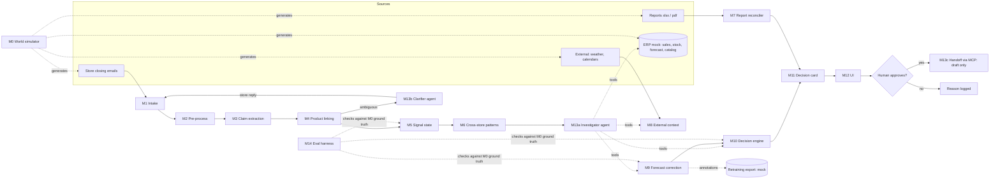

# Project design — what we solve, how, and which pieces we build

_Last updated: 2026-10-22. Builds on `findings.md`. This is a proposal for the team to lock in, not a final decision._

**Guiding rule: AI reads, code counts, humans decide.**

---

## 0. TL;DR

- **Problem (locked):** HQ learns about demand changes late. Forecasts learn from last season. Certified sales arrive a day later, time zone by time zone. Demand that hits an empty shelf never shows up in sales data at all. Store staff see all of it the same evening and write it down, but as free text in their own language, with no product codes, and nobody systematically reads it.
- **Approach:** a pipeline in five steps:
  1. read each evening's store notes;
  2. turn them into product-linked, verifiable signals, asking the store back when unsure;
  3. use those signals to **correct the short-term forecast** at store × SKU × size, with an explicit range;
  4. compute **feasible stock options** with deterministic rules;
  5. present them as evidence-backed decision cards for a human to approve.

  An agent investigates each case through tools, and another agent clarifies ambiguous notes with the store.
- **What we prove (in controlled synthetic scenarios):**
  - signals are extracted and linked correctly, and ambiguity is caught;
  - the action is flagged *N days before* sales data would flag it, or flagged when sales data never would;
  - noise doesn't move the forecast.
- **Not doing:** a new forecast model, real integrations, real company data, automatic execution, production planning.
- **Structure:** each step is a module behind a fixed data contract, with a fixture/mock fallback. We wire the whole chain with mocks first, then replace mocks with real modules in priority order. Whatever time remains decides how many are real; the demo always runs.

---

## 1. Locking the problem

### 1.1 Why existing systems don't cover it

| Source | Latency | What it can't see |
|---|---|---|
| Forecast models | Learns from history (≈ last season) | Anything new: virality, a geopolitical shock, a failed campaign, a new product |
| Certified actuals (POS) | ≈ 24h, staggered by time zone | **Unmet demand** (stockout = zero sales, not zero demand); the *why* behind a deviation |
| Store closing notes | **Same evening** | Nothing: they see it first. But they are unstructured, multilingual, have no SKUs, are uncertified, and arrive by the hundreds a day |

### 1.2 Problem statement

> Turn the free-text evening notes from hundreds of stores into product-level, evidence-backed demand signals, and use them to correct the short-term forecast and propose feasible stock actions **before** certified sales data would reveal the need. Where the need would never show in sales data (unmet demand), these signals are the only source.

### 1.3 Hypotheses the demo must support

- **H1 — Reading.** Notes in ≥ 4 languages become typed claims linked to the right SKU and size, with a verbatim evidence span. When the product is ambiguous, the system **asks instead of guessing** (target: no wrong confident links in the test set).
- **H2 — Anticipation.** On the planted scenarios the system raises the case on the evening of day D. A sales-only detector would fire on D+k, or never, and we show k.
- **H3 — No harm.** On decoy and noise scenarios the corrected forecast stays at the baseline and no action is proposed.
- **H4 — Feasibility.** Every proposed option passes 100% of the constraint checks (stock ≥ 0, safety stock, reserved units, lead time, border rules, scarcity policy).

### 1.4 Non-goals

- Replacing or retraining their forecast model. We *export* annotations a retraining job could use, but the export is mocked.
- Replacing certified reporting.
- Real integrations, real data, or executing moves (the logistics handoff creates a **draft**).
- Production and long-term scarcity decisions. These appear only as routed *insights*.
- Full report reconciliation (PDF/slides). At most one canned conflict example.

---

## 2. Candidate project shapes

Every shape is a **subset of the same modules** (§3). Choosing a shape means choosing which modules are Build, Thin, Mock or Cut, so we can change shape mid-hackathon without rewriting anything.

| | A. Store Signal Engine | B. Forecast Correction | C. Signal-to-Decision (recommended) |
|---|---|---|---|
| One-liner | "Hundreds of messy notes → a clean, linked, deduplicated signal feed" | "Baseline + store evidence → corrected forecast with a range, and an annotated history" | "Tonight's note → corrected forecast → feasible options → approved draft" |
| Deep modules | M1–M6, M13b | M0, M9, M9b, M14 | M3, M4, M5, M9, M10, M11, M13a |
| Thin or mocked | M9–M11 | M3–M5 (thin), M10–M12 | M6, M8, M13b, M13c, M14 |
| Strong for | AI-agent score (clarifier); clearest "AI reads" story | Data-science credibility | Feasibility (40%), market need, demo story |
| Weak for | Stops before a decision ("so what?") | Synthetic backtests risk being circular; less visual; little agentic work | Breadth risk. Mitigate by going deep on **one** path |
| Technical heart | Extraction + entity linking + signal state | Uplift/decay math, Gamma-Poisson cold start, backtest harness | All of A's core + B's core math + the decision engine + the investigator agent |

**Recommendation: C, with A's core (M3–M5) built properly.** It's the only shape that ends in the "concrete indication" the brief asks for, and it covers both readings the rep accepted (correct the forecast, support the decision). If we fall behind, C degrades gracefully into A (stop at signals plus a simple card) or into a thin C (§8).

**Report reconciliation (D)** is never the main shape. It stays an optional module (M7).

---

## 3. The modular pipeline



### 3.1 Module catalogue

Tiers: **Build** = real implementation · **Thin** = real but simplified · **Mock** = fixture/canned output behind the same contract · **Cut** = absent (UI hides it).
Effort: S < 2h · M ≈ half a day · L ≈ a day, for one person.

| ID | Module | In → Out | AI? | Effort | Plan A | Plan B | Plan C |
|---|---|---|---|---|---|---|---|
| M0 | World simulator | params → catalog, stores, demand truth, sales, stock, forecast, notes, labels | LLM (offline, for notes) | M | Thin | Thin | Hand-written fixtures |
| M1 | Intake | paste / .txt / .eml / .xlsx → `SourceDocument` | — | S | Thin | Paste only | Paste only |
| M2 | Pre-process | language, PII redaction, business date/TZ | regex + LLM | S | Merged into M3 | Merged | Cut |
| M3 | Claim extraction | `SourceDocument` → `Claim[]` | **LLM** | M | **Build** | **Build** | **Build** |
| M4 | Product linking | `Claim` → `LinkedClaim` | rules + LLM rerank | M–L | **Build** | Build (no embeddings) | Rules only |
| M5 | Signal state | `LinkedClaim[]` → `Signal[]` (dedup, time, open/resolved) | — | M | **Build** | Thin | Thin |
| M6 | Cross-store patterns | `Signal[]` → `Pattern[]` | optional embeddings | M | Thin | Cut | Cut |
| M7 | Report reconciler | xlsx → metrics + conflicts | LLM mapping | L | Mock (one conflict) | Cut | Cut |
| M8 | External context | city, dates → weather/calendar facts | — | S | Thin (snapshot) | Static JSON | Cut |
| M9 | Forecast correction | baseline + signals → `ForecastAdjustment` | — | M | **Build** | **Build** | Build (uplift only) |
| M9b | New-product prior | analogs + early evidence → rate posterior | — | S–M | Thin | Cut | Cut |
| M10 | Decision engine | adjustment + stock + rules → `ActionOption[]` | — | M | **Build** | Transfer + hold | Transfer only |
| M11 | Decision card | everything → `DecisionCard` (+ narrative) | LLM (prose only) | S–M | **Build** | Template text | Template text |
| M12 | UI | feed, card, evidence, approve, what-if | — | L | **Build** | Build (no what-if) | Card + approve |
| M13a | Investigator agent | case → tool calls → verdict + options | **LLM + tools** | M | **Build** | Fixed DAG | Fixed DAG |
| M13b | Clarifier agent | ambiguous claim → question to store → resolved link | **LLM** | M | Thin | Mock | Cut |
| M13c | MCP and handoff | expose our tools + mock logistics server | — | M | Thin | Mock endpoint | Show payload |
| M14 | Eval harness | outputs vs M0 truth → metrics table | — | M | **Build** | Thin | Lead time only |

> **Agent floor:** never let both M13a and M13b fall to Mock/Cut. They are the 20% "AI agents" category. If time is short, keep M13a as a real tool-calling loop with the fixed DAG as its fallback.

### 3.2 Module notes

**M0 — World simulator.** The test oracle; everything else is measured against it.
- **Catalog:** about 6 fictional models × 2–3 colours × 5 sizes, each with lifecycle (evergreen / seasonal / new) and a `scarcity_managed` flag. Stores: about 8–12 across EU / UK / APAC / US, with time zones and languages (IT, FR, EN, DE, JA, KO, ZH). One EU DC.
- **Daily truth:** `demand[store][sku][day]`. Baseline forecast = truth without the planted events, plus noise ("their model").
- **Sales** = min(demand, stock), so sales are **censored by stock**.
- **Notes** are generated *from the truth* by an LLM with store-manager personas: terse, chatty, typos, mixed language. Deliberate **omissions** (some events never mentioned) and **decoys** are added.
- **Everything is generated once and committed as JSON**, so the demo is deterministic.

**M1/M2 — Intake and pre-processing.**
- Convert to UTC, but keep the **business date in the store's time zone**. That date is what relative expressions resolve against.
- PII: regex for emails and phone numbers, plus an LLM flag for personal names. Store `[CLIENT]` / `[STAFF]` placeholders.
- Keep a raw-file hash for provenance.

**M3 — Claim extraction (LLM, structured output).**
- One call per note, returning a JSON-schema-validated `Claim[]`.
- **Claim types:**

  | Type | Meaning |
  |---|---|
  | `unmet_demand` | Customers asked; item wasn't available |
  | `demand_up` / `demand_down` | Interest rising or falling |
  | `stockout` / `low_stock` | The store reports it is out of, or low on, an item |
  | `traffic_disruption` | Something cuts footfall (construction, closure) |
  | `customer_profile` | Who is buying (e.g. tourists of a nationality) |
  | `product_feedback` | Quality, fit or design comments |
  | `local_event` | Events near the store |
  | `other` | Anything else |

- **What the model returns:**
  - **Product mention as surface attributes** (model name, colour, size, category). **Never a SKU**; linking is M4's job.
  - Quantity as a **range** with its basis: explicit, a vague quantifier, or none.
  - Time expression, verbatim.
- **Validators:**
  - evidence must be an exact substring of the source;
  - the enum must be valid;
  - every quantity must trace back to text.

  On failure: retry once, then mark the claim `needs_review`.
- **Caching:** LLM outputs are cached by `hash(prompt_version + input)`.
- **Vague quantifier table** (shared, tunable): one → [1,1], a couple / quelques → [2,3], several / plusieurs / alcuni → [2,4], many / tanti / beaucoup → [4,8].

**M4 — Product linking (the hardest piece).**
1. Candidate set = the store's assortment, i.e. what it stocked or sold in the last N days.
2. Score candidates on model-name match (fuzzy, multilingual aliases), colour (multilingual colour dictionary), size, and category.
3. The LLM reranks only within that candidate set, and must give a reason.
4. Decide:
   - **linked** if the top score ≥ τ and the margin over #2 ≥ δ;
   - **ambiguous** if several candidates are close (→ M13b);
   - **unlinked** if no product is mentioned (e.g. traffic disruption → `scope: "store"`).
5. Size may be missing ("the black Aurore"). Then link at model+colour level (`scope: "model"`) and let M9 spread the signal across sizes using the size curve.

**M5 — Signal state.**
- Resolve time expressions to absolute dates.
- **Dedup key:** (store, sku-or-model, type), within a window. A repeat increments `mentions` and updates `last_seen`; it doesn't create a new signal.
- **Resolution:** "M arrivata" (M arrived) or new stock in the ERP closes a stockout signal; no mention for h days lets it decay.
- **Cross-check against the ERP:** a `stockout` claim while the system shows on-hand > 0 creates a **phantom-inventory card** (owner: retail ops).

**M6 — Cross-store patterns.** Group open signals by (model, colour, region) and count the distinct stores. ≥ 3 stores within 7 days raises a `Pattern`. If an M8 calendar or tourism fact overlaps, attach it as context. Optionally, multilingual embeddings can group claims that don't link to a product ("customers asking for something warmer"). This module feeds the **marketing** output ("what to tell customers").

**M7 — Report reconciler (optional).**
- The LLM proposes a mapping from columns to canonical metrics, with the definition evidence (header or footnote text). A human confirms, and the mapping is saved as a template that replays deterministically.
- Same metric name with a different formula → a conflict card.
- Plan A: one canned pair of Excel files whose "sell-through %" definitions differ.

**M8 — External context.**
- Open-Meteo forecast **snapshot** per store city (captured once, with the capture timestamp shown).
- A static calendar JSON (holidays per country, synthetic tourist-flow index).
- Rule: **context only, never a trigger on its own.** It raises a signal's strength by one step when it agrees with the notes.

**M9 / M9b — Forecast correction:** see §5.1. **M10 — Decision engine:** see §5.2.

**M11 — Decision card.**
- Built deterministically from signal IDs, the adjustment, the options, the checks, and evidence spans with links to the source notes.
- Optional LLM narrative, generated **only from the card's fields**. A validator rejects any number in the prose that isn't in the card.
- Owner routing:

  | Signal / output | Routed to |
  |---|---|
  | unmet demand, stock options | Allocation |
  | `customer_profile` patterns, trends | Marketing / clienteling |
  | traffic disruption, phantom inventory | Retail ops |
  | product feedback, scarcity insight | Product / merchandising |
  | censoring/anomaly annotations | Data team (retraining) |

**M12 — UI.** Four views:
1. **Tonight's feed**, rolling by time zone ("follow the sun"), with a map.
2. **Signal explorer:** original text, highlighted span, translation, link status.
3. **Decision card:** baseline vs corrected forecast, options, checks, "show me the evidence", approve/reject with reason.
4. **What-if:** edit an assumption (critical ratio, donor forecast, lead time) and **recompute** for real.

**M13 — Agents and integration:** see §6. **M14 — Evaluation:** see §7.

---

## 4. Data contracts

These are the only coupling between modules. A mock is any function that returns these shapes from a fixture. Types are in TypeScript, assuming the stack from the draft (Nuxt + Hono/Bun + SQLite).

```ts
type SourceDocument = {
  doc_id: string; store_id: string;
  kind: "closing_email" | "report_xlsx" | "report_pdf" | "clarification_reply";
  received_at: string;      // ISO UTC
  business_date: string;    // YYYY-MM-DD in store timezone
  language?: string;
  text: string;             // PII-redacted
  raw_sha256: string;
};

type Claim = {
  claim_id: string; doc_id: string;
  type: "unmet_demand" | "demand_up" | "demand_down" | "stockout" | "low_stock"
      | "traffic_disruption" | "customer_profile" | "product_feedback" | "local_event" | "other";
  product_mention: { text: string; model?: string; color?: string; size?: string; category?: string } | null;
  quantity: { low: number; high: number; basis: "explicit" | "vague" | "none" } | null;
  time_text: string | null;
  evidence: { text: string; start: number; end: number };   // verified substring of doc.text
  extractor_version: string;
};

type LinkedClaim = Claim & {
  link: {
    status: "linked" | "ambiguous" | "unlinked" | "not_product";
    scope: "sku" | "model" | "store";
    sku?: string; model_color?: string;
    candidates: { sku: string; score: number; reason: string }[];
  };
};

type Signal = {
  signal_id: string; store_id: string; scope: "sku" | "model" | "store"; key: string;  // sku | model_color | store_id
  type: Claim["type"];
  period: { from: string; to: string | null };       // resolved business dates
  first_seen: string; last_seen: string; mentions: number;
  quantity: { low: number; high: number } | null;
  strength: "strong" | "medium" | "weak";
  claim_ids: string[];
  status: "open" | "resolved" | "needs_clarification" | "dismissed";
};

type ForecastAdjustment = {
  store_id: string; sku: string; horizon_days: number;
  baseline: number;                                  // sum over horizon
  corrected: { low: number; high: number };          // sum over horizon
  factors: { signal_id: string; kind: "uplift" | "traffic" | "prior"; value: number; formula: string }[];
  annotations: { kind: "censored" | "anomaly"; from: string; to: string; reason: string }[];
};

type ActionOption = {
  option_id: string;
  kind: "dc_replenish" | "store_transfer" | "mixed" | "hold" | "insight";
  lines: { from: string; to: string; sku: string; qty: number; eta_days: number }[];
  checks: { name: string; passed: boolean; detail: string }[];
  expected_unserved_units: number;
  recommended: boolean; rule: string;                // why it's recommended
};

type DecisionCard = {
  card_id: string; title: string;
  owner: "allocation" | "marketing" | "retail_ops" | "product" | "data";
  signal_ids: string[]; adjustment?: ForecastAdjustment; options: ActionOption[];
  context: { source: string; fact: string; captured_at: string }[];   // M8
  narrative?: string;                                                 // validated: no foreign numbers
  status: "proposed" | "approved" | "rejected"; decided_by?: string; reason?: string;
};
```

---

## 5. The math (deterministic, explainable, tunable)

All parameters below are **explicit assumptions** shown in the UI and editable in the what-if view. They are not learned. A learned version (regressing realized uplift on signal features) is the "retrain the model" path, described in the pitch but not built.

### 5.1 M9 — Forecast correction

For store s and SKU k, `f_t` is the baseline daily forecast, `y_t` is certified sales, and W is the lookback window the signal refers to (default 3 days).

1. **Realized demand over W** = sales + reported unmet demand:
   `D_low = Σ_W y_t + L_low`, `D_high = Σ_W y_t + L_high`
2. **Shrunk demand ratio:** small counts are noisy, so pull the ratio toward 1 with a prior worth α units of forecast (default α = Σ_W f_t):
   `r = (D + α) / (Σ_W f_t + α)`, clamped to [0.3, 3].
   Signals without counts (`demand_up` with no quantity) use a lookup: strong → 1.5, medium → 1.25, weak → 1.1.
3. **Decaying uplift:** `u_t = w · (r − 1) · 0.5^(t/h)`, with t = days since `last_seen`, half-life h = 7, and strength weight w = 1 / 0.6 / 0.3.
4. **Traffic factor:** a `traffic_disruption` signal sets `φ_t` for its period ("dimezzato" → 0.5). It applies to all SKUs in the store.
5. **Corrected forecast:** `f'_t = f_t · (1 + Σ u_t) · φ_t`, computed once with the low inputs and once with the high inputs to give a band.
6. **Annotations for retraining:**
   - `censored` for each stockout period: sales understate demand there;
   - `anomaly` for disruptions: exclude from learning.

   They are exported as a table, and that export is mocked.

**Worked example (scenario S1).**
- PAR-01, "Aurore" black, size M; baseline 1.0/day. Over the last 3 days, sales were 3 (it sold out).
- Note: *"Aurore noire M épuisée depuis ce midi, plusieurs clientes reparties sans rien"* (black Aurore M sold out since noon, several customers left empty-handed). "plusieurs" → L ∈ [2, 4], explicit report, so w = 1.
- `r_low = (3+2+3)/(3+3) = 1.333`, `r_high = (3+4+3)/6 = 1.667`.
- 7-day decay sum `Σ_{t=1..7} 0.5^(t/7) = 4.804`.
- Corrected 7-day demand: low = 7 + 0.333·4.804 = **8.6**, high = 7 + 0.667·4.804 = **10.2**, against a baseline of **7.0**.

### 5.2 M10 — Decision engine

- **Service quantile:** `CR = c_under / (c_under + c_over)`. This is a policy per product class: hero/luxury → 0.8; seasonal near its end → 0.5.
  Quantity to plan for: `Q = low + CR · (high − low)` (uniform between the band edges, kept simple on purpose).
- **Need at destination over horizon H:** `need = max(0, ⌈Q⌉ + SS_dest − (on_hand − reserved + inbound_≤H))`
- **Donor availability:** protect the donor at the *high* end of its own forecast:
  `avail = max(0, on_hand − reserved − ⌈high_donor(H)⌉ − SS_donor)`
- **Options generated:**
  - DC replenishment;
  - same-zone store transfers (cross-customs-border donors are excluded, with the reason shown);
  - mixed;
  - hold.
- **Day-by-day check:** for each option, simulate stock + arrivals − Q per day and report `expected_unserved_units`.
- **Recommendation rule:** take the option with the fewest unserved units; on a tie, prefer DC over stripping a store.
- **Scarcity-managed SKUs:** no replenishment option. The engine emits an `insight` card for product/merchandising instead.
- **Worked example (continuing S1):**
  - CR 0.8 → Q = 8.6 + 0.8·1.6 = 9.9 → 10. SS = 1, PAR on hand = 0, so **need = 11**.
  - DC-EU has 6 units (ETA 3 days). MIL-01: 18 on hand − 2 reserved − 6 (high forecast) − 2 SS = **8 transferable** (ETA 1 day). LON-01 is excluded as cross-border.
  - Options: (a) 6 DC + 5 MIL, (b) 8 MIL + 3 DC, (c) hold, where ≈ 10 units of demand go unserved this week.
  - (a) vs (b) is decided by the day-by-day check, and the card shows the trade-off: speed vs depleting Milan.

### 5.3 M9b — New product, no history (cold start)

- Daily demand rate `λ ~ Gamma(a, b)`, using the shape/rate parametrization.
- **Prior from analogs** (nearest catalogue items by category, colour and price band): mean = analog launch rate, and strength = "worth n days".
  Example: mean 0.5/day, worth 4 days → Gamma(2, 4).
- **Update** with observed demand (sales + reported unmet) x over t days: `Gamma(a + Σx, b + t)`.
  Example: 9 units in week 1 → Gamma(11, 11), so the mean moves from 0.5 to **1.0/day**. The predictive distribution is negative binomial; show its 80% interval.
- Unmet-demand ranges give two posteriors (low and high), and their envelope is the band. Early weeks are visibly uncertain.

---

## 6. Agents and integration (the 20%)

**M13a — Investigator agent.**
- **Trigger:** one *case* per open signal cluster (store × product, or a pattern).
- **Tools (all deterministic):**
  - `get_signals(key, days)`, `get_sales(store, sku, days)`, `get_stock(store|dc, sku)`, `get_forecast(store, sku, h)`
  - `get_context(city, dates)`
  - `correct_forecast(...)` → M9, `propose_options(...)` → M10
  - `ask_store(store, question)` → M13b
- **Output:** a structured verdict — `act | monitor | ask_store | dismiss` — plus the evidence IDs and the options it chose to surface. It decides *what to look at and what to do next*; it never invents numbers.
- **Guardrails:**
  - at most 8 tool calls;
  - every number in its rationale must appear in a tool result (validated);
  - schema-validated output.
- **Fallback:** a fixed DAG (signals → stock → forecast → correct → options) produces the same output type. The demo flips to it if the agent misbehaves, and we label it honestly.

**M13b — Clarifier agent.**
- When M4 returns `ambiguous`, it writes to the store **in the store's language**, listing 2–3 candidate products (name, colour, photo), and parses the reply back into a link.
- In the demo a teammate types the reply live.
- It also **closes the loop**: "your note led to 11 units arriving Thursday". That gives stores a reason to write useful notes.

**M13c — MCP.**
- Expose our read tools (`get_signals`, `get_case`, `get_card`) as an MCP server, so a planning or marketing agent could query "what are stores saying about X?".
- Consume a **mock logistics MCP server** with `create_transfer_draft(...)` → `draft_created`, called only after human approval.
- This matches the rep's point that vendor systems are being exposed via MCP. Never claim a real integration.

---

## 7. Controlled scenarios and evaluation

### 7.1 Scenarios (planted in M0; the expected outcome is the test oracle)

| ID | Scenario | Planted truth | Expected system behaviour | Shows |
|---|---|---|---|---|
| S1 | Size stockout with unmet demand | PAR black Aurore M demand ×1.6 for 10 days; stock runs out | Linked claim, corrected band, options with DC/transfer, approval → draft | Core path, censored demand |
| S2 | Tourist-driven colour demand | 3–4 EU stores, black variant ↑, notes mention Korean tourists; calendar holiday | Pattern across stores, region-level replenishment + marketing card | Lead time over sales data, cross-store pattern, "what to tell customers" |
| S3 | Construction, traffic halved | MIL-02 footfall ×0.5 for 2 weeks | Traffic factor; **no** "demand down" conclusion and no stock pulled; retail ops card; anomaly annotation | Explaining anomalies |
| S4 | Cold snap | City A: cold + notes asking for heavier jackets; city B: cold, no notes | A: uplift; B: context only | External data as context, not trigger |
| S5 | New product | No history, early unmet demand in 2 stores | Gamma-Poisson band from analogs → updated | Cold start (nice-to-have) |
| S6 | Decoys | "Bella giornata" (nice day), "Aurore blu ancora disponibile in tutte le taglie" (blue Aurore still available in all sizes), one request for a non-existent red version | No action; red version → low-weight product insight | No harm (H3), negation |
| S7 | Phantom inventory | Note: "M finita"; ERP shows 3 on hand | Data-discrepancy card, retail ops | Data quality |
| S8 | Ambiguous product | "the long black one" in a store carrying two long black models | Clarifier question → reply → linked | Ask, don't guess |

S1 is the headline walkthrough. **S2 is where the lead-time number is largest**: a gradual shift that sales-only rules catch days later. Be honest that in S1 the gain is mostly *information* (how big the lost demand is) rather than days.

### 7.2 Metrics (M14 prints one table that goes on a slide)

- **Extraction:** claim precision/recall vs labels; evidence-span validity (must be 100%).
- **Linking:**
  - accuracy;
  - **wrong confident links** (target 0);
  - share routed to clarification.
- **Lead time:** `t_sales_detect − t_signal` per scenario. The sales-only detector fires either on a visible stockout (D+1) or on 3 consecutive days of sales > 1.5× forecast; "never" counts too (unmet-demand magnitude).
- **Forecast:** WAPE (weighted absolute percentage error) over the next 7 days against ground-truth demand, baseline vs corrected, **per scenario including decoys**.
- **Decisions:** constraint-check pass rate (must be 100%).
- **Circularity mitigation:**
  - the note generator prompt is written separately from the extractor prompt;
  - a **hand-written hold-out set of about 20 notes** by a teammate not working on M3/M4;
  - the rep reviews sample notes;
  - everything is labelled "controlled synthetic cases".

---

## 8. Build order and cut plan

1. **Walking skeleton first (≈ 2–3h, all hands).**
   - Freeze the §4 contracts.
   - Commit the M0 fixtures for S1, S3 and S6.
   - Wire M1→M12 with every module returning fixtures.
   - Get the card, the evidence and the approve flow on screen.

   From then on **the demo always works**; each step below swaps a mock for a real module.
2. Replace mocks in this order (stop wherever time runs out):
   1. M3 extraction
   2. M4 linking
   3. M9 correction
   4. M10 options
   5. M12 evidence view
   6. M13a investigator (fallback = DAG)
   7. M14 metrics table
   8. M13b clarifier
   9. M6 patterns + M8 context (unlocks S2/S4)
   10. M13c MCP
   11. M9b cold start
   12. M7 reconciler
3. **Freeze features** with ≥ 25% of the time left: rehearse, record a backup video of the demo, and prepare the replay cache.

**Cut order under pressure** (first to go → last): M7 → M9b → M13c (show the JSON payload instead) → M6/M8 (drop S2/S4) → what-if → M13b (S8 shown as a canned example) → the investigator's free agency (keep the DAG and show its tool trace). **Never cut:** M3, M4, M9, M10, and evidence on the card.

**Team of 4:**

| Person | Area | Modules |
|---|---|---|
| P1 | AI reading | M3, M4, M13b, extraction eval |
| P2 | Math and rules | M0 numbers, M5, M9, M10, M14 |
| P3 | UI | M12, M11 |
| P4 | Agents, integration, pitch | M13a, M13c, M8, scenario script, slides |

---

## 9. Demo script (≈ 4 minutes)

1. **The world tonight.** Notes roll in by time zone; sales for today don't exist yet. "Certified data arrives tomorrow; unmet demand never arrives."
2. **Paste a new French note** (S1). Highlighted span → claim → linked to black Aurore M → signal.
3. **The investigator runs.** Its tool trace is visible: stock 0, corrected forecast 8.6–10.2 vs 7.0, options a/b/c with checks.
4. **What-if.** Raise Milan's forecast; the transferable quantity falls and the recommendation changes. Approve → draft via the logistics MCP mock.
5. **S3 in 20 seconds.** Low sales in Milan-2, but the note explains the construction: no stock pulled, a retail ops card instead.
6. **S8 in 20 seconds.** An ambiguous note → the agent asks the store in Italian → teammate replies → linked.
7. **Metrics slide** from M14: precision, zero wrong confident links, lead time per scenario, no harm on decoys.
8. **Market need.** Buyer is HQ allocation and planning; stores change nothing; integration goes through the MCP layer vendors are already adding.
